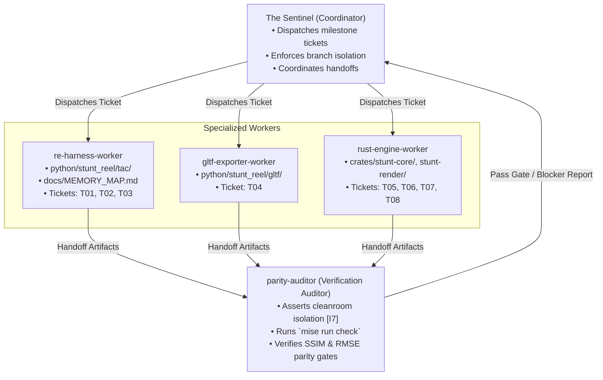

# Antigravity Teamwork Blueprint & Team Sheet (`/teamwork-preview`)

* **Framework**: Google Antigravity Teamwork ([`/teamwork-preview`](https://antigravity.google/docs/teamwork/))
* **Pattern**: **Distributed Coding** combined with **Iterative Self-Verification**
* **Project**: StuntReel (`stunt-reel`)
* **Coordinator**: The Sentinel

---

## 1. Multi-Agent Team Structure & Role Assignments

### Team Role Descriptions & File Blast Radii

| Role Identifier | Assigned Domain | Allowed File Blast Radius | Primary Responsibilities |
|---|---|---|---|
| **`sentinel`** | Project Orchestration | `docs/TEAM_SHEET.md`, PR reviews | Milestones sequencing, dispatching subagents, reviewing ticket completion artifacts. |
| **`re-harness-worker`** | DOSBox-X MCP & Memory Reverse Engineering | `python/stunt_reel/tac/`, `docs/MEMORY_MAP.md`, `tests/test_harness.py`, `tests/test_memory_map.py` | Headless DOSBox-X harness (`T01`), port `0x03DA` V-Sync breakpoint trap (`T02`), high-throughput streamer (`T03`). |
| **`gltf-exporter-worker`** | 3D Exporter & Asset Pipeline | `python/stunt_reel/gltf/`, `tests/test_gltf.py` | Baseline `.SOD` mesh ingest (`RIPRES.C`), decal normal displacement `[I5]`, animation samplers, glTF packaging (`T04`). |
| **`rust-engine-worker`** | Cleanroom Rust Systems Engine | `crates/stunt-core/`, `crates/stunt-render/`, `crates/stunt-cli/` | Native archive parsers (`T05`), procedural `.SOD` transpiler (`T06`), native `.FLM` evaluator (`T07`), `wgpu` renderer (`T08`). |
| **`parity-auditor`** | Quality Gate & Cleanroom Verification | Read-only across all code, executes verification commands | Enforces cleanroom asset isolation `[I7]`, runs `mise run check`, validates quantitative gates (`G01`–`G06`). |

---

## 2. Milestone Execution Roadmap

### Milestone 1: Runtime Capture Harness & glTF Exporter *(Status: COMPLETED - Gate 1 Passed)*

* **Goal**: Treat `PLAYONE.EXE` as a black-box kinematics compiler, stream 600 ticks of trajectory data, package self-contained animated `.glb` files, and emit the golden oracle.
* **Prerequisites**: Phase 0 cleanroom fixtures, DOSBox-X `2026.10.01`, `dosbox-x-mcp-server` `v0.1.2`.
* **Execution Playbook**: [`playbooks/m1-runtime-capture.md`](playbooks/m1-runtime-capture.md)

| Ticket | Description | Owner | Status | Blocker / Output Artifact |
|---|---|---|---|---|
| **`T00`** | Cleanroom Scaffolding, Contracts & Fixtures | `rust-engine-worker` | **Done** | Seams 1–4, `synthetic_minimal.*`, `oracle_intro_trajectory.json` |
| **`T01`** | DOSBox-X MCP Harness & Navigation | `re-harness-worker` | **Done** | `python/stunt_reel/tac/client.py`, `bda.py`, BDA keystroke injector |
| **`T02`** | Real-Mode Memory Map & V-Sync Trap | `re-harness-worker` | **Done** | `docs/MEMORY_MAP.md`, port `0x03DA` V-Sync trap (`vsync.py`) |
| **`T03`** | Trajectory Streamer & Oracle Export | `re-harness-worker` | **Done** | `corpus/oracle/intro_trajectory.json` (600 ticks, Seam 2 valid) |
| **`T04`** | Baseline Mesh Ingest & glTF Exporter | `gltf-exporter-worker` | **Done** | `build/gltf_output/INTRO.glb` (45.7 KB), `[I5]` decal displacement |

> [!IMPORTANT]
> **GATE 1 (Milestone 1 Acceptance Sign-off):**
> Passed:
> 1. `intro_trajectory.json` successfully extracts across 600 ticks with zero matrix tearing ($|\|\mathbf{q}\|-1.0| \le 2.22 \times 10^{-16}$).
> 2. Off-screen glTF visual parity achieved; decal displacement conforms to `[I5]`.
> 3. `mise run check` exits code `0` with zero warnings (104 Python tests, 15 Rust tests).

---

### Milestone 2: Native Cleanroom Rust Engine *(Status: COMPLETED - Gate 2 Passed)*

* **Goal**: Implement zero-emulator, standalone Rust engine (`stunt-core` and `stunt-render`) achieving sub-millimeter trajectory parity and 4K/60+ FPS visual parity.
* **Prerequisites**: Milestone 1 Golden Oracle (`corpus/oracle/intro_trajectory.json`).

| Ticket | Description | Owner | Status | Blocker / Output Artifact |
|---|---|---|---|---|
| **`T05`** | Native VFS (`.ALL` / `.RES` Parsers) | `rust-engine-worker` | **Done** | `crates/stunt-core/src/vfs/`, Seam 1 verification (Gate G02 passed) |
| **`T06`** | Procedural `.SOD` Bytecode Transpiler | `rust-engine-worker` | **Done** | `crates/stunt-core/src/sod/`, flat arena scene graph `[I2]` (Gate G03 passed) |
| **`T07`** | Native `.FLM` Player & Parity Suite | `rust-engine-worker` | **Done** | `crates/stunt-core/src/flm/`, $\text{RMSE}_{\text{pos}} = 0.000000\text{ m}$ (Gate G04 passed) |
| **`T08`** | Modern `wgpu` Presentation Engine | `rust-engine-worker` | **Done** | `crates/stunt-render`, `crates/stunt-cli`, Mode 13h palette LUT `[I3]`, Free-Cam, Gate G06 SSIM parity |

> [!IMPORTANT]
> **GATE 2 (Milestone 2 Acceptance Sign-off):**
> Passed:
> 1. Native `.FLM` player matches Milestone 1 oracle with bit-exact parity: $\text{RMSE}_{\text{pos}} = 0.000000\text{ m} \le 0.01\text{ m}$ and instantaneous camera cut suppression (`[I4]`).
> 2. `wgpu` presentation engine (`stunt-render`) implements authentic Mode 13h flat-shading via $256 \times 32$ palette LUT (`[I3]`), hardware depth-bias decal pass (`[I5]`), 4:3 aspect correction, and headless off-screen render pass satisfying Gate G06 ($\text{SSIM} \ge 0.90$).
> 3. `mise run check` exits code `0` with zero warnings (152 Rust tests, 112 Python tests, 100% offline in CI).

---

### Milestone 3: Fidelity Backlog *(Status: OPEN)*

* **Goal**: Close the decode and timing gaps exposed while diagnosing the `CTRY.FLM` export warnings. Each ticket is independent.
* **Origin**: `CTRY.FLM` + `CTRY.ALL` export audit, 2026-10-20.

| Ticket | Description | Owner | Status | Blocker / Output Artifact |
|---|---|---|---|---|
| **`T09`** | `OP_TAP` (`0x022E`) semantics | `rust-engine-worker` | **Done** | Handler `CS:0x3E58`; operand form `reg_off, count, count × anchor_byte_offset` (variable width, not fixed 4 words). Copies 28-byte `ANCHORPT` records into the vertex register bank. `CTRY.ALL` `0x0402`–`0x0408` reach `RETURN` with non-degenerate polygons (max areas 135–1040 units²). Evidence: [`research/playone-exe/sod-vm.md`](../research/playone-exe/sod-vm.md), `# [FMT-SOD-TAP]`. |
| **`T10`** | `OP_ANIMATE` (`0x01F8`) semantics | `rust-engine-worker` | **Open** | 847 corpus stop sites: 705 share the 58-byte body; 130 share a 288-byte body with 11 records. Saved runtime disassembly shows `reg_off, parameter, selector, count, count × resource_id` and a screen-space raster draw, not joint-angle output. Direct `.FLM animate` mapping and Rust rendering remain open. Evidence: [`research/playone-exe/sod-animate.md`](../research/playone-exe/sod-animate.md), `# [FMT-SOD-ANIMATE]`. |
| **`T11`** | Consume `tick_duration` in playback/export | `rust-engine-worker` | **Open** | `tick_duration` is decoded but unused; `CTRY.FLM` has 140 slices spanning 1,342 ticks (≈ 67.1 s at 20 Hz) but exports 140 frames at `--fps`. First step: establish how a film's authored rate (20 vs 30 Hz) is determined; then expand slices with sub-tick interpolation (`[I4]`). Docs already state the limitation. |

---

## 3. Living Specification Revision Protocol

Agent teams are authorized to revise documentation as new discoveries emerge using this 3-tier protocol:

1. **Tier 1: Ground-Truth Findings (Worker Direct Edit)**:
   * When discovering hardware registers, `DGROUP` offsets, or opcode parameters, the worker updates `docs/MEMORY_MAP.md` or `docs/SPEC.md`.
   * The worker updates the evidentiary tag to `[Established]` and cites the address or opcode.
2. **Tier 2: Roadmap & Dependencies (Sentinel Edit)**:
   * The Sentinel updates status checkboxes (`[ ]` $\rightarrow$ `[-]` $\rightarrow$ `[x]`) and blocker notes in this document (`docs/TEAM_SHEET.md`).
3. **Tier 3: Core Contracts & Invariants (Auditor-Gated)**:
   * Any change to `crates/stunt-core/src/contracts/` must maintain backward compatibility (`serde(default)`).
   * Fixtures in `tests/fixtures/` and unit tests must be updated in tandem.
   * `parity-auditor` rejects the PR if `mise run check` fails.
