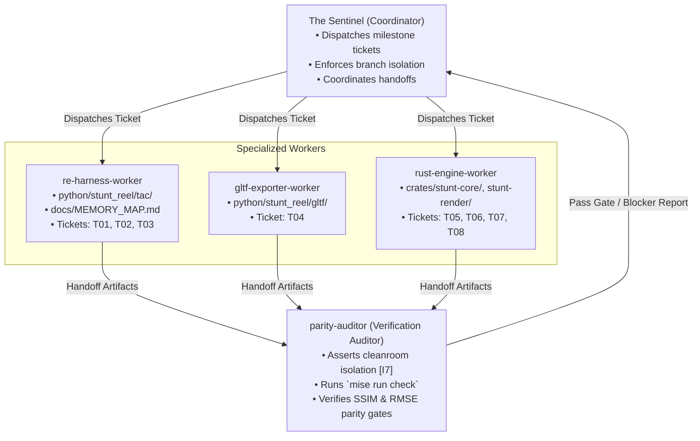

# Antigravity Teamwork Blueprint & Team Sheet (`/teamwork-preview`)

* **Framework**: Google Antigravity Teamwork ([`/teamwork-preview`](https://antigravity.google/docs/teamwork/))
* **Pattern**: **Distributed Coding** combined with **Iterative Self-Verification**
* **Project**: StuntReel (`stunt-reel`)
* **Coordinator**: The Sentinel

---

## 1. Multi-Agent Team Structure & Role Assignments

### Team Role Descriptions & File Blast Radii

| Role Identifier | Assigned Domain | Allowed File Blast Radius | Primary Responsibilities |
|---|---|---|---|
| **`sentinel`** | Project Orchestration | `docs/TEAM_SHEET.md`, PR reviews | Milestones sequencing, dispatching subagents, reviewing ticket completion artifacts. |
| **`re-harness-worker`** | DOSBox-X MCP & Memory Reverse Engineering | `python/stunt_reel/tac/`, `docs/MEMORY_MAP.md`, `tests/test_harness.py`, `tests/test_memory_map.py` | Headless DOSBox-X harness (`T01`), port `0x03DA` V-Sync breakpoint trap (`T02`), high-throughput streamer (`T03`). |
| **`gltf-exporter-worker`** | 3D Exporter & Asset Pipeline | `python/stunt_reel/gltf/`, `tests/test_gltf.py` | Baseline `.SOD` mesh ingest (`RIPRES.C`), decal normal displacement `[I5]`, animation samplers, glTF packaging (`T04`). |
| **`rust-engine-worker`** | Cleanroom Rust Systems Engine | `crates/stunt-core/`, `crates/stunt-render/`, `crates/stunt-cli/` | Native archive parsers (`T05`), procedural `.SOD` transpiler (`T06`), native `.FLM` evaluator (`T07`), `wgpu` renderer (`T08`). |
| **`parity-auditor`** | Quality Gate & Cleanroom Verification | Read-only across all code, executes verification commands | Enforces cleanroom asset isolation `[I7]`, runs `mise run check`, validates quantitative gates (`G01`–`G06`). |

---

## 2. Milestone Execution Roadmap

### Milestone 1: Runtime Capture Harness & glTF Exporter *(Status: ACTIVE)*

* **Goal**: Treat `PLAYONE.EXE` as a black-box kinematics compiler, stream 600 ticks of trajectory data, package self-contained animated `.glb` files, and emit the golden oracle.
* **Prerequisites**: Phase 0 cleanroom fixtures, DOSBox-X `2026.10.01`, `dosbox-x-mcp-server` `v0.1.2`.

| Ticket | Description | Owner | Status | Blocker / Output Artifact |
|---|---|---|---|---|
| **`T00`** | Cleanroom Scaffolding, Contracts & Fixtures | `rust-engine-worker` | **Done** | Seams 1–4, `synthetic_minimal.*`, `oracle_intro_trajectory.json` |
| **`T01`** | DOSBox-X MCP Harness & Navigation | `re-harness-worker` | `[ ] Ready` | `python/stunt_reel/tac/harness.py`, BDA keystroke injector |
| **`T02`** | Real-Mode Memory Map & V-Sync Trap | `re-harness-worker` | `[ ] Blocked on T01` | `docs/MEMORY_MAP.md`, post-retrace breakpoint on port `0x03DA` |
| **`T03`** | Trajectory Streamer & Oracle Export | `re-harness-worker` | `[ ] Blocked on T02` | `corpus/oracle/intro_trajectory.json`, reference frames |
| **`T04`** | Baseline Mesh Ingest & glTF Exporter | `gltf-exporter-worker` | `[ ] Blocked on T03` | `build/gltf_output/INTRO.glb`, visual parity report |

> [!IMPORTANT]
> **GATE 1 (Milestone 1 Acceptance Sign-off):**
> Before Milestone 2 unlocks:
> 1. `intro_trajectory.json` successfully extracts across 600 ticks with zero matrix tearing.
> 2. Off-screen glTF visual parity achieves mean $\text{SSIM} \ge 0.88$ (`[I6]`).
> 3. `mise run check` exits code `0` with zero warnings.

---

### Milestone 2: Native Cleanroom Rust Engine *(Status: BLOCKED ON GATE 1)*

* **Goal**: Implement zero-emulator, standalone Rust engine (`stunt-core` and `stunt-render`) achieving sub-millimeter trajectory parity and 4K/60+ FPS visual parity.
* **Prerequisites**: Milestone 1 Golden Oracle (`corpus/oracle/intro_trajectory.json`).

| Ticket | Description | Owner | Status | Blocker / Output Artifact |
|---|---|---|---|---|
| **`T05`** | Native VFS (`.ALL` / `.RES` Parsers) | `rust-engine-worker` | `[ ] Blocked on Gate 1` | `crates/stunt-core/src/vfs/`, Seam 1 verification |
| **`T06`** | Procedural `.SOD` Bytecode Transpiler | `rust-engine-worker` | `[ ] Blocked on T05` | `crates/stunt-core/src/sod/`, flat arena scene graph `[I2]` |
| **`T07`** | Native `.FLM` Player & Parity Suite | `rust-engine-worker` | `[ ] Blocked on T05, T03` | `crates/stunt-core/src/flm/`, $\text{RMSE} \le 0.01\text{ m}$ regression |
| **`T08`** | Modern `wgpu` Presentation Engine | `rust-engine-worker` | `[ ] Blocked on T06, T07` | `crates/stunt-render`, Mode 13h palette LUT `[I3]`, Free-Cam |

> [!IMPORTANT]
> **GATE 2 (Milestone 2 Acceptance Sign-off):**
> 1. Native `.FLM` player matches Milestone 1 oracle with $\text{RMSE}_{\text{pos}} \le 0.01\text{ m}$.
> 2. `wgpu` presentation achieves mean $\text{SSIM} \ge 0.90$ (`[I6]`) and $\ge 60\text{ FPS}$ at 4K.
> 3. `mise run check` passes 100% offline in CI.

---

## 3. Living Specification Revision Protocol

Agent teams are authorized to revise documentation as new discoveries emerge using this 3-tier protocol:

1. **Tier 1: Ground-Truth Findings (Worker Direct Edit)**:
   * When discovering hardware registers, `DGROUP` offsets, or opcode parameters, the worker updates `docs/MEMORY_MAP.md` or `docs/SPEC.md`.
   * The worker updates the evidentiary tag to `[Established]` and cites the address or opcode.
2. **Tier 2: Roadmap & Dependencies (Sentinel Edit)**:
   * The Sentinel updates status checkboxes (`[ ]` $\rightarrow$ `[-]` $\rightarrow$ `[x]`) and blocker notes in this document (`docs/TEAM_SHEET.md`).
3. **Tier 3: Core Contracts & Invariants (Auditor-Gated)**:
   * Any change to `crates/stunt-core/src/contracts/` must maintain backward compatibility (`serde(default)`).
   * Fixtures in `tests/fixtures/` and unit tests must be updated in tandem.
   * `parity-auditor` rejects the PR if `mise run check` fails.
