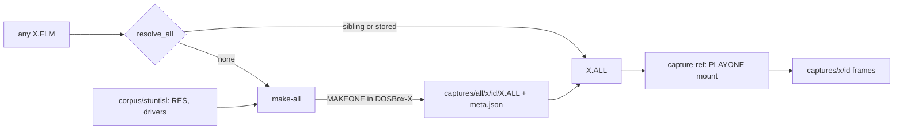

# `make-all`: capture any film (2026-10-29)

Status: **implemented on branch `feat/make-all`; live runs on `BALLOON` and `TRAINTNL` done 2026-10-29 (Q1 and Q5 answered); revised after a code review of the first draft (section 9)**. Source: a brainstorming session of 2026-10-29 starting
from "make it easier to have DOSBox plus `PLAYONE.EXE` capture films other than `INTRO.FLM`
and `CTRY.FLM`", and a feasibility spike (section 2). The code is on the branch named above. The durable
decision, once accepted, is a new ADR (step 7); this note owns the steps and the log. It
builds on [ADR 0021](../../adr/0021-capture-chooses-its-control-port.md) and
[ADR 0022](../../adr/0022-captures-are-add-only-beside-a-read-only-corpus.md), so it lands
after the [data-root split](data-root-split-2026-10-29.md).

## 1. Goal and what blocks it

Parity needs a `PLAYONE.EXE` reference capture of a film, and `PLAYONE.EXE` needs the film's
`.FLM` **and** its `.ALL` archive (the film's models, palettes and sounds). `capture-ref
-- --film X.FLM` already stages any such pair into a private DOSBox-X mount
([`staging.py`](../../../python/stunt_reel/tac/staging.py)). The blocker is the `.ALL`:

- The demo (`corpus/stisldem/VAULT`) ships a pair for `INTRO` and `CTRY` only.
- The full game (`corpus/stuntisl/VAULT`) ships `.FLM` files (`BALLOON`, `BOMB`, `HIGHWAY`,
  `LAND`, `LOCATION`, `PLANES`, `TOD`, `TRAINTNL`) and `.TKE` takes, and no `.ALL`.
- `MAKEONE.EXE` makes the `.ALL` (the manual, "Previewing Films to Other PC Owners";
  [`all.md`](../../../research/formats/all.md)). It is interactive: a Load File requester.

Scope: **any `.FLM`** the user supplies, not a fixed list. Success: one command turns a
`.FLM` into a stored `.ALL`, and `capture-ref` then captures that film with no extra flags.

## 2. Spike result (throwaway; evidence for the decisions)

Run 2026-10-29 on `corpus/stuntisl/VAULT/BALLOON.FLM`. Scratch code and outputs are in
`build/spike-makeone/` and are not kept. `[Bounded Observation]`, one film.

| Question | Observed |
|---|---|
| Runs under the harness conf (`core = normal`, `output = surface`, controller attached)? | Yes: 5 of 5 runs produced the same 46,702-byte `BALLOON.ALL`, md5 `1db59e1edd4d3debaca5e6188ead38df`. |
| Runs without the controller? | Yes: the parity conf with autoexec `autotype -w 12 -p 1 b enter`, `makeone.exe`, `exit` exited 0 after about 90 s and wrote the same bytes. |
| Screens | Grey "Caching data" box, then the `LOAD FILM` requester (Filename `*.*`, Dir `C:\VAULT`, list starting `[..]`, OK, Cancel, Exit, Load), then the film playing in the theatre (`00:00.00` timecode), then text mode with a bare `C:\>`. |
| Keys | `b`, Enter. The prefix jump fills the Filename field, so no Down (unlike `PLAYONE`'s listbox). Sent about 10 s after connect, 0.7 s apart. |
| Completion | `VGA MODE` reports `M_TEXT` and the page has 1 distinct index. Text mode came about 76 s after Enter: the film plays in real time. No file appears before then. |
| Minimal mount | Root: `MAKEONE.EXE`, `DRIVER1-3.BIN`, `GAME.CFG`, `INSTALL.CFG`, `PFONT.BIN`, `VDATA.BIN`; `RES\` (about 9.8 MB); `VAULT\<film>.FLM`. Without `RES\` it sat on "Caching data" for at least 25 s. `.TKE`, `SETS\`, `SS\`, `PILOTS\`, `GAME.VAR` and `SPOOL.$$$` were not needed (`.TKE` and the other four tested dropped separately). The engine files were not dropped one by one. |
| Output | `BALLOON.ALL` appears in the mount's `VAULT\`, beside the `.FLM`. A scratch parse agrees with [`all.ksy`](../../../research/formats/all.ksy): 62 ids, 378-byte header, monotone offsets, last offset equal to the file size. The Rust parsers were not run on it. |
| Plays? | `capture-ref -- --film <staged BALLOON.FLM> --out build/spike-makeone/play-out --max-frames 30` captured 30 frames in 12.6 s, film ticks about 10 to 345, 43 to 72 distinct indices. |
| Other | The requester screens read back an all-black live DAC palette, so a colour check of those pages is meaningless. A mount copied after a run already held an `.ALL` and contaminated two test runs. A stale `dosbox-x.exe` holds the control port. |

## 3. Decisions

| # | Decision |
|---|---|
| D1 | A new step `make-all` runs `MAKEONE.EXE` in DOSBox-X against a private staged mount and keeps the `.ALL` it writes. It uses the controller session (`run_session`), because completion is detected, not guessed. The plain `autotype` route also works and is the fallback if a later film breaks the controller. |
| D2 | The mount is a fresh copy every run, never a symlink and never reused: `MAKEONE` writes into the mount, and a copied mount that already held an `.ALL` made the output ambiguous. The `.ALL` is removed from the mount before launch if present. |
| D3 | Staging is generalised from "one film plus its sibling `.ALL`" to two mount builders sharing the engine-file list: a `MAKEONE` mount (engine files, `RES\`, one `.FLM`) and a `PLAYONE` mount (engine files, one `.FLM`, one `.ALL` given as an explicit path). `PLAYONE` still finds both in `VAULT\`, copied just in time. |
| D4 | The generated `.ALL` is stored at `captures/all/<film>/<id>/<FILM>.ALL` with a `meta.json`, written once and never changed (ADR 0022). `<id>` is `<date>-<checkout>-<flm hash>`, built by `new_capture_id` like a frame capture. An existing id is refused; a run that died before `meta.json` (written last) leaves a partial that is cleared, as `is_taken` does, and a directory without `meta.json` is never a result for the resolver. `captures/` is already a linked directory ([`LINK_TARGETS`](../../../python/stunt_reel/dataroot.py)), so `all/` inside it is shared with every worktree and needs no new link, migration or `reap` rule. Nothing enumerates `captures/*` by film (`references.py` addresses `captures/<film>/<id>` by name), so the only clash is a film whose stem is `ALL`; both scripts refuse that stem. |
| D5 | A resolver, `resolve_all(flm)`, answers "which `.ALL` goes with this `.FLM`": (1) a sibling `X.ALL` beside `X.FLM`; (2) otherwise the `captures/all/<film>/*/` entries with a `meta.json` whose `flm_sha256` equals the film's, taking the greatest id (ids start with the date); its `.ALL` must hash to the `all_sha256` in its `meta.json`, and a mismatch is an error naming the id, never a skip to an older entry; (3) otherwise an error naming `mise run make-all -- --film <path>`. It never generates one silently, because a run takes 90 s or more. |
| D6 | Completion is `VGA MODE` reporting `M_TEXT` after a graphics mode was seen **since Enter was sent**. Before launch and during the first seconds the guest may be in text mode, so text mode alone is not a signal; a framebuffer dump cannot tell, because the dump reads `A000:0000`, which does not change in text mode. This needs a new transport operation, `video_mode()` (the `Transport` protocol has none today; step 4). A cap (`--timeout`, default 600 s) bounds a film that never returns. |
| D7 | The `.ALL` is accepted only if it exists, is non-empty, and parses as a directory (`u16` count, header `6n+6`, monotone offsets, last offset equal to the size). Anything else is an error and leaves no capture. It is written to a `.partial` sibling and renamed into its id directory with `meta.json` last, so a reader never sees half of one. |
| D8 | The full-game files `MAKEONE` needs (`RES\`, drivers, configs) come from `--game-root`, default `corpus/stuntisl`. The `.FLM` may be anywhere; it is copied into the mount's `VAULT\` and its own stem names the `.ALL`. |
| D9 | The `MAKEONE` conf is the parity conf with its `playone.exe` autoexec line replaced and only the film literal of its title changed (the words "parity capture" stay), through the same fail-loudly literal replacement `_replace_once` already does for the mount and film literals. The `[autoexec]` section of `dosbox-parity.conf` ends with `playone.exe`; a conf without it is an error, not a silent `PLAYONE` run. No `exit` is added: the controller stops the emulator at D6. |
| D10 | Out of scope: scoring a new film. `FILMS` in `parity_pipeline.py` holds fixed `corpus/...` strings that `parity_run.py` and `parity_sweep.py` build their CLI choices from, and `references.toml` needs a reviewed row per film. Capturing a film and scoring it are separate steps; scoring generated films is a follow-up spec once a first one is worth promoting. |

## 4. Design

### 4.1 Units

| Unit | Purpose | Depends on |
|---|---|---|
| [`parity_layout.py`](../../../python/stunt_reel/parity_layout.py) additions | `all_root()`, `all_path(film, id)`; no filesystem access | nothing |
| `tac/staging.py` (changed) | `stage_makeone(flm, game_root, conf)` and `stage_play(flm, all_path, conf)` over one `ENGINE_FILES` list; both return `StagedMount`; label and cleanup as today (ADR 0021) | `parity_layout`, `dataroot` |
| `tac/makeone.py` (new) | `MAKEONE` profile beside [`playone.py`](../../../python/stunt_reel/tac/playone.py): `film_selection_keys(name)` is `[letter, Enter]`, the settle and completion tests | `tac/bda.py` |
| `tac/transport.py` (changed) | a `video_mode()` operation on the `Transport` protocol, `_FramedTransport` (one `VGA MODE` request, parsed for `M_TEXT`) and `MockTransport` (a settable mode) | nothing new |
| `tac/session.py` (changed) | `run_session` is welded to `PLAYONE`: it calls `staging.stage_film`, `playone.film_selection_keys` and arms nothing until the sampler runs. It takes a profile (stage function, key function, settle) with `PLAYONE` as the default, so existing callers and tests are unchanged, and a `MAKEONE` session reuses its launch, settle, teardown and mount cleanup. The sampler for `MAKEONE` polls `video_mode()` to D6 and returns; it never calls `next_frame()`, so the retrace trap is never armed | `tac/emulator.py`, `transport.py` |
| `all_archive.py` (new) | `resolve_all(flm)` (D5), the D7 check, `meta.json` read and write | `parity_layout` |
| `python/scripts/make_all.py` (new) | argument parsing, progress lines, exit codes, the `ALL` stem refusal; the `mise run make-all` entry | the above |
| [`capture_playone_reference.py`](../../../python/scripts/capture_playone_reference.py) (changed) | calls `resolve_all`, passes the result to `stage_play`; `--film` stays | `all_archive` |

### 4.2 Data flow

### 4.3 `meta.json` of an archive

`film` (file name), `flm_bytes`, `flm_sha256`, `all_bytes`, `all_sha256`, `makeone_sha256`,
`game_root` files staged (name, bytes), `wall_seconds`, `created` (UTC date). Fields added
later take defaults when absent.

### 4.4 Error handling

- **Mount or port trouble** (`PortTaken`, `EmulatorUnavailable`): reported as `capture-ref`
  reports them, exit 1.
- **Timeout (D6) or controller connection lost:** emulator stopped, mount removed, no capture
  directory content left (the partial rule of D4), exit 1.
- **Text mode reached but no valid `.ALL` (D7):** exit 1 naming what was missing.
- **Stale emulator:** the message names it, as the existing failure table does.
- **Cleanup:** the mount is removed whether or not the run succeeded, in the caller's
  `finally`, as ADR 0021 requires.

## 5. Tests

Offline, with `MockTransport` and synthetic fixtures ([`tests/tac_mock.py`](../../../tests/tac_mock.py),
[`tests/fixtures/README.md`](../../../tests/fixtures/README.md)); none touches `corpus/`.

- the `MAKEONE` key sequence is `[letter, Enter]` and `PLAYONE`'s is unchanged;
- `video_mode()` parses a `VGA MODE` reply with and without `M_TEXT`, and the mock's settable mode drives the session tests;
- the profile refactor leaves `PLAYONE` sessions unchanged (the existing `tests/test_tac_capture_session.py` cases pass untouched);
- D6: text mode before a graphics mode does not complete; text mode after one does; the cap fires;
- D9: a conf without the `playone.exe` line is rejected;
- the `ALL` stem is refused by both scripts;
- D5: a stored archive whose bytes no longer hash to `all_sha256` is an error naming the id;
- the `MAKEONE` mount holds exactly the listed files, a pre-existing `.ALL` is absent, and the
  `PLAYONE` mount holds the explicit `.ALL`;
- D7 accepts a synthetic valid archive and rejects an empty, truncated or non-monotone one;
- D4: a new id is written, an existing id is refused, a partial is cleared;
- D5: sibling first, then stored by hash, then the error text; a hash mismatch does not match;
- `capture-ref` still captures `CTRY` with its sibling `.ALL` unchanged.

The live run is manual and recorded in [`research/parity/log.md`](../../../research/parity/log.md):
`make-all` on `BALLOON`, then `capture-ref` on it (step 8).

## 6. Steps

Each step leaves `mise run check` green.

1. **Layout.** Add `all_root` and `all_path` to `parity_layout.py`, with tests.
2. **Archive module.** `all_archive.py`: the D7 check, `meta.json`, `resolve_all`; tests with a synthetic archive added to `tests/fixtures/`.
3. **Staging.** Split `stage_film` into `stage_makeone` and `stage_play` (D3, D9); `capture-ref` keeps working through `resolve_all`, sibling resolution first.
4. **Transport and session profile.** `video_mode()` on all three transports, then the profile parameter on `run_session` with `PLAYONE` as the default (D1, D6); then the `MAKEONE` profile in `tac/makeone.py`.
5. **`make-all` script, mise task, ids and refusal** (D4, D8); `mise tasks` lists it.
6. **Resolver in `capture-ref`:** a stored archive is found without `--film` sibling files, and the missing-archive error names `make-all`.
7. **Docs and research.** ADR 0023 (the decision, D1 to D9), a new subject note `research/makeone-exe/driving.md` (section 2 of this note, with tiers, **Ruled out** and **Open questions**), the `.ALL` production facts in [`formats/all.md`](../../../research/formats/all.md), a pointer in [`capture.md`](../../../research/playone-exe/capture.md), a row in `research/README.md`, the commands in [`development.md`](../../development.md), full-game films in [`corpus/README.md`](../../../corpus/README.md), a glossary entry for the generated archive, and SOP 6 item 3 updated to name `captures/all/`.
8. **Live verification.** `make-all` and `capture-ref` on `BALLOON.FLM`, and on one longer film to measure run time; log the rows.

## 7. Ruled out

- **Symlinks for adjacency.** Windows symlinks need privilege; ADR 0018 records junction removal behaving differently across git builds; DOSBox-X's mount behaviour over them is unchecked. Copies are cheap (films and archives are 5 KB to 235 KB).
- **Silent generation in `capture-ref`.** Hides a 90 s step and an emulator session inside another command.
- **Writing the `.ALL` beside the `.FLM` in `corpus/`.** Breaks ADR 0022.
- **Our own `.ALL` writer.** Needs the packaging reverse-engineered first (`all.md` Q-ALL-05, `[Hypothesis]`); `MAKEONE` output becomes its oracle later.
- **Plain `autotype` as the primary route.** It works but cannot tell completion from a stall; kept as the fallback.

## 8. Open questions

- **Q1. Answered 2026-10-29:** the settle fired on `MAKEONE`'s requester (4 distinct indices), so no fixed delay is used. The spike pressed the key about 10 s after connect. `_settle` compares raw index rasters (five equal dumps after at least three changes), so the black live palette of the requester does not matter to it; what is untested is whether `MAKEONE`'s "Caching data" box then requester gives that pattern. Step 4 tries the settle first and keeps a fixed delay as the fallback.
- **Q2.** Digits: [`char_to_key`](../../../python/stunt_reel/tac/bda.py) has scan codes for `0`-`9`, so `747.FLM` types; characters outside its table (for example `$`) get scan code 0, and whether the game accepts that is unchecked. Step 8 includes a digit-named film if one is at hand.
- **Q3.** Films that need more than `RES\` as shipped: community `FLMUsnd` films want a `USERSNDX.SMP` in `RES\` (`Playing_Films.txt`), and only `BALLOON` was tried for `.TKE` independence. `--game-root` lets a caller point at a prepared tree; whether `make-all` should offer to add extra `RES` files is deferred until a film needs it.
- **Q4.** Scoring generated films (D10): the batch survey scores any film against its latest capture ([#27](https://github.com/neilsh/stunt-reel/pull/27)); bringing one into the single-film parity loop is [#80](https://github.com/neilsh/stunt-reel/issues/80).
- **Q5. Answered 2026-10-29:** `BALLOON` took 81.1 s and the longer `TRAINTNL` 134.3 s through `make-all`; run time grows with the film.
- **Q6.** An `.ALL` made on one machine embeds the sound setup of the machine that ran `MAKEONE` (`Playing_Films.txt`); the effect on a DOSBox-X-made archive is untested. It does not affect frames, which parity compares.

## 9. Review of the first draft

A read of `session.py`, `transport.py`, `bda.py`, `parity_pipeline.py`, `dataroot.py` and
`references.py` against the first draft changed it as follows.

- **`run_session` is not reusable as written.** It stages with `stage_film`, types
  `playone.film_selection_keys` and drives a retrace-trap sampler. The draft's "an entry
  point in `session.py`" hid a profile refactor; it is now explicit in 4.1 and step 4.
- **There is no way to read the video mode.** `Transport` has no `VGA MODE` operation, and
  a framebuffer dump cannot see text mode. D6 now names the new operation and step 4 adds it.
- **The conf runs `playone.exe`.** Generating a `MAKEONE` conf needs a second literal
  replacement (D9); the draft only mentioned the mount.
- **Scoring a new film is a larger change than the draft said.** `FILMS` feeds the CLI
  choices of `parity_run.py` and `parity_sweep.py`, and `references.toml` needs a reviewed
  row. The draft's step 6 is cut back to `capture-ref` and scoring is D10, a follow-up.
- **The `captures/all/` clash was overstated.** `captures/` is one linked directory and
  nothing enumerates it by film, so there is no link, migration or `reap` work; only a film
  stem of `ALL` clashes, which D4 refuses.
- **The resolver and the write were underspecified.** D5 now picks the newest id, checks the
  stored hash, and fails on a mismatch; D7 publishes by rename with `meta.json` last.
- **Two open questions closed by reading code:** digits do have scan codes (old Q4), and the
  settle compares index rasters so the black live palette is irrelevant to it (old Q3).
