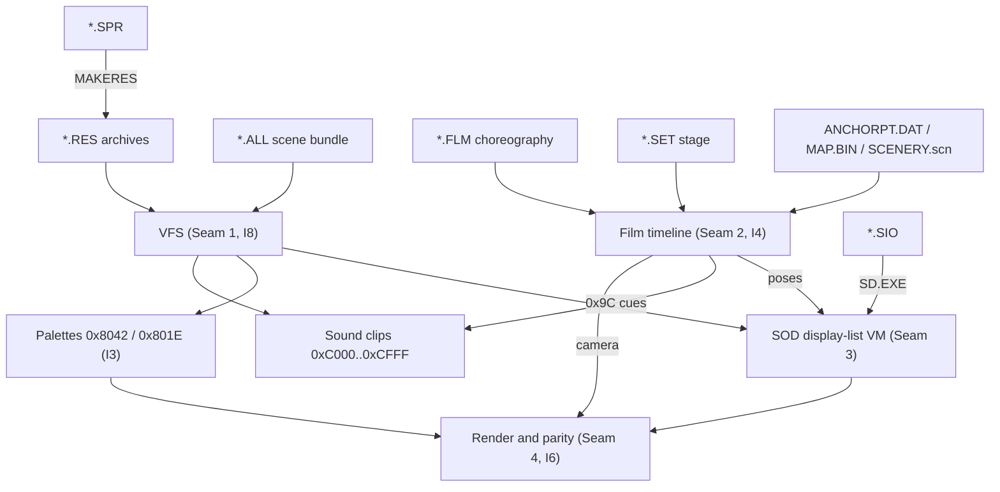

# Stunt Island Format Index

Router to the format specifications, shared concept notes and Kaitai schemas for *Stunt Island* (1992). Byte layouts live only in the `.ksy` schemas; the specifications give meaning, evidence and parser policy. Invariants `[I1]`-`[I8]` are defined in [`docs/SPEC.md`](../../docs/SPEC.md#2-system-architectural-invariants--guardrails); [`docs/ARCHITECTURE.md`](../../docs/ARCHITECTURE.md) routes code paths to documents; fixtures are described in [`tests/fixtures/README.md`](../../tests/fixtures/README.md).

---

## 1. Format Catalog

| Format | Magic | Role | Tier | Spec | Schema |
| :--- | :--- | :--- | :---: | :--- | :--- |
| `.RES` | `b"RS"` at `0x0000` | Global static archive in `res\`: models, sprites, UI, dialogue, scenery | `[Established]` | [`res.md`](res.md) | [`res.ksy`](res.ksy) |
| `.ALL` | none (`u16` item count) | Per-scene bundle from `MAKEONE.EXE`: models, palettes, `.VOC` clips, paired `.FLM` | `[Established]` | [`all.md`](all.md) | [`all.ksy`](all.ksy) |
| `.SOD` | `0x000C` (`OP_ID`) at `0x0000` | 3D model display-list bytecode run by the real-mode VM | `[Established]` | [`sod.md`](sod.md), [`sod-opcodes.md`](sod-opcodes.md), [`sod-opcode-coverage.md`](sod-opcode-coverage.md) | [`sod.ksy`](sod.ksy) |
| `.FLM` | `b"FILM"` at `0x0000` | 50 Hz choreography: actor and camera trajectories, cuts, credits, sound cues | `[Established]` | [`flm.md`](flm.md) | [`flm_slice.ksy`](flm_slice.ksy) (one slice, given slot masks) |
| `.SET` | none (30-byte stunt name; `0x08` at `0x52`) | Set Designer stage: environment, props, actor starts, event triggers | `[Established]` | [`auxiliary/set.md`](auxiliary/set.md) | [`set.ksy`](auxiliary/set.ksy) |
| `.SPR` | none (`width: u16`, `height: u16`) | Raw 8-bit billboard sprite, colour 0 transparent | `[Established]` | [`auxiliary/spr.md`](auxiliary/spr.md) | [`spr.ksy`](auxiliary/spr.ksy) |
| `.SIO` | `53 64 73 01 00 00 00 00` | SLICE modeller project; compiled to `.SOD` by `SD.EXE` | `[Established]` | [`auxiliary/sio.md`](auxiliary/sio.md) | [`sio.ksy`](auxiliary/sio.ksy) |
| `ANCHORPT.DAT`, `MAP.BIN`, `SCENERY.scn` | none (fixed tables in `SIDATA\`) | Island terrain: anchor points, terrain patches, BSP scenery tree | `[Supported Inference]` | [`auxiliary/map.md`](auxiliary/map.md) | [`anchorpt.dat.ksy`](auxiliary/anchorpt.dat.ksy), [`map.bin.ksy`](auxiliary/map.bin.ksy), [`scenery.scn.ksy`](auxiliary/scenery.scn.ksy) |

Byte layouts kept in Markdown because no schema covers them: the `.SOD` operand tables ([`sod-opcodes.md`](sod-opcodes.md)), the `.FLM` slice header and epilogue ([`flm.md` § 2](flm.md#2-header--memory-layout)), and the `.SET` prop field map, whose schema owns only the 64-byte stride ([`auxiliary/set.md` § 3.1](auxiliary/set.md#31-prop-record-table-exact-64-byte-stride-0x40)). Every specification follows the five-section template checked by `python/scripts/verify_formats_docs.py`, which also compiles the schemas against the synthetic fixtures; `mise run verify-corpus` runs them over the retail corpus. Evidentiary tiers are defined in [`docs/SPEC.md`](../../docs/SPEC.md); open questions sit in section 4 of each specification.

---

## 2. Runtime Asset Graph

Which format feeds which subsystem. Resolution is by 16-bit compound key `(res_index << 8) | item_index` ([`res.md` § 3.2](res.md#32-direct-16-bit-compound-key-resource-addressing), [`all.md` § 3.1](all.md#31-resource-id-partitioning)).

---

## 3. Concepts and Auxiliary Notes

| Note | One line |
| :--- | :--- |
| [`concepts/coordinates-and-units.md`](concepts/coordinates-and-units.md) | `[I1]` basis, fixed-point and BAM units, `sod_scale_table`, FOV, vertex welding |
| [`concepts/palette-and-shading.md`](concepts/palette-and-shading.md) | `[I3]`, `[I5]`, `[I6]`: Mode 13h DAC, shading ramps, LUT sampling, decals, SSIM |
| [`concepts/timeline-and-ticks.md`](concepts/timeline-and-ticks.md) | `[I4]` 50 Hz clock, slice timing, sub-tick interpolation, cut suppression |
| [`concepts/compression.md`](concepts/compression.md) | DOS memory limits, storage tiers, `[I8]` path rules, asset isolation |
| [`memory/kaitai-memory-spike.md`](memory/kaitai-memory-spike.md) | Whether runtime memory records fit `.ksy` schemas; includes [`actor_record.ksy`](memory/actor_record.ksy) |
| [`sod-opcodes.md`](sod-opcodes.md) | Authoritative `.SOD` opcode table |
| [`sod-opcode-coverage.md`](sod-opcode-coverage.md) | Corpus coverage queue for `.SOD` opcodes |

Runtime memory offsets are in [`research/playone-exe/memory-map.md`](../playone-exe/memory-map.md).

---

## 4. Provenance

Community sources: Adrian Stephens (original engine), Chris Phillips (`.RES`, `.SOD` and terrain decoding), Dave Palmowski (SpriteMaker, SLICE, ResMaker), Doug Armknecht (`.FLM` corpus analysis), Neil Halelamien (`.SET` notes). The archive they come from is `corpus/siarchive/` ([`corpus/README.md`](../../corpus/README.md)); each specification's section 5 carries its own attribution and reference paths.
