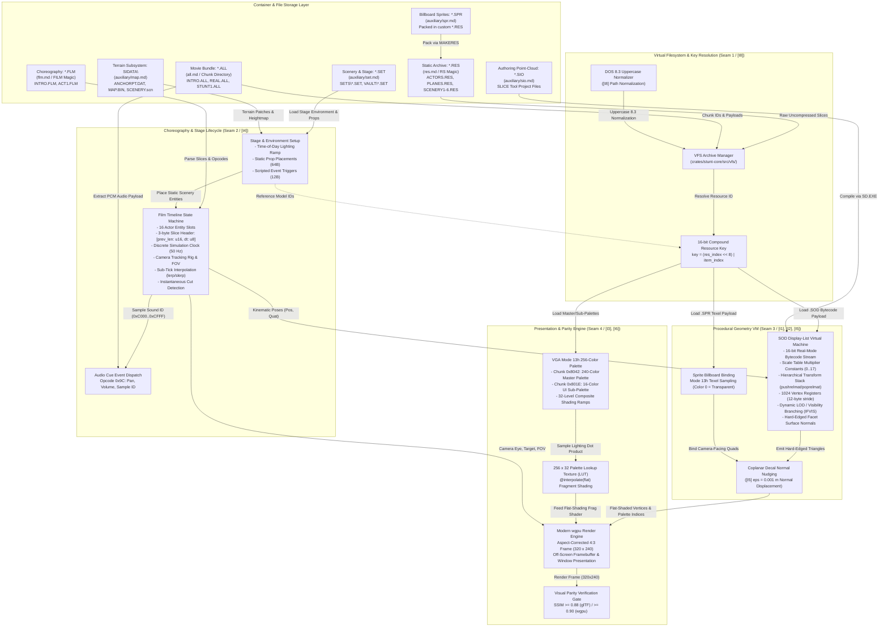

# Stunt Island Technical Reference Catalog & Format Index

This catalog serves as the authoritative, reverse-engineering grade index of all file formats, container architectures, and shared engine subsystems powering *Stunt Island* (1992, Walt Disney Computer Software / The Assembly Line). It consolidates historical reverse-engineering archives, disassembly findings from `PLAYONE.EXE` and `STUNT.EXE`, cleanroom codebase contracts, and mathematical invariant definitions into a unified technical reference.

---

## 1. Master Format Catalog

The table below indexes all primary engine containers, procedural geometry formats, choreography streams, world scenery definitions, and auxiliary modding formats used throughout *Stunt Island*.

| Format Extension | Magic / Header Signature | Container / Storage Role | Endianness | Engine Purpose & Lifecycle Role | Specification Document |
| :--- | :--- | :--- | :--- | :--- | :--- |
| **`.RES`** | 2-byte ASCII: `b"RS"` (`0x52, 0x53`) at `0x0000` | Static global archive container in `res\` directory (`DS:05DB`) | Little-Endian | Master static resource library providing $O(1)$ direct indexed access to 3D geometry (`.SOD`), 2D billboard sprites (`.SPR`), frame animations (`.ANM`), dialogue recordings (`DIALOG.RES`), UI definitions (`GAME.RES`), and scenery packages (`SCENERY1.RES`–`SCENERY6.RES`). | [`res.md`](res.md), [`res.ksy`](res.ksy) |
| **`.ALL`** | None (starts with `num: u16` item count at `0x0000`) | Scene-level movie bundle in `vault\` or scene directories | Little-Endian | Consolidated movie package generated by `MAKEONE.EXE`. Encapsulates all assets needed for a scene: 3D `.SOD` models (IDs `0x0001`–`0x7FFF`), 240-color master palette (`0x8042`), 16-color UI sub-palette (`0x801E`), `.VOC` PCM sound clips (`0xC000`–`0xCFFF`), and paired `.FLM` choreography. | [`all.md`](all.md), [`all.ksy`](all.ksy) |
| **`.SOD`** | 16-bit word: `0x000C` (`OP_ID`) at byte `0x0000` | Compiled bytecode stream in `.RES` / `.ALL` or loose files | Little-Endian | Procedural 3D model geometry display list executed by real-mode 16-bit Virtual Machine. Evaluates hierarchical transform stack (`pushcentre`, `pushrelmat`, `poprelmat`, `popcentre`), fixed-point vertices, Mode 13h color/shading indices, decals, and dynamic LOD/visibility branching (`ifvis`, `sorton`). | [`sod.md`](sod.md), [`sod.ksy`](sod.ksy) |
| **`.FLM`** | 4-byte ASCII: `b"FILM"` (`0x46, 0x49, 0x4C, 0x4D`) at `0x0000` | Cinematic timeline stream in `vault\` (paired 1:1 with `<NAME>.ALL`) | Mixed (scalars LE, 3-byte slice headers) | Deterministic flight choreography and camera timeline. Drives 16-slot entity state machine across discrete simulation ticks (50 Hz), recording 6-DOF actor trajectories, articulated subobjects, camera tracking channels, director cuts (`cut_from_previous`), and audio cue event dispatch (`0x9C`). | [`flm.md`](flm.md), [`flm_slice.ksy`](flm_slice.ksy) |
| **`.SET`** | None (starts with 30-byte ASCII stunt name; marker `0x08` at `0x52`) | Loose scene file in `SETS\` or `VAULT\`, or packed in `SETS.RES` | Little-Endian | Scenery stage configuration authored by Set Designer in `STUNT.EXE`. Defines global environment (time-of-day palette lighting, camera view modes, vehicle payload), static scenery prop placements (64-byte records), actor start positions, and scripted event triggers (12-byte records). | [`auxiliary/set.md`](auxiliary/set.md), [`auxiliary/set.ksy`](auxiliary/set.ksy) |
| **`.SPR`** | None (starts with `width: u16`, `height: u16` at `0x0000`) | Binary entry in `.RES` archives (`MAKERES.EXE`), bound to `.SOD` | Little-Endian | Uncompressed 8-bit indexed raster billboard image ($W \times H + 6\text{ bytes}$). Bound to procedural `.SOD` models compiled by `MAKESPR.EXE` for camera-facing visual effects (explosions, smoke clouds, muzzle flashes, rocket flares, dynamic logos) with color index `0` as transparency key. | [`auxiliary/spr.md`](auxiliary/spr.md), [`auxiliary/spr.ksy`](auxiliary/spr.ksy) |
| **`.SIO`** | 8-byte ASCII: `53 64 73 01 00 00 00 00` (`b"Sds\x01\x00\x00\x00\x00"`) | Loose 3D modeling project file (SLICE tool, 1999–2001) | Little-Endian | High-level 3D point cloud and wireframe authoring format. Ingests geometric primitives and parametric midpoint generators, feeding the official Stunt Island object compiler (`SD.EXE`) to compile procedural `.SOD` display lists. Concludes with `FF FF 00 00` trailer. | [`auxiliary/sio.md`](auxiliary/sio.md), [`auxiliary/sio.ksy`](auxiliary/sio.ksy) |
| **`.MAP` / `.BIN` / `.SCN`** | Fixed table structures (`ANCHORPT.DAT`, `MAP.BIN`, `SCENERY.scn`) | Loose scenery tables in `SIDATA\` or compiled into executables | Little-Endian | Static island world terrain subsystem: `ANCHORPT.DAT` (heightmap and ground-normal anchor points, $28{,}672$ bytes), `MAP.BIN` (continuous polygonal terrain patches, $5{,}372$ bytes), and `SCENERY.scn` (hierarchical BSP spatial partition tree for LOD culling, $118{,}236$ bytes). | [`auxiliary/map.md`](auxiliary/map.md), [`auxiliary/anchorpt.dat.ksy`](auxiliary/anchorpt.dat.ksy), [`auxiliary/map.bin.ksy`](auxiliary/map.bin.ksy), [`auxiliary/scenery.scn.ksy`](auxiliary/scenery.scn.ksy) |

### 1.1 Byte-Layout Source of Truth

**Byte layouts live in the `.ksy` schemas.** Field widths, offsets, byte order and counts are defined once, in the Kaitai Struct schema beside each specification. The Markdown documents describe meaning, evidence and parser policy and link to the schema; they do not re-tabulate it. `python/scripts/verify_formats_docs.py` compiles the schemas and runs them against the synthetic fixtures, and `mise run verify-corpus` runs them over the retail corpus.

| Format | Schema | Layout kept in Markdown because no schema covers it |
| :--- | :--- | :--- |
| `.RES` | [`res.ksy`](res.ksy) | none |
| `.ALL` | [`all.ksy`](all.ksy) | none |
| `.SOD` | [`sod.ksy`](sod.ksy) | opcode operand tables ([`sod.md` § 3.2](sod.md#32-the-authoritative-107-opcode-reference-table--fmt-sod-opcodes)) |
| `.FLM` | [`flm_slice.ksy`](flm_slice.ksy) (one slice, given the slot masks) | the 3-byte slice header and epilogue ([`flm.md` § 2.1](flm.md#21-the-solved-3-byte-slice-header-reverse-engineering-breakthrough)); no schema exists |
| `.SET` | [`auxiliary/set.ksy`](auxiliary/set.ksy) | none |
| `.SPR` | [`auxiliary/spr.ksy`](auxiliary/spr.ksy) | none |
| `.SIO` | [`auxiliary/sio.ksy`](auxiliary/sio.ksy) | none |
| `ANCHORPT.DAT`, `MAP.BIN`, `SCENERY.scn` | [`anchorpt.dat.ksy`](auxiliary/anchorpt.dat.ksy), [`map.bin.ksy`](auxiliary/map.bin.ksy), [`scenery.scn.ksy`](auxiliary/scenery.scn.ksy) | none |

---

## 2. Runtime Asset Dependency Graph & Data Flow Architecture

### 2.1 Complete Runtime Asset Dependency Graph

The following Mermaid graph documents how static containers, scene bundles, choreography timelines, procedural display lists, raster textures, palettes, and terrain tables interconnect at runtime.

---

### 2.2 Comprehensive Architectural Narrative

The asset architecture of *Stunt Island* is governed by a strict division of responsibility across static global packages, scene-specific bundles, and procedural runtime interpreters:

#### 1. The Multi-Tier Asset Resolution Model
Asset management in *Stunt Island* avoids runtime filesystem traversal and string searching during active 3D rendering. Assets are divided into two distinct tiers:
- **Global Static Archives (`.RES`):** Located in the `res\` directory (`ACTORS.RES`, `PLANES.RES`, `SCENERY1.RES`–`SCENERY6.RES`, `GAME.RES`, `DIALOG.RES`). These packages contain assets shared across multiple scenes and world areas. Their header and offset array ([`res.ksy`](res.ksy)) give $O(1)$ random seek to raw, uncompressed byte payloads.
- **Scene-Specific Packages (`.ALL`):** Produced by the standalone linker utility `MAKEONE.EXE`. When a user stages or records a movie in the Set Designer or plays back a cinematic in `PLAYONE.EXE`, all models, choreography timelines, sound effects, and color palettes required by that specific film are bundled into a single `.ALL` archive. This eliminates disk thrashing on low-end floppy or early hard disk drives.

#### 2. The Compound 16-Bit Resource Keying Architecture
The engine references geometry, props, and textures through a unified 16-bit unsigned integer key, `(res_index << 8) | item_index`. The per-archive `res_index` values are tabulated in [`res.md` § 3.2](res.md#32-direct-16-bit-compound-key-resource-addressing) and [`res.md` § 3.3](res.md#33-master-resource-index-enumeration-table) (`res_index` is a header byte, [`res.ksy`](res.ksy)). In `.ALL` full-scene bundles the directory's 16-bit IDs mirror this scheme; the ID ranges (models, palettes, sound clips, `FILM`) are partitioned in [`all.md` § 3.1](all.md#31-resource-id-partitioning).

When an entity or prop is loaded from a `.SET` file or spawned by a `.FLM` timeline, the virtual filesystem (`Seam 1: VfsArchive`) checks the active scene's `.ALL` container first. If the requested key is present in the `.ALL` chunk table, it is extracted immediately from the scene bundle; if not, the VFS falls back to the corresponding global `.RES` archive indexed by `res_index`.

#### 3. Scene Staging, Timeline Evaluation & Entity State Machine
When a movie is launched:
1. **Modal Selection (`0x0787` in `PLAYONE.EXE`):** The engine presents the modal film selection dialog, loading the chosen `<NAME>.ALL` package and its paired `<NAME>.FLM` choreography file.
2. **Environment & Stage Initialization:** If the scene includes a `.SET` file, the global 96-byte header configures stage parameters: time-of-day lighting ramps, initial camera placement, vehicle flight controls, and weapon loads. Prop records (64 bytes each) instantiate static scenery buildings, trees, and runway markers at 32-bit fixed-point $16.16$ coordinates relative to the island center $(100000, 0, 100000)$.
3. **Simulation Clock & Time Slices (`[I4]`):** The `.FLM` choreography stream runs at a fixed $50\text{ Hz}$ playback clock ($20.0\text{ ms}$ per tick; PIT divisor `0x5D38` in `PLAYONE.EXE`). Each time slice begins with the solved 3-byte header (`prev_slice_len: u16`, `tick_duration: u8`), where `tick_duration` is the elapsed interval since the previous slice (cumulative sum yields the slice timestamp), and drives up to 16 concurrent object slots.
4. **Kinematic Updates & Cuts:** Entity opcodes update 6-DOF positions, unit orientation quaternions, and articulated subobject joints. When a camera switch occurs (`view_obj` opcodes `0x90`–`0x97`), the `cut_from_previous` flag is asserted, suppressing sub-tick interpolation to prevent camera motion blur or matrix tearing across scene cuts.
5. **Audio Dispatch:** Choreography opcode `0x9C` triggers digital audio clips by pushing volume, stereo pan, and sample ID (`0xC000`–`0xCFFF`) to the audio event queue.

#### 4. Procedural Display List Geometry VM (`[I1]`, `[I2]`, `[I5]`)
Unlike static triangle meshes, `.SOD` models are dynamic display lists executed by an internal real-mode virtual machine:
- **Transform Hierarchy:** The VM maintains a transformation stack using opcodes `pushcentre`, `pushrelmat`, `movecentre`, `poprelmat`, and `popcentre`, enabling complex articulated subobjects (spinning propellers, retracting landing gear, deflected rudders, and rotating gun turrets).
- **Metric Scaling (`[I1]`):** Integer vertex coordinates are scaled into metric meters using the model's power-of-two scale index (`0..17`) from `sod_scale_table`.
- **Dynamic Visibility & LOD:** Branching opcodes (`ifvis`, `sorton`) evaluate viewer distance squared or face normals to cull backfaces, switch LOD representations, or hide interior cockpit details.
- **Coplanar Decals (`[I5]`):** Decals, markings, and insignias share identical spatial planes with base surfaces. To prevent Z-fighting in modern depth buffers, decals are detected via surface normal alignment and displaced outward by $\epsilon = 0.001\text{ m}$ (or offset via hardware depth bias in `wgpu`).

#### 5. Authentic VGA Mode 13h Presentation & Parity (`[I3]`, `[I6]`)
Rendering faithfully reproduces the 1992 8-bit VGA hardware output:
- Vertices store raw Mode 13h color indices (`0..=255`) and hard-edged facet normals.
- Fragment lighting calculates surface illumination by quantizing the light-normal dot product into 32 discrete shading levels, sampling authentic shading ramps from the $256 \times 32$ palette lookup texture (LUT) with `@interpolate(flat)`.
- The presentation pipeline displays aspect-corrected 4:3 images ($320 \times 240$) and achieves strict visual parity thresholds ($\text{SSIM} \ge 0.88$ for glTF baselines, $\ge 0.90$ for native `wgpu` rendering per `[I6]`).

---

## 3. Shared Architectural Concepts Directory

To avoid duplicating mathematical, hardware, and filesystem rules across individual format documents, core principles are formalized in `research/formats/concepts/`:

| Concept Document | Governing Invariants | Core Topics & Hardware Models | Key Formulae / Constants |
| :--- | :--- | :--- | :--- |
| [`concepts/coordinates-and-units.md`](concepts/coordinates-and-units.md) | `[I1]` | Metric Right-Handed Coordinate Basis ($+X$ Right, $+Y$ Up, $+Z$ Backward, $-Z$ Forward), fixed-point 16.16 / 12.4 / 8.8 representations, Binary Angular Measurement (BAM), `sod_scale_table` exponential decay, vertical $\text{FOV}_y$ calculation, and attribute-preserving vertex welding. | $\text{BAM} = \lfloor(\theta_{\text{deg}} / 360.0) \times 65536\rfloor$ $S_0 = 1.0, S_k = 1.0 / 2^k$ $\text{FOV}_y = 2 \arctan(120.0 / \text{focal\_dist}) \times (180/\pi)$ |
| [`concepts/palette-and-shading.md`](concepts/palette-and-shading.md) | `[I3]`, `[I5]`, `[I6]` | IBM VGA Mode 13h ($320 \times 200$, 256 colors), 18-bit hardware DAC ($6\text{ bits/component}$; the 6-bit to 8-bit scalings are defined once in [§ 1.1](concepts/palette-and-shading.md#11-vga-hardware-dac-principles)), 16-color groups and 32-color shading ramps, Master Palette (`0x8042`) and UI sub-palette (`0x801E`), $256 \times 32$ RGBA LUT texture sampling with `@interpolate(flat)`, decal depth bias, and SSIM parity validation. | $\text{level} = \text{clamp}(\lfloor\mathbf{N} \cdot \mathbf{L} \times 31\rfloor, 0, 31)$ $\text{LUT}(u, v) = \text{PaletteTable}[\text{color\_index}][\text{level}]$ |
| [`concepts/timeline-and-ticks.md`](concepts/timeline-and-ticks.md) | `[I4]`, `[I1]` | Discrete simulation clock (50 Hz), solved 3-byte slice header (`prev_slice_len: u16`, `tick_duration: u8`), 16-slot entity state machine, continuous sub-tick lerp and slerp with antipodal quaternion handling, instantaneous director cut suppression, and synchronized digital audio cue dispatch (`0x9C`). | $\Delta t = 20.0\text{ ms}$ $\alpha = (t_{\text{render}} - t_{\text{slice}}) / (20\text{ ms} \times \text{tick\_duration})$ $\mathbf{P}(t) = (1 - \alpha)\mathbf{P}_0 + \alpha\mathbf{P}_1$ (if $\alpha_{\text{eff}} > 0$) |
| [`concepts/compression.md`](concepts/compression.md) | `[I8]`, `[I7]` | MS-DOS conventional memory limits (640 KB) and 64 KB `DGROUP` constraints, tiered storage strategy (offline LZEXE 0.91 floppy compression, zero-CPU runtime raw streaming in `.RES`/`.ALL`, PCX RLE in sprite creation), uppercase DOS 8.3 filename normalization, and cleanroom asset isolation rules. | $N_{\text{offsets}} = (\text{ofs}[0] / 4) - 1$ $\text{DOS 8.3 Uppercase: } \texttt{NAME.EXT}$ $\text{Cleanroom: 0 proprietary bytes in Git CI}$ |

**Governing invariants, contracts and fixtures:** the invariants `[I1]`–`[I8]` are defined once in [`docs/SPEC.md`](../../docs/SPEC.md#2-system-architectural-invariants--guardrails); the Seam contracts are the Rust sources under [`crates/stunt-core/src/contracts/`](../../crates/stunt-core/src/contracts/mod.rs); [`docs/ARCHITECTURE.md`](../../docs/ARCHITECTURE.md) routes each code path to its documents; the cleanroom fixtures are described in [`tests/fixtures/README.md`](../../tests/fixtures/README.md). This catalog restates none of them.

---

## 4. Reverse Engineering Backlog & Open Questions

The following table summarizes open questions, bounded observations, and hypotheses across the Stunt Island format suite, categorized by evidentiary tiers:

| Format / Area | Evidentiary Tier | Topic & Open Question | Current Understanding & Working Hypothesis |
| :--- | :--- | :--- | :--- |
| **`.RES`** | `[Bounded Observation]` | In-Memory DOS Descriptors | In retail `PLAYONE.EXE`, the engine constructs a 16-byte descriptor per loaded archive. Words 6 and 7 contain bitmasks that appear to track whether payloads are cached in EMS/XMS or read on-demand. |
| **`.RES`** | `[Hypothesis]` | Dynamic Scenery Swapping | Whether `SCENERY1.RES` through `SCENERY6.RES` are loaded dynamically during flight based on player coordinates or pre-staged based on `.SET` scene configuration. |
| **`.ALL`** | `[Supported Inference]` | Audio Clip Format Headers | PCM audio chunks (`0xC000`–`0xCFFF`) contain 8-bit mono samples, but whether they include a standard Creative Voice (.VOC) 26-byte header or raw headerless PCM bytes is contingent on the packaging version of `MAKEONE.EXE`. |
| **`.ALL`** | `[Bounded Observation]` | Unallocated Chunk ID Ranges | IDs between `0x8050` and `0xBFFF` do not appear in retail intro films. These may represent reserved slots for interactive flight dynamics tables or cockpit instrument gauges. |
| **`.SOD`** | `[Supported Inference]` | Opcode `0x03BA` (`OP_DISC`) Tessellation | Procedural circular primitives (`OP_DISC`) evaluate dynamic segment subdivisions. Disassembly suggests a default of 12 or 16 radial segments based on bounding radius. |
| **`.SOD`** | `[Hypothesis]` | Opcode `0x02D0` (`OP_SHADE2`) Illumination | Evaluates two-sided polygon illumination. It is hypothesized that when the facet dot product is negative, the surface normal is inverted and shaded against secondary ambient light. |
| **`.FLM`** | `[Established]` | Solved 3-Byte Slice Header | The 3-byte slice header `[prev_slice_len: u16, tick_duration: u8]` has been proven 100% bit-exact across all 15,544 simulation slices in the retail corpus, fully explaining reverse-scrubbing back-pointers. |
| **`.FLM`** | `[Bounded Observation]` | Opcode `0x98` Credit Banners | Opcode `0x98` sets on-screen credit strings. Further reverse engineering is needed to decipher coordinate packing for multi-line banner positioning and font index selection. |
| **`.SET`** | `[Established]` | Corrected Prop Record Stride | Prop records in `.SET` files occupy exactly 64 bytes (`0x40`), disproving historical 80-byte notes resulting from an arithmetic typo in community documentation. |
| **`.SET`** | `[Bounded Observation]` | Scripted Trigger Semantics | 12-byte event trigger blocks support camera cuts and explosions; additional opcodes (autopilot takeover, audio trigger, weather modulation) remain partially mapped. |
| **`.MAP` / `.SCN`**| `[Supported Inference]` | BSP Node Distance Culling | `SCENERY.scn` evaluates 12 node types (`SP_*`). Nodes perform integer comparison against `splitdist * 48` to swap LODs or prune subtrees at high flight altitudes. |

---

## 5. Provenance & Community Attribution

The technical specifications in this catalog synthesize twenty-five years of reverse engineering by community pioneers and modern cleanroom reconstruction teams:

- **Adrian Stephens (The Assembly Line, 1992):** Original engine architect and lead programmer. Designed the groundbreaking real-mode 3D display list bytecode VM, flat-shaded polygon rasterizer, BSP scene graph, and flight dynamics subsystem for IBM PC hardware.
- **Chris Phillips (1998–2001):** Author of the seminal `SODParse` toolkit (`ripres.c`, `DECODE.C`, `SOD.H`), `sires.cpp`, `simap.cpp`, and `siobj.cpp`. Discovered the `.RES` header layout, solved the 107-opcode `.SOD` dispatch table, and mapped the island terrain files (`MAP.BIN`, `ANCHORPT.DAT`, `SCENERY.scn`).
- **Dave Palmowski (Stunt Island Filmmakers Association / SIFA, 1999–2001):** Creator of the `SpriteMaker` suite (`PCX2SPR`, `MAKESPR`, `DRAWSPRT`), the `SLICE` visual 3D modeler (`.SIO`), `ResMaker 1.0`, and comprehensive resource ID index tables (`indices.txt`).
- **Doug Armknecht (2001–2004):** Author of the `SI_FLM_Format` archive, `flm_extract.py`, and `CORPUS_FINDINGS.md`. Conducted extensive corpus analysis across thousands of `.FLM` choreography files, documenting entity slots, camera channels, and director opcodes.
- **Neil Halelamien (2004):** SIFA researcher who analyzed the `.SET` scenery file format (`Notes_SETFile`), discovering environment header structures, camera setup blocks, prop placement tables, and 16-bit compound model keys.
- **Ángel Eduardo:** Author of `Notes_SIExtractor`, documenting resource archive packaging structures and decompression routines.
- **Alberto Marnetto:** Author of `SI-8x` research documentation and custom mission creation utilities.
- **StuntReel Teamwork Agents (2026):** Cleanroom analysis and formal specification by `explorer_survey_1`, `explorer_survey_2`, `spec_miner_survey_1`, `worker_t05_vfs_1`, `worker_t06_sod_1`, `worker_fmt_core`, `worker_fmt_concepts`, and `worker_fmt_aux`.
