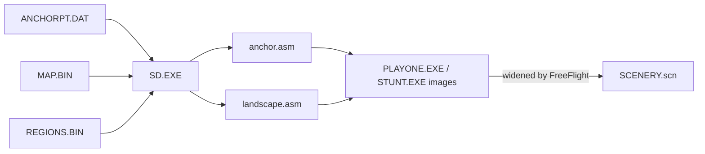

# Specification: `MAP.BIN` Terrain Patches and the `SD.EXE` Scenery Build

## 1. Overview & File Identification

`MAP.BIN` holds the island's ground: flat polygons over [`ANCHORPT.DAT`](anchorpt.md)'s points, each with a palette colour, linked into lists of coarse patches and the finer patches that replace them up close. `REGIONS.BIN` is the block tree those lists hang from. Both are working files of `SD.EXE`, the developers' scenery compiler, which turns them into the scenery tree the game carries ([`scenery.md`](scenery.md)). The renderer reads `MAP.BIN` for terrain (`world/mod.rs`); nothing reads `REGIONS.BIN`.

### 1.1 Origin: `SD.EXE`, the scenery compiler

`SITools/SD.EXE` is a plain MZ executable; load-image offsets below are its file offsets minus `0x600`, and its header, segments and routine table are in [`sd-exe/image.md`](../../sd-exe/image.md). The evidence that it is the developers' tool is `[Established]` for the strings and code, `[Supported Inference]` for the claim that the shipped game was built with it:

- **Strings** (file offsets `0x18A8A`–`0x1A1A6`): `anchorpt.dat`, `map.bin`, `scenery.bin`, `squished.bin`, `regions.bin` and `Anchor point height (ft) :`.
- **Assembler output**: the paths `\stunt\landscape.asm` and `\stunt\anchor.asm`, the node directives `sp_pos` … `sp_posxz`, `include strucs.asm`, `public anchorpts,noanchpts`, `dseg3d segment` and `($-anchorpts)/aptlen`. So it writes the tree and the anchor table as assembler source, which the game assembles in.
- **Code**: it loads and saves `ANCHORPT.DAT` ([`anchorpt.md`](anchorpt.md) section 1) and `MAP.BIN` (section 2.2), and compiles `MAP.BIN` under `REGIONS.BIN`'s blocks into nodes of the shipped tree's types (section 3.2).

### 1.2 Copies

- **Corpus.** Six `MAP.BIN` copies: `Developer/FreeFlight/SIDATA/`, `Developer/SIRes/SiData/`, `Developer/SODParse/`, `SITools/` and `SITools/OBJECTS/Dean/Egalloc/` are byte-identical. `SITools/OBJECTS/Dean/MAP.BIN` is a community edit: six records differ, and patch 22 counts 2 vertices. `REGIONS.BIN`, `SCENERY.BIN` and `SQUISHED.BIN` exist only in `SITools/`.
- **Not in the game** (`[Established]` for the search, 2026-11-06). The unpacked `PLAYONE.EXE` (both builds) and `STUNT.EXE` (both copies, searched: the retail copy is the OldPLAY build with an entry stub appended, and both unpack to the same 248,460-byte image) hold the compiled ground: 158 of the 166 active patches as polygons with `MAP.BIN`'s colours ([`world-scene.md`](../../playone-exe/world-scene.md) section 2.1). Patches 52–55 and 62–65 appear in neither pointer nor index form in those four images or in any of the 3,844 corpus files that are not a `MAP.BIN` copy. Neither do the 12-byte headers of records 0, 1, 52 and 62. The record fields and those eight patches exist only in `MAP.BIN`, so the file cannot be rebuilt from the game.

**Governing invariants:** [`[I1]`](../../../docs/SPEC.md#i1-metric-right-handed-coordinates-attribute-preserving-vertex-welding--anglefov-normalization), [`[I3]`](../../../docs/SPEC.md#i3-authentic-vga-mode-13h-palette-indexing--flat-shading), [`[I8]`](../../../docs/SPEC.md#i8-dos-83-uppercase-path-normalization). **Contract and code:** [`contracts/vfs.rs`](../../../crates/stunt-core/src/contracts/vfs.rs), [`world/mod.rs`](../../../crates/stunt-core/src/world/mod.rs) and [`scene_tree.py`](../../../python/stunt_reel/scene_tree.py). No synthetic terrain fixture exists yet.

---

## 2. Header & Memory Layout

### 2.1 File Summary

| File | Size | Layout | Evidentiary Tier |
| :--- | :--- | :--- | :--- |
| `MAP.BIN` | $5{,}372$ bytes | 2-byte list head + 179 records of 30 bytes | `[Established]` |
| `REGIONS.BIN` | $3{,}074$ bytes | 2-byte head + 256 records of 12 bytes | `[Established]` |

### 2.2 Pools, Links and Free Records

Both files are `SD.EXE` record pools saved from memory (`[Established]`). The `MAP.BIN` loader at `0xB1EF` clears the in-use byte of all 1,000 pool records (`0xB0F8`). It then reads one word into the list head `DS:0x22C2`, and up to `0x7530` bytes into the pool at pool offset 2. The saver at `0xB221` writes the head and then every record up to the last one in use, so the file's record count is that last index plus one.

| Form | Link to record *k* | No link | Vertex *i* |
| :--- | :--- | :--- | :--- |
| On disk | `30 × k` | `-1` | `i` |
| In memory | `2 + 30 × k` | `0` | `4 + 28 × i` (offset into the anchor buffer) |

The load converter at `0xB10D` and the save converter at `0xB17D` translate between the two forms, but only for records in use. So free records 102, 103, 130 and 133–144 still hold memory forms. For example, record 134's vertices 2048, 592, 620 and 2580 are anchors 73, 21, 22 and 92.

### 2.3 `MAP.BIN` Memory Layout (`# [FMT-MAP-AREA]`)

The file is the list head (`30 × index` of the first top-level patch: 540, record 18), then the records (`[Established]`, `SD.EXE` code above and the build in section 3.2). Their byte layout is in [`map.bin.ksy`](map.bin.ksy); what each field means:

| Field | Meaning |
| :--- | :--- |
| `in_use` | Non-zero for a record in use |
| `block` | `REGIONS.BIN` leaf a top-level patch is compiled under; 0 on child patches |
| `next` (`a`) | Next patch in the same list |
| `first_child` (`b`) | First of the finer patches that replace this one within its split distance |
| `split_distance_x2` (`c`) | Twice the `SP_GROUND` split distance; 100 or 0 where unused |
| `parent` (`d`) | Patch whose `first_child` list holds this one |
| `color` | Mode 13h palette index, emitted as the leaf polygon's colour |
| `num_verts` | Vertex count, the loop count of both converters: 3 to 8 in every record in use, except patch 22 of the community edit `SITools/OBJECTS/Dean/MAP.BIN`, which counts 2 and is not drawn (`[BK-MAP-05]`) |
| `vertex_indices[8]` | `ANCHORPT.DAT` indices; the first `num_verts` are used |

Until 2026-11-06 this project and FreeFlight's `sisland.cpp` read the file 2 bytes off. They took a `num` word at the front of each record, seven vertex slots, and a null terminator. Under that reading, patch 131's eighth vertex appeared to overflow into the next record. Record indices and the fields the renderer reads are the same under both readings.

Executable layout: [`map.bin.ksy`](map.bin.ksy).

### 2.4 `REGIONS.BIN` Memory Layout

The block tree has no schema, so its layout is recorded here (`[Established]` for the counts and the match with the image, `[Supported Inference]` for the field roles, which come from `SD.EXE`'s walker at `0xD43B`):

| Offset | Size | Meaning |
| :--- | :--- | :--- |
| `+0x00` | u8 | In use when non-zero |
| `+0x01` | u8 | Node type: 16 (`SP_HSLOPE`), 18 (`SP_VSLOPE`), or 0 for a leaf |
| `+0x02` | i16 | Parent link (`12 × index`) |
| `+0x04` | i16 | Split node: plane word; leaf: block id |
| `+0x06` | i16 | Split node: plane word |
| `+0x08`, `+0x0A` | i16 × 2 | Child links (`12 × index`) |

107 of the 256 records are in use: 33 of type 16, 20 of type 18 and 54 leaves with block ids 0 to 53. `PLAYONE`'s tree has exactly 33 type-16 and 20 type-18 nodes, and all 53 split nodes appear in it with their two plane words ([`scenery.md`](scenery.md) section 3.1). Block 27 holds no patch.

---

## 3. Data Structures & Opcode Table

### 3.1 Patch Lists

`next`, `first_child` and `parent` make a forest (`[Established]`, every active record of the corpus copy):

- The **top-level list** starts at the head, record 18, and runs 124 records through `next`. Each top-level patch names its block.
- A patch with **children** is a coarse polygon: `first_child` starts a list of finer patches (through `next`), each of which names it as `parent`. All 12 coarse patches match an `SP_GROUND` node of the image, whose `splitdist` is the record's `split_distance_x2 >> 1`. For example, record 158 has 936 and its node has 468, and record 0 has 4998 and its node has 2499.
- The top-level list and its children reach exactly the 158 records `PLAYONE` draws.
- Patches 52–55 and 62–65 are two lists of their own, each four records long. No record's `next` names them, their `parent` is `-1`, and their block is 0. Records 133–136 are free quads over the same anchors, so the eight triangles are those quads split.

`SD.EXE` inserts into these lists at `0xB78C` (append), `0xB7D2` (prepend) and `0xB7F6` (unlink).

### 3.2 How `SD.EXE` Compiles the Tree

`[Established]`, `SD.EXE` load image:

1. `0xD43B` walks the `REGIONS.BIN` block tree. Each split node becomes a slope node of the shipped tree.
2. At each leaf, `0xD2D9` takes from the list head the top-level patches whose `block` equals the leaf's id, and `0xD399` compiles them there.
3. `0xD21A` emits one node per patch:
   - A patch without children becomes an `SP_GLEAF`.
   - A patch with children becomes an `SP_GROUND` with `split_distance_x2 >> 1`, a computed extent and centre, and the link words.
   - Each node then carries the plane, `color`, `num_verts` and the vertices as `28 × index` (the form [`scene_tree.py`](../../../python/stunt_reel/scene_tree.py) reads).
   - `0xD21A` then recurses through `next` and `first_child`.
4. Every route starts at the list head, so the two unlinked lists, patches 52–55 and 62–65, are never compiled. That is why `PLAYONE` lacks them ([`world-scene.md`](../../playone-exe/world-scene.md) section 2.1).

### 3.3 Terrain Ingestion in `stuntreel`

`world/mod.rs` `parse_map_bin` reads the records after the head and keeps those in use whose vertices all index the anchor table, less the eight unlinked patches (`PATCHES_PLAYONE_NEVER_DRAWS`). That gives 158 polygons over 166 active records. The 166 records carry 584 vertex references in total: 94 records with three corners, 62 with four, 8 with five, one with six and one with eight. So `MAP.BIN` is a flat polygon list, not a tessellated mesh. Each polygon is fanned from its first corner and drawn flat at its colour (`[Established]`).

### 3.4 Global Ocean Water Quad

The ocean is not in `MAP.BIN`. The renderer draws a planar quad at sea level from $(-32000, -1, -32000)$ to $(+32000, -1, +32000)$ before the terrain (`[Supported Inference]`).

---

## 4. Open Questions & Analysis Backlog

Anchor items `[BK-MAP-01]` and `[BK-MAP-08]` are in [`anchorpt.md`](anchorpt.md); tree items `[BK-MAP-02]`, `[BK-MAP-04]` and `[BK-MAP-07]` are in [`scenery.md`](scenery.md).

| Item ID | Topic | Description | Evidentiary Tier |
| :--- | :--- | :--- | :--- |
| `[BK-MAP-03]` | Fields `a, b, c, d` | Settled 2026-11-06 from `SD.EXE`'s code: `next`, `first_child`, `split_distance_x2` and `parent` (sections 2.3 and 3.1). | `[Established]` |
| `[BK-MAP-05]` | `num_verts` outliers | Settled 2026-11-06: records have eight vertex slots, so patch 131's eight vertices are its own (section 2.3). Patch 22 of `SITools/OBJECTS/Dean/MAP.BIN` counts 2, a community edit that `mise run verify-corpus` keeps in its baseline. | `[Established]` |
| `[BK-MAP-06]` | Terrain per-region shade | The capture draws the flat colour-195 airfield at palette 196 for 58%, 194 for 24% and 193 for 15% of its pixels. Those shades are scenery tiles placed on the patch, not a shade of the patch ([`world-scene.md`](../../playone-exe/world-scene.md) section 3, [`attribution.md`](../../parity/attribution.md#3-the-loss-is-structural-edges-not-flat-colour)). | `[Bounded Observation]` |

### 4.1 Ruled out

- **`a, b, c, d` as a bounding box** (`[BK-MAP-03]`): they are list links and a split distance (section 2.3).
- **Patch 131 reading past its record** (`[BK-MAP-05]`): the record has eight slots (section 2.3).
- **`MAP.BIN` or its eight undrawn patches in `STUNT.EXE`** (section 1.2): the editor's unpacked image holds the same tree as `PLAYONE`, and none of those patches.
- **A field that marks the eight undrawn patches as hidden**: their `in_use` and `block` bytes look like those of drawn child patches. What sets them apart is that no list reaches them (section 3.1).

### 4.2 Open questions

1. **What `SCENERY.BIN` and `SQUISHED.BIN` encode.** The `SD.EXE` code that writes them (`0xE9B6`–`0xED28`) is unread, and they do not hold the tree in either form ([`scenery.md`](scenery.md) section 4.1).
2. **Whether running `SD.EXE` on the corpus files reproduces the shipped tree word for word.** That would make `SCENERY.scn` rebuildable from source as well as from the image.
3. **`mise run unlzexe` fails on `STUNT.EXE`** with an `IndexError` while decoding the relocation table. Its decompressor alone unpacks the image used here.

---

## 5. Attribution & Provenance

- **Chris Phillips (2000–2003):** FreeFlight, SIRes and SODParse, whose `sisland.cpp`, `simap.cpp` and `simap.h` first read `MAP.BIN` and whose `SIDATA` directories carry it (`corpus/siarchive/Developer/FreeFlight/`, `corpus/siarchive/Developer/SIRes/`, `corpus/siarchive/Developer/SODParse/`).
- **Dave Palmowski (1999–2004):** the `SITools` collection that carries `SD.EXE`, `REGIONS.BIN`, `SCENERY.BIN` and `SQUISHED.BIN` (`corpus/siarchive/SITools/`).
- **Neil Halelamien (2004):** scenery resource extraction and set coordination research (`corpus/siarchive/Developer/Notes_SETFile/`).
- **Doug Armknecht (2000–2002):** island coordinate conventions (`corpus/siarchive/Developer/SI_FLM_Format/`).
- **Stunt Reel contributors (2026):** the record layout and field meanings from `SD.EXE`'s code, the `REGIONS.BIN` match with the image, and the corpus and image searches.
