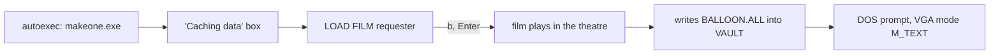

# `MAKEONE.EXE`: Driving the Film Linker Under DOSBox-X

`MAKEONE.EXE` is the retail film linker: it turns a film's `.FLM` into the `.ALL` archive that `PLAYONE.EXE` plays ([`all.md`](../formats/all.md)). The retail manual describes it as a DOS program that opens a Load File requester, prepares the chosen film and returns to DOS. This note records what it does when the capture harness drives it, so a film without an `.ALL` can be given one. The harness itself is in [`capture.md`](../playone-exe/capture.md); the design is in [`docs/process/plans/make-all-2026-10-29.md`](../../docs/process/plans/make-all-2026-10-29.md) and [ADR 0023](../../docs/adr/0023-make-all-generates-archives-with-makeone.md).

Every observation below is `[Bounded Observation]`: `BALLOON.FLM` from the full game in a spike on 2026-10-29 (and `TRAINTNL.FLM` in section 7), `dosbox-x-v2026.10.01`, the parity profile (`core = normal`, `output = surface`). The tier of a statement is repeated in its section's first line.

---

## 1. Run Sequence

`[Bounded Observation]`, five harness runs and one run with no controller.

| Stage | What the framebuffer shows | Notes |
|---|---|---|
| Caching | A grey box, "Caching data / 14912K in extended memory" | Without the `RES\` tree it stayed here for at least 25 s. |
| Requester | `LOAD FILM`: Filename `*.*`, Dir `C:\VAULT`, a list starting `[..]`, OK and Cancel, a DRIVE row, a bottom bar with Exit and Load | The live DAC palette read all black on these pages; a colour check of them is meaningless. |
| Playback | The theatre with a `00:00.00` timecode; the film runs in real time | About 76 s after Enter for `BALLOON.FLM`. |
| Done | A bare `C:\>` in text mode; the page dump has one distinct index | `VGA MODE` reports `mode=M_TEXT`. |

## 2. Keys

`[Bounded Observation]`. The prefix jump fills the Filename field, so the keys are the film's first letter and Enter, with no Down (unlike `PLAYONE`'s list box, which needs a Down; [`playone.py`](../../python/stunt_reel/tac/playone.py)). In the spike's mount `VAULT` held `balloon.flm` and `balloon.tke`, and `b` selected `balloon.flm`; the committed command stages the `.FLM` alone, where the list shows only that film. The spike pressed `b` about 10 s after the controller connected, 0.7 s before Enter; the harness's own dialog settle also works on these screens (section 7).

## 3. Completion

`[Bounded Observation]`. The only sign that `MAKEONE` has finished is the video mode returning to text. A framebuffer dump cannot see it (`MEMDUMPBIN A000:0000` reads the graphics page, which does not change in text mode), so the harness reads `VGA MODE`; a reply is a line such as `VGA mode info: | mode=M_VGA vref=70.087Hz href=31468.750Hz chrclk=3146875.000Hz dotclk=25175000.000Hz`. No file appears before the end, and no `SPOOL.$$$` was left behind. Text mode alone is not a signal, because the guest sits at a prompt before the program starts; a graphics mode must have been seen first.

## 4. Minimal Mount

`[Bounded Observation]`. Tested on `BALLOON.FLM`:

| Needed | Not needed |
|---|---|
| `MAKEONE.EXE`, `DRIVER1.BIN`, `DRIVER2.BIN`, `DRIVER3.BIN`, `GAME.CFG`, `INSTALL.CFG`, `PFONT.BIN`, `VDATA.BIN` at the root | `BALLOON.TKE` (tested absent) |
| `RES\` (about 9.8 MB) | `SETS\`, `SS\`, `PILOTS\`, `GAME.VAR` (tested absent), `SPOOL.$$$` |
| `VAULT\BALLOON.FLM` | |

The engine files were not dropped one at a time. A mount that already held an `.ALL` (copied from an earlier run) made the output ambiguous, so each run uses a fresh copy.

## 5. Output

`[Bounded Observation]`. `BALLOON.ALL` appears in the mount's `VAULT\`, beside the `.FLM`: 46,702 bytes, md5 `1db59e1edd4d3debaca5e6188ead38df`, identical in all five harness runs and the run with no controller. It parses as [`all.ksy`](../formats/all.ksy): 62 chunk ids, a 378-byte header, the first offset 378, offsets increasing, the last offset equal to the file size. `PLAYONE` plays it: `capture-ref` captured 30 frames (film ticks about 10 to 345, 43 to 72 distinct indices each) in 12.6 s. Whether `PLAYONE` insists that the archive's stem equals the film's was not tested; every pair in the corpus matches.

## 6. Routes

`[Bounded Observation]`.

| Route | Result |
|---|---|
| Controller session (port 0, BDA keys, poll `VGA MODE`) | Worked, about 91 s wall including the 0.8 s connect. No crash, no illegal-interrupt storm. |
| No controller: the parity conf with `autotype -w 12 -p 1 b enter`, `makeone.exe`, `exit` | Worked, exit 0 after about 90 s. The 12 s wait is long enough that the key is not dropped, unlike `autotype` at `PLAYONE`'s boot ([`capture.md`](../playone-exe/capture.md) § 2). |

A stale `dosbox-x.exe` from an earlier killed run holds the control port; kill it first.

## 7. Through `mise run make-all`

`[Bounded Observation]`, 2026-10-29, the committed command rather than the spike scripts. The dialog settle that `PLAYONE` uses (five identical dumps after at least three changes) fired on `MAKEONE`'s screens with 4 distinct indices, so no fixed delay is needed before the keys. `BALLOON.FLM`: 46,702 bytes, md5 `1db59e1edd4d3debaca5e6188ead38df` again, 81.1 s, and `capture-ref` then captured 30 frames from the stored archive. `TRAINTNL.FLM` (28,517 bytes, longer): 107,816 bytes in 134.3 s, 30 frames captured (film ticks to about 322, 52 distinct indices on the last). Run time grows with the film's length.

---

## 8. Run Time Under Different CPU Settings

`[Bounded Observation]`, 2026-10-30, `flmonly-747land` unless named; the batch survey was loading the machine (about 19% CPU idle load, 16 logical cores), so seconds are indicative. Every run below wrote the same 146,215-byte `.ALL` (sha256 `998ec65c…`), checked with `cmp`.

| `[cpu]` setting | Seconds |
|---|---|
| `core = normal`, `cycles = 8000` (the parity conf) | 179 |
| `core = normal`, `cycles = max` | 27 |
| `core = dynamic`, `cycles = max` | 13 to 17 |
| `core = dynamic`, `cycles = max 50%` | 16 (30 to 34 under survey load) |

`MAKEONE` is not single-stepped by the debugger, so the `cacheblocks` crash that rules out the dynamic core for captures does not apply here. The same `dynamic` plus `max` setting also produced byte-identical archives for `flmonly-747` (852 s down to 27 s), `flmonly-battle` (346 s to 19 s) and `flmonly-bigfoot` (44 s to 7 s). DOSBox-X took no more than 0.94 of one core (about 5% of total CPU) at `cycles = max`, so a percentage cap bought nothing. [`tools/dosbox/dosbox-archive.conf`](../../tools/dosbox/dosbox-archive.conf) is the parity conf with only these two lines changed; captures keep the parity conf ([ADR 0023](../../docs/adr/0023-make-all-generates-archives-with-makeone.md)).

Where the remaining time goes (from existing logs, nothing re-run): launch to dialog settled is 3 to 4 s, `wait_for_text` polls `VGA MODE` every 2 s ([`makeone.py`](../../python/stunt_reel/tac/makeone.py) `POLL_SECONDS`), so a run overshoots by 0 to 2 s, and the stage copies 35 files (10,137,583 bytes) of `RES\` per run ([`staging.py`](../../python/stunt_reel/tac/staging.py)). The `autotype -w 12` route of § 6 is not on the live path. Untested cheap options: `POLL_SECONDS` 0.25, `[dosbox] fastbioslogo = true` with `startbanner = false`, and a directory junction for `RES\` (unsafe if `MAKEONE` writes into it).

## Ruled out

- **Running without `RES\`.** The run never left the caching box in 25 s.
- **A capped `cycles = max 50%`.** It was 1.7 times slower than `max` (30 to 34 s against 18 s) and saved about 2 points of total CPU; plain `max` is used.
- **Needing the `.TKE`.** `BALLOON` converted without its take file.
- **`autotype` at boot as the primary route.** It works only with a long wait and cannot tell completion from a stall; it is the fallback if a film breaks the controller.

## Open questions

1. Run time scales with the film's length (81 s `BALLOON` and 134 s `TRAINTNL` at `cycles = 8000`). At `dynamic` plus `max` the longest film measured took 27 s (`flmonly-747`); films over 300 KB that timed out at 900 s under the old conf are not yet re-run at the new speed.
2. Is a `.ALL` made from one `.FLM` byte-stable across runs for films other than `BALLOON`? Only that one was repeated.
3. Films that need more than the shipped `RES\` (community films with custom sounds) and films whose `.FLM` references takes: untested.
4. Does a `.ALL` made under DOSBox-X carry the sound set-up of the machine that ran `MAKEONE` (`corpus/siarchive/Films/Playing_Films.txt`)? Frames are unaffected.
5. A film whose name starts with a digit or a character outside [`bda.py`](../../python/stunt_reel/tac/bda.py)'s scan-code table.
6. Does `PLAYONE` require the archive's stem to equal the film's?

_Found 2026-10-29; see the [parity log](../parity/log.md)._
