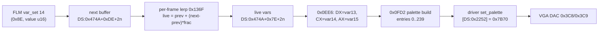

# `PLAYONE.EXE`: Film Brightness and the End-of-Film Fade

* **Binary**: `PLAYONE.EXE` (LZEXE 0.91), statically unpacked
* **Method**: The packed file was decompressed with a local LZEXE 0.91 unpacker into a 200,524-byte load image (no MZ header). Disassembly is Capstone 16-bit. Corpus cross-check: `CTRY.FLM` `var_set` stream against the fade levels measured from the parity captures (`build/parity/reference/ctry`).
* **Scope**: What drives the palette fade at the end of `CTRY.FLM` (Q-FLM-09 in [`../formats/flm.md`](../formats/flm.md)).
* **Anchor**: `# [MEM-FLM-VARS]`, `# [MEM-PALETTE]`

Offsets below are load-image offsets. Code is in image segment `0x0000`, which runs at `CS = 0x0824` in the captured session (`DS = 0x1575`, and `DGROUP` is image paragraph `0x0D51`, so the image loads at `0x1575 - 0x0D51 = 0x0824`). `DS:` offsets are `DGROUP`-relative. The unpacked image and the unpacker are local evidence and are not committed.

---

## 1. Finding

`[Established]` The fade is authored in the film. `CTRY.FLM` ramps film variable 14 from 32768 to 0 with `var_set` opcodes between ticks 993 and 1333. `PLAYONE` interpolates the variable every frame and uses its high byte as palette brightness. It is not a fixed end-of-film routine.

## 2. Film Variables

The film player keeps its state in a structure at `DS:0x474A`. Its sibling at `DS:0x4888` holds the film clock at `+0x0E` (`# [MEM-FLM-TICK]`). Both are initialised by the routine at `0x3723`, which also zeroes the 16 live variables at `+0x7E`.

| Field | Content |
|---|---|
| `+0x20`, `+0x22` | 16-bit masks: which variables a `before` record touched, one per playback direction |
| `+0x24` | Mask of variables interpolated in the current slice |
| `+0x7E + 2n` | Live value of variable `n` (`u16[16]`) |
| `+0x9E + 2n` | `before` value of variable `n` |
| `+0xBE + 2n`, `+0xDE + 2n` | Slice start and end values of variable `n` |

* **`var_set` (`0x80`–`0x8F`), handler `0x3D54`:** stores the operand at `+0xDE + 2n`, or at `+0xBE + 2n` when the direction flag `DS:0x2274` is negative.
* **`before` (`0xA0`–`0xAF`), handler `0x3D2A`:** stores the operand at `+0x9E + 2n` and sets bit `n` in `+0x20` or `+0x22`. Opcodes `0xB0`–`0xBF` hit `int3` in this build.
* **Interpolation, `0x136F`:** for every variable whose bit is set in `+0x24`, `live = start + ((end - start) * frac) >> 15`, with `frac` taken from `DS:0x22E0 >> 1`. Variables therefore move linearly between `var_set` keys rather than stepping.

## 3. Palette Build

`0x0EE6` loads the variables from the `0x474A` structure and calls `0x0FD2`:

| Register | Source | Use in `0x0FD2` |
|---|---|---|
| `DX` | var 13 (`+0x98`) | Night term: `|DX| - 0x2000`, clamped to `0..0x4000`; its high byte `N` (`0..64`) darkens the scene entries, moves the sky gradient toward its night colours, and from `N >= 0x20` switches entries 213–214 to their night colours (section 3.1) |
| `CH` | high byte of var 14 (`+0x9A`) | Brightness `BL = round(CH / 2)`, `0..64` |
| `AH` | high byte of var 15 (`+0x9C`) | Saturation `BH = round(AH / 2)`, `0..64` |

The routine caches the three inputs at `DS:0x227B..0x227D` and returns early when they are unchanged. Otherwise it rebuilds the working palette `DS:0x2768` from the base palette `DS:0x2468`. The per-entry transform at `0x10C4` works in 6-bit DAC units:

$$g = \left\lfloor \frac{\lfloor (3R + B) / 4 \rfloor + G}{2} \right\rfloor,\qquad c' = \left\lfloor \frac{\left(g + \lfloor (c - g)\,BH / 64 \rfloor\right) BL}{64} \right\rfloor$$

This applies to each channel `c` of entries 0–239, in two blocks. The first block (entries 0–214, or 0–208 when `N >= 0x20`) uses the darkened brightness `BL' = ((0x80 - (N + N/2)) * BL * 2) >> 8`; the second (to entry 239) uses `BL`. Both divisions by 64 are `imul; shl ax, 2; mov al, ah`, so they floor toward negative infinity. Entries 240–255, the cursor and button-bar colours loaded by `0x7DB2` from a 48-byte palette resource, are never touched. That is why they do not fade. The new palette reaches the DAC through the driver's `set_palette` vector, unless the screen-faded flag `DS:0x227A` is set.

At full values (`var14 = var15 = 32768`, so `CH = AH = 0x80` and `BL = BH = 64`) and `N = 0` the transform is the identity.

### 3.1 Night Term (Var 13)

Before the transform, `0x0FD2` rewrites parts of the base palette from constants in `DGROUP`, in 6-bit DAC units:

| Source | Content | Written to |
|---|---|---|
| `DS:0x09DE` | Six `(day, night)` byte pairs: zenith `R, G, B` = `(0, 0)`, `(40, 0)`, `(63, 0)`; horizon `R, G, B` = `(52, 26)`, `(52, 0)`, `(52, 26)` | Each channel becomes `day + floor((night - day) * N / 64)`, stored at `DS:0x09EA` |
| `DS:0x09EA` | Zenith and horizon colours for this `N` | Entries 224–238: step `k = 1..15` is `zenith + trunc((horizon - zenith) * k / 15)` (`idiv`) |
| `DS:0x09F0` | Day lights `(40, 38, 38)`, `(29, 26, 26)` | Entries 213–214 when `N < 0x20` |
| `DS:0x09F6` | Night lights `(63, 46, 0)`, `(56, 55, 55)` | Entries 213–214 when `N >= 0x20` |

The sky gradient is therefore never the static `pal.h` table: at `N = 0` entries 224–238 run from `(3, 40, 63)` to `(52, 52, 52)`. The `CTRY` captures, where var 13 is 45 (so `N = 0`), match this exactly at entries 224, 233 and 238 (`(12, 162, 255)`, `(138, 194, 227)`, `(210, 210, 210)` after the DAC's 6-to-8-bit expansion). The night path is checked against a capture (section 5.1).

## 4. Driver Vector Table

The 17-entry vector table at `DS:0x10A4` is copied to `DS:0x2240` at `0x47E9`. Then `[DS:0x2240]` is jumped to. The palette slots are:

| Slot | Target | Routine |
|---|---|---|
| `DS:0x224E` | `0x7AE1` | Blocking fade-in: ramps `DS:0x14CC` up to `DS:0x2768` over `BX/2` steps, two retraces per step |
| `DS:0x2250` | `0x7B0D` | Blocking fade-out, the same in reverse |
| `DS:0x2252` | `0x7B70` | `set_palette`: index 0, then 384 bytes on each of two retraces (all 256 entries) |
| `DS:0x225E` | `0x7DB2` | Load palette resource into `DS:0x2768`, 8-bit to 6-bit (`shr 2`); a 48-byte resource lands at entries 240–255 |

The blocking fades are used only by the screen transitions at `0x4916` and `0x494A` (`BX = 0x20`, about 0.45 s). They are not the film fade.

## 5. Corpus Cross-Check

`CTRY.FLM` sets variables 0–3 to 8192, var 11 to 300, var 13 to 45, and vars 14 and 15 to 32768 at tick 0. Var 10 then climbs through the film, and var 11 drifts and drops to 128 at tick 834. Var 14 is ramped down in 34 `var_set` keys from tick 993 (32700) to tick 1333 (0).

Keys are quoted by the tick at which their slice starts. A slice's tick duration is the time since the previous slice, so the evaluator (and `PLAYONE`) places a slice's record at its end, and the variables ramp toward each key across the span before it ([`GLOSSARY.md`](../../GLOSSARY.md), *Tick duration*).

`[Established]` With that convention the modelled brightness needs no lag. `PaletteControls::film_palette` fed by `FilmTimeline::sample(film_tick)` reproduces all 240 live DAC entries, comparing 6-bit levels, in 128 of the 140 `CTRY.FLM` captures; the other 12 differ by one level (`worst = 1`) at some entries. An earlier version of this note read the keys at their slice starts, which made the ramp look 6–11 ticks late (a "6-tick lag" fitted at `film_tick - 6`); that was the timestamp convention, not a delay in `PLAYONE`.

`[Bounded Observation]` The residual is jitter and rounding, not a lag. Scanning the sampling offset `s` in `film_tick - s` from -4 to 16 ticks in 0.1 steps, the offsets that reproduce a frame exactly form a window of about 5 to 7 ticks per frame (the brightness byte steps every 512 raw units, about 5 ticks on this ramp). No single offset fits all frames: frame 997 needs `s >= 2` while frames 1216 and 1238 need `s <= -0.6`, so the capture trap's clock read is off the palette build by at least a couple of ticks either way. Six frames (clock 1041, 1095, 1172, 1194, 1249, 1260) are not reproduced at any offset and miss by one level throughout, which points at the evaluator's floating-point interpolation differing from `PLAYONE`'s integer `0x136F` by a unit at a rounding boundary (`BL = round(CH / 2)`); that is not isolated.

The variables are common across the corpus. Of 561 films that decode, 407 lower var 14 below 32768 at some point (fade-ins as well as fade-outs), 108 lower var 15, and 224 drive var 13 past `0x2000`. No film sets var 14 or 15 above 32768. Three films never set var 14 (`EXIT.FLM` and `EXIT2.FLM` in `MultiFLM/Collage4`, `CPU_CRED.FLM`).

### 5.1 Night Capture (`COL3-2.FLM`)

`[Established]` for the modelled palette at the captured ticks. `corpus/si_archive/Films/MultiFLM/Collage3/COL3-2.FLM` sets var 13 to 32813 (`N = 64`, full night) at tick 0, to 0 at tick 100, back to 32813 at tick 198 and 713, and to 45 at tick 698. It was captured with the harness of [`capture.md`](capture.md), mounting a directory that holds only that film's `.FLM` and `.ALL` beside the demo's engine files, so the dialog's `c`, `Down`, `Enter` keys select it. The 30 captured frames cover ticks 168–201 (var 14 is 0) and 458–726 (var 14 is 32768).

`PaletteControls::film_palette` fed the variables sampled at the capture's `film_tick` reproduces all 240 live DAC entries of every frame, comparing 6-bit levels, so the night path in section 3.1 is exact: the night sky gradient, the night lights at entries 213–214, the darkened scene entries, and the all-black palette while var 14 is 0. The ticks quoted for `COL3-2.FLM` are slice starts, as above.

## 6. Open Points

* The meaning of variables 0–3, 10 and 11 is not established. Var 10's steady climb suggests a time or progress value (`[Hypothesis]`).
* `[Supported Inference]` A film that never sets var 14 plays with its scene colours black in `PLAYONE`. Every film start (`0x3F24` → `0x3A11` → `0x37AA`) zeroes the 64 words at `+0x7E` of the `0x474A` structure: the live values and the `before`, start and end buffers of all 16 variables. `0x3723` zeroes the live values only once, at program start (`0x0E27`). With `+0x24` set to `0xFFFF` (`0x37F3`), `0x136F` interpolates every variable from start 0 to end 0, so var 14 stays 0, `CH = 0` and `BL = 0` in the transform of section 3, and entries 0–239 become `(0, 0, 0)`. Only the cursor and button-bar entries 240–255 stay lit. This is static analysis, not a capture. The three films (`EXIT.FLM`, `EXIT2.FLM`, `CPU_CRED.FLM`) all set var 15 to 32768 but not var 14, so they look like authoring omissions. The renderer starts vars 14 and 15 at 32768 instead, keeping them visible, which deliberately differs from `PLAYONE`.
* The one-level residual in 12 of the 140 `CTRY.FLM` captures (section 5) is unexplained. Matching `0x136F`'s integer interpolation (`live = start + ((end - start) * frac) >> 15`) instead of the evaluator's `f32` blend is the candidate; the effect is below one DAC level and has no visible parity cost.
* The renderer applies vars 13–15 through `PaletteControls::film_palette` in `stunt-core` ([`contracts/palette.rs`](../../crates/stunt-core/src/contracts/palette.rs)). It clamps brightness and saturation above 32768 to full, which no corpus film reaches.
