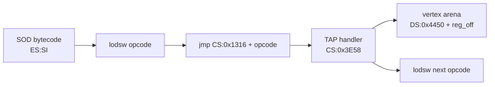
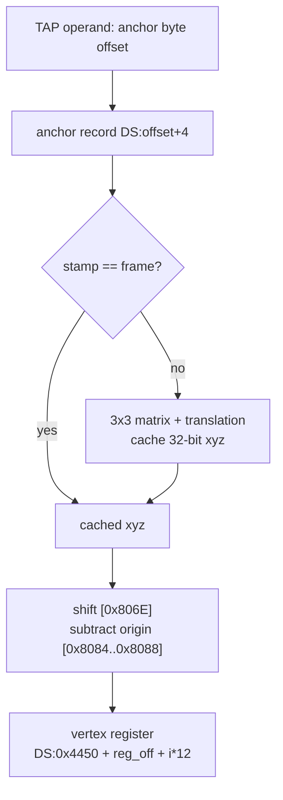

# `PLAYONE.EXE`: SOD Display-List VM & `OP_TAP` Semantics

* **Binary**: `PLAYONE.EXE` (LZEXE 0.91; unpacked EXE 201,548 bytes, i.e. the 200,524-byte load image plus its 1,024-byte MZ header)
* **Method**: DOSBox-X `MEMDUMPBIN` of the unpacked image after the LOAD FILM dialog settles; Capstone 16-bit disassembly
* **Scope**: `OP_TAP` (`0x022E`) operand encoding and register side effects; the general VM execution model (section 8)
* **Anchor**: `# [FMT-SOD-TAP]`, `# [MEM-SOD-VM]`

Runtime segments in the captured session: `CS = 0x0F17`, `DS = 0x1575` for the main data segment, and a fixed display-list work segment at `0x1DF8` holding both the anchor table and the 1024-entry vertex register arena. The memory image was dumped starting at segment `0x0D51`.

---

## 1. Dispatch

The VM does not compare opcodes one by one. A dispatch table at `CS:0x1316` contains a 3-byte near jump at every opcode value multiple of 9. The TAP entry sits at `CS:0x1316 + 0x022E = CS:0x1544` and jumps to `CS:0x3E58`.

The table is a run of 108 nine-byte slots at load-image offset `0x8240`, which is paragraph `0x824` (runtime `0x1048` in the `CTRY.FLM` session). The 6 bytes before each jump aren't padding: they're `26 C7 44 FE imm16`, `mov word es:[si-2], imm16`, and for every slot `imm16 + 0x8240` equals the jump target. The VM runs with `CS` = paragraph `0x824`, so an opcode word is the offset of its slot. The first time a slot runs, it overwrites the opcode word in the stream with its handler's IP, so later passes jump straight to the handler. No separate translation pass exists. In these coordinates the ground handler `0x995C` (op `0x0168`) is `0x171C`, `0x9A24` (op `0x02BE`) is `0x17E4`, and the `SHADES` handler `0x9481` (op `0x0156`) is `0x1241`. The `CS:0x1316` addresses above use the session's `CS = 0x0F17` alias for the same code. `[Established]`, from a byte scan of the unpacked image ([`parity-findings.md`](../parity-findings.md) section 25, "The Dispatch Slots Patch The Stream Themselves").

A 2026 community report, from an AI-assisted reading of a disassembly, says the game generates machine code at load time to draw shapes ([*Vibe-exploring Stunt Island*](https://marnetto.net/2026/04/26/vibe-exploring-si)). `PLAYONE.EXE` generates none: what changes at run time is the bytecode stream, whose opcode words the slots overwrite with handler offsets as described above. The report most likely describes this self-patching. `[Bounded Observation]`; `STUNT.EXE` is unchecked.



`Execution supported by 107 table entries at 9-byte pitch: entry for opcode 0x022E observed as E9 rel16 at CS:0x1544.` `[Established]`

---

## 2. TAP Operand Encoding (`# [FMT-SOD-TAP]`)

```text
OP_TAP (0x022E)
  reg_off : u16      ; byte offset into the 12-byte vertex arena
  count   : u16      ; number of anchor records to copy
  anchors : u16[count]; byte offsets into the 28-byte anchor table
```

The operand width is **variable**: `2 + count` words. The handler reads the first anchor inside the loop and the next bytecode opcode after the final iteration.

```asm
3E58  lodsw                  ; reg_off
3E5A  mov di, 0x4450
3E5D  add di, ax
3E5F  lodsw                  ; count -> [0x41B8]
3E64  lodsw                  ; first anchor offset -> SI
...
3F25  pop si
3F26  add di, 0x0C           ; next vertex register
3F29  dec word [0x41B8]
3F2D  je 3F32
3F2F  jmp 3E64               ; next anchor offset
3F32  lodsw                  ; next opcode
3F34  jmp ax
```

`[Established]`

Corpus evidence (`python` scan of every `.ALL`/`.RES`/`.SOD` chunk):

| Fact | Value |
|---|---|
| Stop sites | 2,413 |
| Unique TAP model payloads | 14 |
| `count` values | 2 and 3 |
| Anchor-offset alignment | every operand is `n * 28` |
| Maximum anchor index | 193 (CTRY hills) |

The ticket's original "operand width is 4 words" holds only for `count = 2`. `CTRY.ALL` chunk `0x0204` in `BOB1.ALL` uses `count = 3`, so a fixed four-word skip desynchronizes the stream.

`[Established]`

---

## 3. Anchor Record Layout

TAP reads a 28-byte record from the display-list work segment (`DS = 0x1DF8` in the captured run):

| Record offset | Type | Meaning |
|---|---|---|
| `+0x00` | `i16` | Raw island X |
| `+0x02` | `i16` | Raw island Y (elevation, non-positive) |
| `+0x04` | `i16` | Raw island Z |
| `+0x06` | `i32` | Cached transformed X (written by TAP) |
| `+0x0A` | `i32` | Cached transformed Y |
| `+0x0E` | `i32` | Cached transformed Z |
| `+0x12` | `u16` | Copied to vertex `+6` (projection/ordering field) |
| `+0x16` | `u16` | Copied to vertex `+8` |
| `+0x1A` | `u8` | Vertex flag copied to `+0xA` |
| `+0x1B` | `u8` | Per-frame transform cache stamp |

TAP operand values point **four bytes before** the record (`record = table + operand + 4`); the table begins with a four-byte header, so record 0 lives at `table + 4` and the first operand is `0`. All corpus operands are `n * 28`.

- The per-frame stamp at `+0x1B` is invalidated by `CS:0x492D`:
  - `mov ax,0x1DF8; mov ds,ax; mov cx,0xE7; mov si,0x1F; loop { [si]=0; si += 0x1C }`
  - 231 records (`0xE7`) confirm the table length and 28-byte stride.
- The runtime table's `x/y/z` match `ANCHORPT.DAT` records at the same indices; 145 of the 150 reachable records matched exactly, and the five mismatches were `y = -32768` sentinels stored as `0`.
- `ANCHORPT.DAT` record layout is `x,y,z,f[11]`; the in-memory record keeps `x/y/z` at `+0/+2/+4` and reuses `f[0..]` as transform/cache scratch.

`[Established]` for layout and cache loop; `[Bounded Observation]` for the source that populates the 231-entry table (embedded in `PLAYONE.EXE` for the demo; retail loading path not disassembled).

---

## 4. Register Side Effects

For each anchor record:

1. If the cached stamp differs from `[0x19A8]` (frame counter), transform the raw point through the current 3×3 matrix at `[0x80C0..0x80CA]`, add translation `[0x41D4..0x41DA]`, cache the 32-bit results at record `+0x06/+0x0A/+0x0E`, and store the stamp.
2. Convert each cached 32-bit component to a 16-bit register value with arithmetic shift `[0x806E]`.
3. Subtract the view-origin words `[0x8084]`, `[0x8086]`, `[0x8088]`.
4. Write `x, y, z` into the 12-byte vertex register `0x4450 + reg_off + i*12`.
5. Write `+6` and `+8` from anchor fields `+0x16`/`+0x1A`, or projected screen coordinates when `[0x8082] == 0x1AB1`; write the record flag to vertex `+0xA`.

The **geometry** effect is therefore: *copy transformed terrain anchor points into the SOD vertex register bank*. Subsequent `POLYZ` reads those registers exactly like `VECTORS`-populated vertices.

`[Established]`



---

## 5. CTRY Hill Models

`CTRY.ALL` chunks `0x0402`–`0x0408` are 14 unique TAP payloads (the seven hills are replicated across the corpus). Example `0x0402`:

| Field | Value |
|---|---|
| Header | `bounding=0x3971`, `yoff=0`, `scale_index=6` |
| TAP | `reg_off=0`, `count=2`, anchors `141`, `157` (`0x0F6C`, `0x112C`) |
| Follow-up | `VECTORS` reg 511 = `(0, -4928, 0)`; `GETV 511; SHLV 1; PUTV 510` |
| Derived vertex | `reg2 = reg1 - reg510` (raises the second anchor by 9,856 units) |
| Emit | `POLYZ 3` over regs `0,1,2` with two `IFVIS` colors |

`0x0204` in `BOB1.ALL` uses `count=3` (anchors `14`, `185`, `193`) and emits four triangles over registers `0`–`3`.

Verdict: TAP is **not** a debug marker and **not** a no-op. It is the terrain-anchor loader used by ground patches.

`[Established]`

---

## 6. HUGETAP

`OP_HUGETAP` (`0x0237`) dispatches to `CS:0x3F36`, which is a single `int3` byte. The demo engine does not implement it. Do not model HUGETAP until a build with a real handler is found.

`[Established]`

---

## 7. Rust Mapping

| Original | Reconstruction |
|---|---|
| 28-byte anchor table | `stunt_core::anchor::AnchorPoint` slice |
| TAP operand loop | `OP_TAP` arm in [`crates/stunt-core/src/sod/vm.rs`](../../crates/stunt-core/src/sod/vm.rs) |
| Work-segment transform/cache | Not modelled; TAP writes `[-x, -y, z]` raw units directly (identity model transform) |
| Vertex arena write | `regs[(reg_off/12 + i) & 1023]` |
| Anchor source | `ANCHORPT.DAT` located by [`crates/stunt-cli/src/scene.rs`](../../crates/stunt-cli/src/scene.rs); raw records supplied to the VM |

Open items:

- Exact fixed-point matrix and shift for non-identity model transforms `[Unknown]`.
- Retail `PLAYONE.EXE` anchor-table population path `[Bounded Observation]`.
- HUGETAP semantics `[Unknown]`.

---

## 8. Execution Model

The VM is a stack-based, register-oriented geometry engine. Opcode semantics and operand widths are in [`formats/sod-opcodes.md`](../formats/sod-opcodes.md); this section holds the state the opcodes act on. Dispatch is section 1. Each claim carries its tier.

### 8.1 Vertex Register Bank

`[Established]` for the 12-byte stride, the 1024-entry arena at `DS:0x4450` and the `x/y/z` words (section 4 step 4). `[Supported Inference]` for the index mask.

- The VM keeps 1024 vertex registers (`regs[0..1023]`). In `PLAYONE.EXE` each is 12 bytes: three signed 16-bit coordinate words plus projection and flag words at `+6`, `+8` and `+0xA` (section 3).
- Bytecode operands address a register by **byte offset** (a multiple of 12). The reconstruction decodes `reg_index = (reg_off / 12) & 1023`; the mask keeps a bad operand inside the bank.
- The reconstruction stores each register as three floating-point metres `[x, y, z]`, scaled by the header scale table ([`sod.md`](../formats/sod.md) section 2); the original holds raw 16-bit units.
- Whether `PLAYONE.EXE` paged the bank or kept it in the work segment is Q-SOD-06 in [`sod.md`](../formats/sod.md). The captured session holds it in the work segment `0x1DF8`.

### 8.2 Vector Accumulator

`[Supported Inference]` — operand semantics from `SOD.H`, FreeFlight and the assembler macros; handlers other than `TAP` are not traced.

The VM keeps one 3D accumulator, `cur_vert = [x, y, z]`, which the vector opcodes read and write:

- `OP_CLRV` zeroes it; `OP_GETV reg` loads `regs[reg]`; `OP_PUTV reg` stores it into `regs[reg]`.
- `OP_ADDV reg` and `OP_SUBV reg` add or subtract `regs[reg]`; `OP_NEGV` negates; `OP_INTV reg` sets it to the midpoint `(cur_vert + regs[reg]) * 0.5`.
- `OP_SHLV n` and `OP_SHRV n` multiply or divide by `2^n`.
- `OP_BLOKADD` and `OP_BLOKNEG` apply the accumulator or a negation across a register range.

The CTRY hill example in section 5 uses this pattern: `GETV 511; SHLV 1; PUTV 510`.

### 8.3 Transform Stack and Subobject Articulation

`[Supported Inference]` — from the assembler macro sources (`SABRE.SOD`, `CURTISS.SOD`) and FreeFlight's `siobj.cpp`; the handlers are not disassembled.

Moving parts (propellers, landing gear, rudders) are subobjects drawn under a hierarchical stack, so they stay attached to the body:

1. `OP_PUSHCENTRE` (`0x007E`) pushes the current rotation origin onto the centre stack.
2. `OP_PUSHRELMAT` (`0x01E6`) pushes the current 3x3 local orientation matrix.
3. `OP_MOVECENTRE reg` (`0x0090`) translates the origin to `regs[reg]`, for example a landing-gear hinge.
4. `OP_ROTX` (`0x02E2`), `OP_ROTY` (`0x01DD`) and `OP_ROTZ` (`0x02EB`) rotate about one axis by a 16-bit BAM angle driven by an animation variable (`undercarriage1`, `rudder`). The si-tools reading of the operand differs ([`sod-opcodes.md`](../formats/sod-opcodes.md) section 3).
5. `OP_GOSUB target` (`0x01A7`) evaluates the articulated subobject geometry (for example `sabre_uc`).
6. `OP_POPRELMAT` (`0x01EF`) restores the parent matrix.
7. `OP_POPCENTRE` (`0x0087`) restores the parent rotation centre.

### 8.4 Control Flow

`[Supported Inference]`

`OP_GOTO` jumps and `OP_GOSUB` calls by a relative word offset; `OP_RETURN` (`OP_END`) ends the list or returns from a subroutine. `OP_SORTON` and the conditional branches `OP_BHID`/`OP_BVIS` (`OP_IFVIS`), `OP_BVLT`, `OP_BVGT` and `OP_BZLT` choose which subtree runs; the visibility and BSP behaviour is in [`sod-opcodes.md`](../formats/sod-opcodes.md) section 2.5. The branch targets are relative, so a walk that mis-sizes one operand desynchronises (see [`sod-opcode-coverage.md`](../formats/sod-opcode-coverage.md) section 4).
