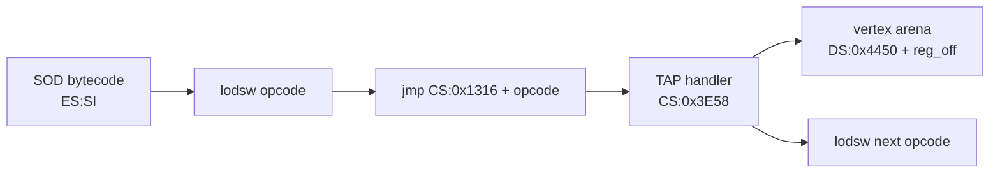
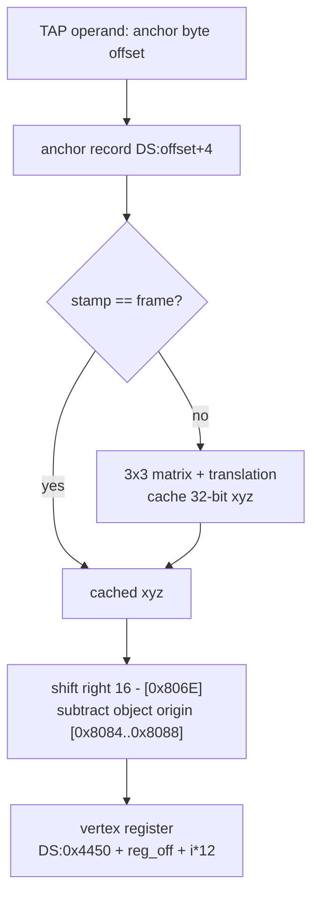

# `PLAYONE.EXE`: SOD Display-List VM & `OP_TAP` Semantics

* **Binary**: `PLAYONE.EXE` (LZEXE 0.91; unpacked EXE 201,548 bytes, i.e. the 200,524-byte load image plus its 1,024-byte MZ header)
* **Method**: DOSBox-X `MEMDUMPBIN` of the unpacked image after the LOAD FILM dialog settles; Capstone 16-bit disassembly
* **Scope**: `OP_TAP` (`0x022E`) operand encoding and register side effects; the general VM execution model (section 8)
* **Anchor**: `# [FMT-SOD-TAP]`, `# [MEM-SOD-VM]`

Runtime segments in the captured session: `CS = 0x0F17`, `DS = 0x1575` for the main data segment, and a fixed display-list work segment at `0x1DF8` holding both the anchor table and the 1024-entry vertex register arena. The memory image was dumped starting at segment `0x0D51`.

---

## 1. Dispatch

The VM does not compare opcodes one by one. A dispatch table at `CS:0x1316` contains a 3-byte near jump at every opcode value multiple of 9. The TAP entry sits at `CS:0x1316 + 0x022E = CS:0x1544` and jumps to `CS:0x3E58`.

The table is a run of 108 nine-byte slots at load-image offset `0x8240`, which is paragraph `0x824` (runtime `0x1048` in the `CTRY.FLM` session). The 6 bytes before each jump aren't padding: they're `26 C7 44 FE imm16`, `mov word es:[si-2], imm16`, and for every slot `imm16 + 0x8240` equals the jump target. The VM runs with `CS` = paragraph `0x824`, so an opcode word is the offset of its slot. The first time a slot runs, it overwrites the opcode word in the stream with its handler's IP, so later passes jump straight to the handler. No separate translation pass exists. In these coordinates the `GVPOLY` handler `0x995C` (op `0x0168`) is `0x171C`, `0x9A24` (op `0x02BE`) is `0x17E4`, and the `SHADES` handler `0x9481` (op `0x0156`) is `0x1241`. The `CS:0x1316` addresses above use the session's `CS = 0x0F17` alias for the same code. `[Established]`, from a byte scan of the unpacked image ([`world-scene.md` § 4](world-scene.md#4-the-dispatch-slots-patch-the-stream-themselves)).

A 2026 community report, from an AI-assisted reading of a disassembly, says the game generates machine code at load time to draw shapes ([*Vibe-exploring Stunt Island*](https://marnetto.net/2026/04/26/vibe-exploring-si)). `PLAYONE.EXE` generates none: what changes at run time is the bytecode stream, whose opcode words the slots overwrite with handler offsets as described above. The report most likely describes this self-patching. `[Bounded Observation]`; `STUNT.EXE` is unchecked.



`Execution supported by 107 table entries at 9-byte pitch: entry for opcode 0x022E observed as E9 rel16 at CS:0x1544.` `[Established]`

---

## 2. TAP Operand Encoding (`# [FMT-SOD-TAP]`)

```text
OP_TAP (0x022E)
  reg_off : u16      ; byte offset into the 12-byte vertex arena
  count   : u16      ; number of anchor records to copy
  anchors : u16[count]; byte offsets into the 28-byte anchor table
```

The operand width is **variable**: `2 + count` words. The handler reads the first anchor inside the loop and the next bytecode opcode after the final iteration.

```asm
3E58  lodsw                  ; reg_off
3E5A  mov di, 0x4450
3E5D  add di, ax
3E5F  lodsw                  ; count -> [0x41B8]
3E64  lodsw                  ; first anchor offset -> SI
...
3F25  pop si
3F26  add di, 0x0C           ; next vertex register
3F29  dec word [0x41B8]
3F2D  je 3F32
3F2F  jmp 3E64               ; next anchor offset
3F32  lodsw                  ; next opcode
3F34  jmp ax
```

`[Established]`

Corpus evidence (`python` scan of every `.ALL`/`.RES`/`.SOD` chunk):

| Fact | Value |
|---|---|
| Stop sites | 2,413 |
| Unique TAP model payloads | 14 |
| `count` values | 2 and 3 |
| Anchor-offset alignment | every operand is `n * 28` |
| Maximum anchor index | 193 (CTRY hills) |

The ticket's original "operand width is 4 words" holds only for `count = 2`. `CTRY.ALL` chunk `0x0204` in `BOB1.ALL` uses `count = 3`, so a fixed four-word skip desynchronizes the stream.

`[Established]`

---

## 3. Anchor Record Layout

TAP reads a 28-byte record from the display-list work segment (`DS = 0x1DF8` in the captured run):

| Record offset | Type | Meaning |
|---|---|---|
| `+0x00` | `i16` | Raw island X |
| `+0x02` | `i16` | Raw island Y (elevation, non-positive) |
| `+0x04` | `i16` | Raw island Z |
| `+0x06` | `i32` | Cached transformed X (written by TAP) |
| `+0x0A` | `i32` | Cached transformed Y |
| `+0x0E` | `i32` | Cached transformed Z |
| `+0x12` | `u16` | Copied to vertex `+6` (projection/ordering field) |
| `+0x16` | `u16` | Copied to vertex `+8` |
| `+0x1A` | `u8` | Vertex flag copied to `+0xA` |
| `+0x1B` | `u8` | Per-frame transform cache stamp |

TAP operand values point **four bytes before** the record (`record = table + operand + 4`); the table begins with a four-byte header, so record 0 lives at `table + 4` and the first operand is `0`. All corpus operands are `n * 28`.

- The per-frame stamp at `+0x1B` is invalidated by `CS:0x492D`:
  - `mov ax,0x1DF8; mov ds,ax; mov cx,0xE7; mov si,0x1F; loop { [si]=0; si += 0x1C }`
  - 231 records (`0xE7`) confirm the table length and 28-byte stride.
- The runtime table's `x/y/z` match `ANCHORPT.DAT` records at the same indices; 145 of the 150 reachable records matched exactly, and the five mismatches were `y = -32768` sentinels stored as `0`.
- `ANCHORPT.DAT` record layout is `x,y,z,f[11]`; the in-memory record keeps `x/y/z` at `+0/+2/+4` and reuses `f[0..]` as transform/cache scratch.

`[Established]` for layout and cache loop; `[Bounded Observation]` for the source that populates the 231-entry table (embedded in `PLAYONE.EXE` for the demo; retail loading path not disassembled).

---

## 4. Register Side Effects

For each anchor record (handler image `0xAD88`, transform `0xAE67`):

1. If the cached stamp `+0x1B` differs from `[0x19A8]` (frame counter), transform the raw point through the 3×3 matrix at `[0x80C0..0x80CA]`, add the translation `[0x41D4..0x41DA]`, cache the 32-bit results at record `+0x06/+0x0A/+0x0E`, and store the stamp.
2. Shift each cached 32-bit component right by `16 - [0x806E]` to a 16-bit value (`0xADAC..0xADF1`).
3. Subtract the object's origin words `[0x8084]`, `[0x8086]`, `[0x8088]`.
4. Write `x, y, z` into the 12-byte vertex register `0x4450 + reg_off + i*12`.
5. Write `+6` and `+8` from anchor fields `+0x16`/`+0x1A`, or projected screen coordinates when `[0x8082] == 0x1AB1`; write the record flag to vertex `+0xA`.

`[Established]` for the instructions. What the words hold is read from their writers. The scene walk normalises the object's 32-bit view position at `0x31CF`, which returns 16-bit words and the shift `CL`. `0x21B2..0x21BC` stores those words, rotated by `0x0824:06B0`, at `[0x8084..0x8088]`. The light setup `0x9100`, called from `0x21F9`, stores that `CL` at `[0x806E]` (`0x9113`). So a register holds the anchor's view-space position less the object's origin, in the units that origin was shifted to. Vertices loaded by `VECTORS` share those units. The cache is one per frame and shared by every object: anchors 156, 157 and 160 are each tapped by two shapes (section 5). So `0x80C0` and `0x41D4` must be the camera's rotation and translation, not an object's (`[Supported Inference]`).

The **geometry** effect is therefore: *load a terrain anchor point, relative to the shape's own origin, into the SOD vertex register bank*. `[Supported Inference]` for the units: that `[0x806E]` and the header's `scale_index` (`[es:8]`, taken into `CH` at `0x21D8` and kept as `[0x806F]`) put tapped and `VECTORS` points in one unit is read from the two writers, not from a trace. On that reading, in the shape's frame, an unrotated scenery shape placed at `p` and lifted by `ground_y_offset >> scale_index` gets `(anchor - p) << scale_index - ground_y_offset`. Its tapped points then land on the anchors wherever it is placed. A point the stream builds from the origin itself, such as `CLRV; PUTV` or `CLRV; SUBV 0`, depends on the placement. Subsequent `POLYZ` reads those registers exactly like `VECTORS`-populated vertices.

_Source: [2026-11-11: how OP_TAP places its points](../../work/2026-11/254_tap-anchors/journal.md#2026-11-11-how-op_tap-places-its-points)._



---

## 5. Hill Fins

`CTRY.ALL` chunks `0x0202`–`0x0208` and `0x0402`–`0x0408` are the 14 TAP shapes (`SCENERY1.RES` and `SCENERY3.RES` #0–6, replicated across the corpus). Example `0x0402`:

| Field | Value |
|---|---|
| Header | `bounding=0x3971`, `yoff=0`, `scale_index=6` |
| TAP | `reg_off=0`, `count=2`, anchors `141`, `157` (`0x0F6C`, `0x112C`) |
| Follow-up | `VECTORS` reg 511 = `(0, -4928, 0)`; `GETV 511; SHLV 1; PUTV 510` |
| Derived vertex | `reg2 = reg1 - reg510`: 9,856 units, 154 m at scale 6, below the second anchor |
| Emit | `POLYZ 3` over regs `0,1,2`, one colour per side (`REJ`, `IFVIS 0` / `IFVIS 1`) |

`0x0204` uses `count=3` (anchors `14`, `185`, `193`) and emits four triangles over registers `0`–`3`, the fourth register being the origin (`CLRV; PUTV`).

`[Established]` for the streams and anchors, `[Bounded Observation]` for the shapes they make. Each was resolved as section 4 describes, at the image tree's one placement of it. Thirteen of the 14 are one vertical triangle each, from an anchor at sea level up to a ridge anchor 58 to 293 m high, with the third corner within 1 m of sea level. On the seven `0x04xx` fins the third corner is directly under the ridge anchor, at the same plan position. On the six `0x02xx` triangles it lies in plan on the line between the two anchors. `0x0204` is the exception: four triangles over anchors at 0, 115 and 148 m and its origin at sea level. The ridge and foot anchors of each `0x04xx` fin are corners of the same `MAP.BIN` hill patches. `0x0402` and `0x0406` take anchors 141–157–158 (peak 155 m), shared by patches 109, 110, 113 and 114. `0x0403`/`0x0407` take 154–156–159 (196 m), `0x0404`/`0x0408` take 155–160–161 (293 m), and `0x0405` takes 149–151 (82 m). Their colours, `0xC0`–`0xC6`, are the colours of the hill patches on those anchors (192–198).

Verdict: TAP is **not** a debug marker and **not** a no-op. It loads terrain anchors. The shapes that use it are vertical fins standing in the hills, not ground patches or airfield tiles.

_Source: [2026-11-11: what the 14 TAP shapes are](../../work/2026-11/254_tap-anchors/journal.md#2026-11-11-what-the-14-tap-shapes-are)._

---

## 6. HUGETAP

`OP_HUGETAP` (`0x0237`) dispatches to `CS:0x3F36`, which is a single `int3` byte. The demo engine does not implement it. Do not model HUGETAP until a build with a real handler is found.

`[Established]`

---

## 7. Rust Mapping

| Original | Reconstruction |
|---|---|
| 28-byte anchor table | `stunt_core::anchor::AnchorPoint` slice |
| TAP operand loop | `OP_TAP` arm in [`crates/stunt-core/src/sod/vm.rs`](../../crates/stunt-core/src/sod/vm.rs) |
| Work-segment transform/cache | Not modelled. TAP writes the anchor's `[-x, -y, z]` in shape units, less the header lift; `world/mod.rs` decodes each TAP shape again against the table shifted by its placement (`anchored_models`) |
| Vertex arena write | `regs[(reg_off/12 + i) & 1023]` |
| Anchor source | `ANCHORPT.DAT` located by [`crates/stunt-cli/src/scene.rs`](../../crates/stunt-cli/src/scene.rs); raw records supplied to the VM |

Open items:

- A rotated TAP shape: `vm.rs` loads the anchor unrotated, which holds only for scenery, whose draw matrix is the view matrix alone ([`memory-map.md`](memory-map.md) `0x808A`).
- Retail `PLAYONE.EXE` anchor-table population path `[Bounded Observation]`.
- HUGETAP semantics `[Unknown]`.

---

## 8. Execution Model

The VM is a stack-based, register-oriented geometry engine. Opcode semantics and operand widths are in [`formats/sod-opcodes.md`](../formats/sod-opcodes.md); this section holds the state the opcodes act on. Dispatch is section 1. Each claim carries its tier.

### 8.1 Vertex Register Bank

`[Established]` for the 12-byte stride, the 1024-entry arena at `DS:0x4450` and the `x/y/z` words (section 4 step 4). `[Supported Inference]` for the index mask.

- The VM keeps 1024 vertex registers (`regs[0..1023]`). In `PLAYONE.EXE` each is 12 bytes: three signed 16-bit coordinate words plus projection and flag words at `+6`, `+8` and `+0xA` (section 3).
- Bytecode operands address a register by **byte offset** (a multiple of 12). The reconstruction decodes `reg_index = (reg_off / 12) & 1023`; the mask keeps a bad operand inside the bank.
- The reconstruction stores each register as three floating-point metres `[x, y, z]`, scaled by the header scale table ([`sod.md`](../formats/sod.md) section 2); the original holds raw 16-bit units.
- Whether `PLAYONE.EXE` paged the bank or kept it in the work segment is Q-SOD-06 in [`sod.md`](../formats/sod.md). The captured session holds it in the work segment `0x1DF8`.

### 8.2 Vector Accumulator

`[Supported Inference]` — operand semantics from `SOD.H`, FreeFlight and the assembler macros; handlers other than `TAP` are not traced.

The VM keeps one 3D accumulator, `cur_vert = [x, y, z]`, which the vector opcodes read and write:

- `OP_CLRV` zeroes it; `OP_GETV reg` loads `regs[reg]`; `OP_PUTV reg` stores it into `regs[reg]`.
- `OP_ADDV reg` and `OP_SUBV reg` add or subtract `regs[reg]`; `OP_NEGV` negates; `OP_INTV reg` sets it to the midpoint `(cur_vert + regs[reg]) * 0.5`.
- `OP_SHLV n` and `OP_SHRV n` multiply or divide by `2^n`.
- `OP_BLOKADD` and `OP_BLOKNEG` apply the accumulator or a negation across a register range.

The CTRY hill example in section 5 uses this pattern: `GETV 511; SHLV 1; PUTV 510`.

### 8.3 Transform Stack and Subobject Articulation

`[Supported Inference]` — from the assembler macro sources (`SABRE.SOD`, `CURTISS.SOD`) and FreeFlight's `siobj.cpp`; the handlers are not disassembled.

Moving parts (propellers, landing gear, rudders) are subobjects drawn under a hierarchical stack, so they stay attached to the body:

1. `OP_PUSHCENTRE` (`0x007E`) pushes the current rotation origin onto the centre stack.
2. `OP_PUSHRELMAT` (`0x01E6`) pushes the current 3x3 local orientation matrix.
3. `OP_MOVECENTRE reg` (`0x0090`) translates the origin to `regs[reg]`, for example a landing-gear hinge.
4. `OP_ROTX` (`0x02E2`), `OP_ROTY` (`0x01DD`) and `OP_ROTZ` (`0x02EB`) rotate about one axis by a 16-bit BAM angle driven by an animation variable (`undercarriage1`, `rudder`). The si-tools reading of the operand differs ([`sod-opcodes.md`](../formats/sod-opcodes.md) section 3).
5. `OP_GOSUB target` (`0x01A7`) evaluates the articulated subobject geometry (for example `sabre_uc`).
6. `OP_POPRELMAT` (`0x01EF`) restores the parent matrix.
7. `OP_POPCENTRE` (`0x0087`) restores the parent rotation centre.

### 8.4 Control Flow

`[Supported Inference]`

`OP_GOTO` jumps and `OP_GOSUB` calls by a relative word offset; `OP_RETURN` (`OP_END`) ends the list or returns from a subroutine. `OP_SORTON` and the conditional branches `OP_IFVIS`/`OP_BVIS`, `OP_BVLT`, `OP_BVGT` and `OP_BZLT` choose which subtree runs; the visibility and BSP behaviour is in [`sod-opcodes.md`](../formats/sod-opcodes.md) section 2.5. The branch targets are relative, so a walk that mis-sizes one operand desynchronises (see [`sod-opcode-coverage.md`](../formats/sod-opcode-coverage.md) section 4).

### 8.5 Polygon Colour at `SHADE` Time

`[Hypothesis]` for the `SHADE*` level law, static and read once; `[Supported Inference]` for the light, measured below. Polygon colour is a running word at `[0x41E8]` that `OP_COLOR` and the four shade opcodes all write. `SHADE1` (`0x0144`), `SHADE2` (`0x014D`), `SHADE16` (`0x02B5`) and `SHADE216` (`0x02C7`) take `norm, base` (handlers at image `0xA526`, `0xA519`, `0xA550`, `0xA55D`, shared tail `0xA52F`): they load `s = word[0x7468 + norm]`, the per-normal shade that `SHADES` (`0x9481`) wrote as `-clamp(N.L >> 16)`, halve it (twice for the 16-level forms; the `2` forms negate it first), and store `base + max(0, (s >> 8) + adj)`, with `adj = -2` when `base == 0x10`. `base` is a ramp start: in the `INTRO.FLM` palette `0x10` is red 16..29, `0x30` grey 48..53, `0x40` brown 64..79, the ramps the capture's triplane uses. FreeFlight discards the operands and paints with the last `OP_COLOR`. The light vector `L` is passed in registers to the display-list entry `0x9100` by its caller: scenery gets the world light `DS:0x49EC..0x49F0` unchanged, a rotated object that light turned by its rotation and the view and doubled (caller `0x1CFB`; [`terrain-shade.md`](terrain-shade.md) section 4.2). `GVPOLY`/`GVPOLY16` give each vertex its own index, which the filler interpolates (below). Their word after the register list is `(ramp_base << 8) | count` (`0x3004` in `CTRY.FLM`'s `0x7F37`, `0x1004` on the triplane), not a normal register, and `count` shade offsets into the `SHADES` words follow, one per vertex (2026-11-01, `[Hypothesis]` from the stream shape; the handlers `0x995C` and `0x9A24` are disassembled for the index they compose, [`terrain-shade.md`](terrain-shade.md) section 5, but not traced for how they read these operands). The renderer first painted each such polygon flat at `base` plus the mean of its vertices' levels: grey-ramp pixels moved toward the capture's (`CTRY` 3.7k -> 33.8k against 52.4k, `INTRO` 120k -> 44.5k against 49.8k) but SSIM did not rise ([parity log](../../work/2026-10/parity-log/log.md)).

**The light** (2026-11-05, [#221](https://github.com/neilsh/stunt-reel/issues/221)). `SHADES` dots `L` with the shape's raw normal words, and an unrotated object is handed the world light as stored, so `L` is in the raw model frame and needs no game-to-`[I1]` axis mapping: the decoder keeps the normals in that frame too. The mapping is derived, not chosen by score. The decoded model frame is +Y up ([`coordinates-and-units.md` § 1.2](../formats/concepts/coordinates-and-units.md#12-right-handed-metric-basis-i1)), so `(99, 32766, -17)` points up, and `s = -(N . L)` leaves an upward face at its ramp base and lifts a downward one. The old stand-in `SHADE_LIGHT = (0, -32767, 0)` had the opposite sign. Both films set film variable 13 to `0x2D` at tick 0 (`mise run flm-events`), the value `0x196C` was seen with on both, so both get `(99, 32766, -17)` ([`ShadeLight`](../../crates/stunt-core/src/sod/light.rs)); how `0x196C` maps other values is open ([`terrain-shade.md`](terrain-shade.md), open question 1). Measured with `DBG_SHADE_LIGHT`, all shapes decoded under one light: the stand-in 0.8646 / 0.7986 (CTRY / INTRO), the world light 0.8641 / 0.8128, its negation `(-99, -32766, 17)` and the 180-degree-about-Z form `(-99, -32766, -17)` both 0.8646 / 0.7986 (the 99 and 17 move no shade across a ramp step, so only the sign of y matters). The world light for scenery with the stand-in for actors scored 0.8646 / 0.7986 exactly: no scenery shade that reaches the screen moves, and the whole gain is on the aircraft. Actors are therefore decoded under the world light unrotated, the light `PLAYONE` would hand a level, unrotated object. Their own light turns with their rotation and the view every frame, and shapes are decoded once, so it is not modelled.

**Interpolation.** The `GVPOLY` handlers write `(index << 8) | fraction` per vertex and the filler `0x75DB` interpolates it linearly in screen space ([`terrain-shade.md`](terrain-shade.md) sections 5-6). The renderer now gives each vertex its own index (`base` plus that vertex's level, the fraction dropped) and interpolates it in screen space (`@interpolate(linear)`), rounding to a whole index per fragment (`[I3]`): CTRY 0.8641 -> 0.8642, INTRO 0.8128 -> 0.8166 (`DBG_GVPOLY_INTERP`). Rounding stands in for the dropped fraction: `PLAYONE` floors the interpolated 8.8 value, and an average fraction of one half makes that a rounding of the whole indices.

Before the ramp word was read, `INTRO.FLM` tick 1009 drew the triplane's fuselage grey and its wings bright pink where the capture has a red fuselage and dark red wings (capture above, ours below): [`intro-1009-gvpoly-running-colour.png`](../../work/2026-11/aircraft-render/images/intro-1009-gvpoly-running-colour.png).

_Found 2026-11-01 by the aircraft render round 2; see the [parity log](../../work/2026-10/parity-log/log.md)._

---

### 8.6 Facing Flags: `OP_REJ` and `OP_IFVIS`

`[Established]` for the instruction sequences, static, read from `build/re/playone.img` with iced-x86 (2026-11-05, [#74](https://github.com/neilsh/stunt-reel/issues/74)); nothing observed live. `OP_IFVIS` is not a level-of-detail gate. Its first operand is the byte offset of a facing flag in `work:0x7C68`, one byte per face, which three earlier opcodes write from the vertex registers. The section runs while its face points at the eye.

| Opcode | Handler | Reads | Does |
|---|---|---|---|
| `0x017A` `OP_IFVIS` | `0x9BCC` | `flag, size` | `cmp byte [flag + 0x7C68], 0`: nonzero runs the section, zero skips `size` bytes from the size word. |
| `0x0183` `OP_BVIS` | `0x9BB3` | `flag, size` | The inverse: zero runs the section. |
| `0x01B9` `REJ` | `0x9567` | `first, count, count × (a, b, c)` | Normal `n = (a - b) × (c - b)` (`0xB621`, registers at `work:0x4450 + reg`), then `n · (b + o)`, `o` the words at `work:0x8084..0x8088` (read as the object's origin relative to the eye, `[Supported Inference]`: the sign measurement below fits it); flag `first + i` = `0xFF` when negative (`shl dx, 1; sbb al, al`), else 0. |
| `0x01B0` `REJVEC` | `0x94D8` | `first, count, count × (p, b, e)` | The same flag from `(e - b) · (p + o)`, the normal given as two registers; the z term is scaled by `work:0x810A` and the x, y terms shifted by `work:0x810C`. |
| `0x01C2` `REJ2D` | `0x95C0` | `first, count, count × (a, b, c)` | The flag from the sign of the 2D cross product of the projected points (`+6`, `+8` of each register): the screen winding. |
| `0x0318` `BZLT` | `0x9BE5` | `reg, val, size` | `cmp [reg + 0x4454], (val >> work:0x806F) - work:0x8088` (signed, `jg`): a register depth `z` with `z + work:0x8088` above `val >> work:0x806F` runs the section, otherwise it skips `size` bytes from the size word. |

`SORTON` (`0x9183`) reads the same table (`js` on the flag byte) to order its two branches. The renderer keeps each `REJ` face as `VisibilityCondition::FacesEye { point: b, normal: n }` in model space and draws the section while `n · (b - eye) < 0`, with the eye taken into each actor's space, and into the world's for scenery props, every frame. Measured 2026-11-05 ([parity log](../../work/2026-10/parity-log/log.md)): CTRY 0.8645 -> 0.8646, INTRO 0.7973 -> 0.7986; the opposite sign gives 0.8061 / 0.7366, which fixes the sign. The old reading (condition 1 as `D^2 <= 1000 m^2`, everything else drawn) had no binary basis.

The in-shape depth gate is `BZLT` (`0x0318`, handler `0x9BE5`), not `IFVIS`: it reads `reg, val, size` and skips `size` bytes when the register's view depth `z + work:0x8088` is at most `val >> work:0x806F`, so its section is drawn only when far. The census once stepped over it by 2 words, one short.

**The rest of the gates in `vm.rs`** (2026-11-12, [#235](https://github.com/neilsh/stunt-reel/issues/235)). `[Established]` for the instruction sequences above, static, read from `build/re/playone.img` with `mise run disasm`; the five gate handlers (`BVIS`, `IFVIS`, `BZLT`, `REJVEC`, `REJ2D`) occur byte for byte in the Patch #3 image the references ran (at `0x8DBE`, `0x8DD7`, `0x8DF0`, `0x87CF`, `0x88B7`). How each becomes a gate:

* **Sections end `size` bytes from the size word.** All three skip with `add si, [es:si]` while `SI` points at the size word (`0x9BBE`, `0x9BD7`, `0x9BFB`). `vm.rs` counted from the word after it, one word late, so the opcode at the true end was still gated. A section that starts inside another pushes the outer gate, which comes back when the inner section ends; a polygon in the inner section takes the inner gate only, since a mesh node carries one condition.
* **`BVIS`** is the `IFVIS` gate with the face's normal negated: the section draws while the face points away. A flag the shape never set leaves the section ungated, as for `IFVIS`.
* **`REJ2D`** is the `REJ` gate of the same triple. The handler computes `P2 − P1` with `P1 = (a.x − b.x)(b.y − c.y)` and `P2 = (a.y − b.y)(b.x − c.x)` on the projected points, flag set when negative, so when `cross2(a − b, c − b) < 0` on screen. The projector (`0x9CF1`) stores `(x + o.x) · 256 / (z + o.z)` and the same for y, with no sign change. For points in front of the eye, that screen sign equals the sign of `((a − b) × (c − b)) · b` in view space, the `REJ` test. `[Supported Inference]`: the equality is algebra on the handlers. For a triple with a point behind the eye the two can differ, and the renderer keeps the `REJ` form.
* **`REJVEC`** sets `FacesEye { point: p, normal: e − b }`. Registers carry the lens zoom: x and y scaled by `m = work:0x8108 / 0x8000`, z shifted right by `c = work:0x810C`. The handler shifts the x and y products right by `2c` (`shl cx, 1` at `0x9524`) and multiplies the z product's point term by `work:0x810A = m² · 0x8000` (`0x953F`). Each term is then the unzoomed product times `m² / 2^(2c)`, so the sign is that of the model-space `(e − b) · (p − eye)`. `[Supported Inference]` for the unit reading.
* **`BZLT`** sets `VisibilityCondition::BeyondDepth { point: reg, depth: val × scale }`, with `scale` the shape's metres per raw unit. The vertex loaders store each register as the high word of the Q15 matrix product, shifted right by `work:0x806F` (section 8.7). That is half the rotated raw coordinate, and the zoomed depth row also shifts it right by `c`. `0x806F` is `CH − CL` from the object entry (`0x9111..0x9113`): the header's scale shift less the view-position shift. The origin word `0x8088` is in the same register units. So the compare is, to rounding, `true depth / 2^(1 + c) ≤ val × scale` in metres, the same halving and lens shift as the `SP_1NODE` gate ([`lod.md`](lod.md) section 2.2). The renderer tests it per frame with [`CameraTransform::view_depth_exceeds`](../../crates/stunt-core/src/contracts/trajectory.rs), from the view taken into the model's space for actors and view-facing props and the world's for gated scenery props. `[Supported Inference]` for the units: they are read from the loaders and the entry, and no `BZLT` was traced live.

**No census walk reaches any of them.** On the `sod-census` walk of the corpus's 3,703 unique models, which follows `SORTON`, `GOTO`, `GOSUB` and, with a temporary switch, both arms of every `BVGT`, no walk reaches `BZLT`, `BVIS`, `REJVEC` or `REJ2D`. With the corrected end, no section starts inside another. No drawing opcode stands at any section's true end. The words there are 102,536 `IFVIS`, 13,845 `RETURN`, 3,070 `SORTON`, 713 `LINECOL`, 79 `COLOR`, 37 `PUSHCENTRE`, 36 `BVGT`, 31 `IPG`, 24 `MOVETO`, 3 `GOSUB` and one `0x0333`. No opcode at a true end draws by itself, though the targets of the 3 `GOSUB` and 36 `BVGT` there were not checked, and `0x0333` is not decoded. A sweep of the old end against the corrected one scored the seven reference films identically to four decimals. `[Bounded Observation]` for this walk: `BVLT`'s branch is not followed, and code no branch reaches is not walked. A raw byte scan for `0x0318` finds hundreds of matches in the `.RES` files, but they are register offsets, since `0x0318` is register 66, not opcodes. So, on the paths the census walks, the props loss the seven reference films measure ([`attribution.md`](../parity/attribution.md) section 2) does not come from `BZLT`, `BVIS`, `REJVEC` or `REJ2D`. A gate behind a `BVLT` branch or in code no branch reaches is not covered.

_Source: [the gate handlers](../../work/2026-11/235_sod-gates/journal.md#2026-11-12-the-gate-handlers), [which stock shapes reach the gates](../../work/2026-11/235_sod-gates/journal.md#2026-11-12-which-stock-shapes-reach-the-gates), [scoring the section end](../../work/2026-11/235_sod-gates/journal.md#2026-11-12-scoring-the-section-end-and-the-gates)._

_Found 2026-11-05 for [#74](https://github.com/neilsh/stunt-reel/issues/74); see the [parity log](../../work/2026-10/parity-log/log.md)._

### 8.7 Model Frame: Cube Corners and `OP_VECTORS`

`[Established]` for the instruction sequences, static, read from `build/re/playone.img` with Capstone (2026-11-06); nothing observed live. `[Supported Inference]` that this is why stock shapes decoded upside down, from the shape census and the sweep below.

Both vertex loaders store `M · v` into a register, with `M` the 3×3 matrix at `work:0x808A` (three words a row) and the sum shifted right by `work:0x806F`:

| Handler | Image offset | Stores |
|---|---|---|
| `OP_VECTORS` (`0x0075`) | `0x9C51` | `count` stream vectors into consecutive registers, each `M · (x, y, z)` with the stream's own signs. |
| `OP_IPG` type 0, cube (`dx, dy, dz, reg`) | `0x965F` calls the word table at `work:0x1954` (type 0: VM `0x3035`, image `0xB275`) | Corners `reg + 0..7` = `M ·` `(+dx, +dy, −dz)`, `(+dx, +dy, +dz)`, `(−dx, +dy, +dz)`, `(−dx, +dy, −dz)`, `(+dx, −dy, −dz)`, `(+dx, −dy, +dz)`, `(−dx, −dy, +dz)`, `(−dx, −dy, −dz)`. It computes four and writes each one's negation as its antipode. |

`vm.rs` writes the cube as PLAYONE's turned half a turn about z (every corner with x and y negated), and its `TAP` writes `(−x, −y, z)`. So the reconstruction's model frame is the raw frame turned 180 degrees about z, which puts the shapes' raw −y, up in their authoring, at `[I1]` +y. `OP_VECTORS` was the exception: it stored `(x, y, z)` unturned. A shape that adds `OP_VECTORS` deltas to cube corners then decodes with those parts turned over, and one built from `OP_VECTORS` alone decodes wholly upside down. That is the "construction delta" correlate in [`hero-aircraft-orientation.md`](../parity/hero-aircraft-orientation.md) section 1.

**Adopted: `OP_VECTORS` turned the same way** (store `(−x, −y, z)`; measured first with the temporary switch `DBG_VECNEG`):

* **Aircraft.** All 14 inverted stock `0x7Fxx` aircraft stand upright, as do the two unclear ones (`0x7F18`, `0x7F21`); the 9 that were upright, and the `OP_IPG`-led aircraft, are unchanged.
* **Every other shape.** Of the 397 stock shapes holding the word `0x0075`, 229 export different geometry; the rest are unchanged, and 19 export nothing either way (terrain patches without anchors, empty shapes). In side views, none turns over and many are righted: the masts of the sailing ships `0x4114`..`0x4117`, `0x414D`, `0x414E` and `0x4153` (below the hull before), the conning tower of `0x3E19`, the antennas of `0x3D47`/`0x3D48`, the wheels of trucks and tanks, and the sign `0x063D`, which now reads "STUNT / ISLAND" top to bottom.
* **Parity** (sweep, RTX 4070): `CTRY.FLM` 0.8725 → 0.8986, `INTRO.FLM` 0.8273 → 0.8337, IoU unchanged. At `CTRY` tick 499 the biplane matches the capture, wing stripes included, which the hand-picked mirror culled ([log row](../../work/2026-10/parity-log/log.md)).

Section 8.5's light needs no change: `SHADES` dots the raw-frame light with the raw normal words, which this turn does not touch. `REJ` takes its points from registers, so it follows them.

**Ruled out: a per-shape term in the draw path.** The actor entry (`0x1C00` → `0x1CFB`) builds its matrix from the slot's three angles at `+0x10/+0x12/+0x14` (`0x04E5`) and the view (`0x060A`) alone. `0x1D5F` hands the VM only slot `+0x16` (stored at `work:0x8124`) and the shape fetched by `0x4C41`, a cache lookup with no transform.

**The `ROT*` angle bank.** `ROTZ` (`0xA807`), `ROTX` (`0xA8F3`) and `ROTY` (`0xA906`) take their angle from the word at `work:0x810E + operand` and skip a zero. The draw path fills that bank: operand `0x16` is slot `+0x16` (`0x1D5F`), and `0x10`..`0x1A` are the words `0x1D96` derives from film variables 10 and 12 ([`palette-fade.md`](palette-fade.md)). The stock aircraft use `0x14`, `(var 10 & 0xFF) << 8`, with `ROTZ` on propellers, and `0x18`/`0x1A`, `±var 12`, with `ROTX` and `ROTZ`. `PUSHRELMAT` (`0xA99A`) pushes the nine words at `0x808A` and the translation at `0x8072..0x8076`; `POPRELMAT` (`0xA9B8`) restores them. `vm.rs` holds every angle at zero ([#271](https://github.com/neilsh/stunt-reel/issues/271)).

_Found 2026-11-06; see the [parity log](../../work/2026-10/parity-log/log.md)._

### 8.8 Model Frame: the Other Generators

`[Established]` for the instruction sequences, static, read from the unpatched load image with `mise run vm-handler` and `mise run disasm` (2026-11-11, [#272](https://github.com/neilsh/stunt-reel/issues/272)); nothing observed live. `OP_IPG` (`0x965F`) reads its type word and calls the word table at `work:0x1954` with `BX` = the type. Each quad handler reads `a, b, reg`, computes two corners as `M · v` (section 8.7) and writes each one's negation as its opposite corner, as the cube does. `vm.rs` stores every corner turned half a turn about z, `(−x, −y, z)`, the frame of section 8.7.

| Generator | Handler (image) | Stream operands | Writes (raw, before the turn) | `vm.rs` |
|---|---|---|---|---|
| `OP_IPG` type 2, ground quad | `0xB41E` (VM `0x31DE`) | `a, b, reg` | `reg + 0..3` = `(+a, 0, −b)`, `(+a, 0, +b)`, `(−a, 0, +b)`, `(−a, 0, −b)`: the order of the cube's corners 0..3 | matches |
| `OP_IPG` type 8, vertical quad | `0xB4B5` (VM `0x3275`) | `a, b, reg` | `reg + 0..3` = `(+a, +b, 0)`, `(−a, +b, 0)`, `(−a, −b, 0)`, `(+a, −b, 0)` | fixed: corners 1 and 3 were swapped, the reverse winding |
| `OP_IPG` type 4, object bucket | `0xB54C` (VM `0x330C`) | `w` | No register. When the head `DGROUP:0x2346 + w` is nonzero it saves the 23-word block at `work:0x806E` (shift, translation, matrix), hands that pending-object list to the walker `0x1B75` ([`lod.md`](lod.md)) and restores the block. | matches (one word, no effect) |
| `OP_IPG` type 6, streamer | `0xB58D` (VM `0x334D`) | none | Registers 4..10, whatever the stream says: point `i` (0..6) is `(M · (x_i, 0, 2(i + 1)) >> work:0x806F) + (BX, DX, BP)`, the CPU registers it was entered with (`BX` = 6 from `0x965F`; `DX`, `BP` left by the previous handler). `x_i = (sin(p + (i + 1) · 0x1000) / 2 − sin(p) / 2) / 2` from the table at `work:0x19AA`, phase `p = (DGROUP:0x22B8 & 0x3F) << 10`, one turn per 64 ticks. | fixed: it read two words; the registers are not written (open question) |
| `OP_SPHERE` | `0x9DB5` | `reg, radius` | No register. Unless the register's flag byte (`+0x0A`) is set, it passes the register's projected point and the screen radius `((radius · work:0x8070) >> 8) / (z + work:0x8088)` to `0xCF39`, then to the flat filler `0x8010`, or plots one pixel (`0x7FFB`) when the radius is 0. No facing test. That `0xCF39` builds a filled circle is `[Supported Inference]` from its inputs. | frame matches (centre from the register); faces fixed, below |
| `OP_PERFDISK` | `0xA040`, operands read by `0xA08E` | `centre_reg, radius, axis_reg` | No register. It skips while the shadow mode `work:0x806C` is set or the centre's depth `z + work:0x8088` is under `0x80`, else builds, from the centre, `(radius · work:0x8070) >> 16` and the normal `regs[centre] − regs[axis]`, a quadratic form that it hands to the flat filler `0x8010`: the screen outline of a disc, `[Supported Inference]`. The normal enters the outline's quadratic form only through products of its components, and no branch tests its sign, so the disc draws from both sides (`[Supported Inference]`). | fixed: a 16-gon of `radius` about the centre, perpendicular to the raw normal, one face for each side ([#392](https://github.com/neilsh/stunt-reel/issues/392)); radius scale checked on one `BOMB` disc at ticks 2058 and 2070, below |
| `OP_VEC` (`0x004B`) | none | none | Not a dispatched opcode ([`sod-opcodes.md`](../formats/sod-opcodes.md) § 1): `CS:0x004B` is image `0x828B`, two bytes into slot `0x0048`'s patch store, where the bytes `FE F4` begin no defined instruction. | moot: three words, no effect |

Walking the 2,425 unique models in the data root's corpus reaches type 0 in 2,192 steps, type 2 in 320, type 4 in 152, type 8 in 57, `SPHERE` in 1,584 and `PERFDISK` in 2,531, and type 6 and `OP_VEC` in none (`[Bounded Observation]`, `trace_sod` over every `0x000C`-magic entry). The type-8 fix reverses the winding of any polygon that uses corners 1 or 3, so such a face that drew from the wrong side should now draw from the right one (`[Supported Inference]`: not checked against a capture).

**`OP_PERFDISK` read** (2026-11-12, [#392](https://github.com/neilsh/stunt-reel/issues/392); `[Established]` for the instruction sequences, static, from the unpacked image with `mise run disasm`; nothing observed live). The entry `0xA040` reads `centre_reg, radius, axis_reg` at `0xA08E`. It skips in shadow mode and when the centre's view depth is under `0x80`. It scales the radius as `(radius · work:0x8070) >> 16`, the normal's depth difference by `work:0x8108` shifted by `work:0x810C + 1`, and normalises the radius and centre to one shift (`0x9FD9`) and the normal to another (`0x9FAB`). It forms products of the normal's components in 32-bit arithmetic and calls `0x0D11D` with a screen centre, two extents and two offsets (`si`, `di`) that shear the mirrored half. `0xD11D` clips against `work:0x41C4`/`0x41C6`, returns carry set off screen, and builds a table of row spans with a stepped 32-bit decision variable (`0xD440`, `0xD4AF`), not a closed form; the flat filler `0x8010` fills them. A sibling entry `0xA05C` runs the same builder `0xA08E` but stores the span-table pointer in the register's slot (`[bx + 0x423E]`) instead of filling; its use is unread. In the entry `0xA040` no second fill or hole appears, so it fills one solid disc; whether `OP_PERFDISK` ever perforates through the `0xA05C` pair is `[Unknown]` (the name suggests it). The tests at `0xA156` (high word of a derived term not above 0) and `0xA1AB` (high word exactly 0) skip the disc; `[Supported Inference]` that they drop a degenerate disc, edge-on or tiny, which `vm.rs` does not reproduce. No branch tests the sign of a normal component.

`vm.rs` draws the disc as a 16-gon (16 is a guess at roundness; the radius is checked, below) in the plane perpendicular to the raw register difference `regs[centre] − regs[axis]`, one face for each side, in the current colour, with `radius` in register units. **Scale checked against a same-camera capture** ([#425](https://github.com/neilsh/stunt-reel/issues/425)). `OP_SPHERE` shifts the radius product by 8 and divides by depth; this handler shifts by 16 (`0xA0A2..0xA0A6`: `imul [0x8070]`, high word) and leaves the perspective to the conic it builds, so the two shifts do not by themselves say the disc is 256 times smaller. `BOMB` tick 2058 has a capture and a render from the same camera (the car body's left edge and the disc's centre column agree to 2 px), and the wheel disc's width agrees with `radius` in register units to about 2 px (one shape, ticks 2058 and 2070; other shapes and depths unchecked): at the rows 172 and 184 the capture is 77 and 91 px wide, the 16-gon 72 and 87 px, and a 64-gon 1 to 2 px under the capture; at tick 2070 the capture and the 64-gon differ by 1 to 2 px over four rows (`[Bounded Observation]`: two ticks, one shape, widths read off the palette index of the disc's flat colour). The 16-gon is 4 to 6 % narrow and the 64-gon closes most of that gap; the remainder is unexplained, perhaps the stepped ellipse of `0xD11D`. A 32-gon moved no film by more than 0.00015 SSIM and BOMB, LOCATION, LAND and INTRO fell (BOMB -0.00014), so it is not adopted and 16 stays. The `work:0x8108` rescale of the normal's depth difference (`0xA0DB..0xA0E8`) is `dz · 0x8108 · 2^(0x810C+1) >> 16`; with the view matrix's two screen rows scaled by `0x8108` in Q15 and the depth row shifted right by `0x810C` ([`memory-map.md`](memory-map.md)), that makes the normal's three components share one scale, which `vm.rs` already has because it keeps the normal in the model frame, so no rescale is added (`[Supported Inference]`: read from the two sites, not verified live; the tilt looks similar, and a 2 px height gap at tick 2058 is unexplained). The near-depth cut, the shadow-pass skip and the early exits are not reproduced. Scored against the seven reference films with `mise run parity` (RTX 4070). _Source: [the handler read and the scores](../../work/2026-11/392_perfdisk/journal.md#2026-11-12-the-handler-read-to-its-end-and-drawn)._

**Sphere faces.** `PLAYONE`'s sphere is a disc on screen, so it has no winding to match. The icosahedron `vm.rs` draws for it wound every face with its right-hand normal outward, counter-clockwise seen from outside, and the pipeline keeps clockwise faces (`FrontFace::Cw`, [`pipeline.rs`](../../crates/stunt-render/src/pipeline.rs)). So only the far half of each sphere drew, seen from inside (`[Supported Inference]` from the winding and the pipeline's cull mode; not scored against a capture). The faces now wind clockwise from outside and the near half draws, with the same outline. `[Supported Inference]` that this changes the image only where something sits inside a sphere, such as a tree trunk in its crown; not yet scored against a capture.

_Source: [the generators read](../../work/2026-11/272_generator-model-frame/journal.md#2026-11-11-the-raw-coordinate-generators-read-statically)._

**Type-8 shapes turn with the camera's heading** ([#399](https://github.com/neilsh/stunt-reel/issues/399)). `[Established]` for the instruction sequences, static, read with `mise run disasm` from the unpatched load image (2026-11-11); `[Supported Inference]` for the header byte they test and for the census tie; nothing observed live. The flat trees are single-sided in `PLAYONE` as in the renderer, but they are drawn through a matrix that keeps them facing the camera's heading:

* **One face, drawn from one side.** The pines `0x03A3` and `0x03A7` (`INTRO.ALL`) are an `OP_IPG` type 8 quad and two `POLYZ` triangles wound the same way; no second, reversed face exists. `POLYZ` (`0x9B78`) draws through the edge builder `0xC9D4`, which takes its left edge by walking backward from the topmost vertex, and the flat filler `0x7571` skips a row whose right end is left of its left (`sub ax,cx; jl` at `0x75A1`, section 8.9). So a `POLYZ` face draws only where its vertices run clockwise on screen, the side the renderer's `FrontFace::Cw` cull keeps (`[Supported Inference]`: the clipping variant `0xC50E` was not read).
* **Two view matrices.** The view setup builds the camera's rotation with `0824:04E5` from the view slot's words `+0x10`, `+0x12`, `+0x14` (roll, pitch, yaw, [`memory-map.md`](memory-map.md)) and transposes it into `0x80C0` (`0x12A7..0x12BD`). It then zeroes `SI`, the yaw (`xor si,si` at `0x12C2`), and builds `0x809C` the same way from roll and pitch alone (`0x12C4..0x12DA`; with the view selector `DS:0x2285` at 0, as in film playback, the words go in unchanged, and its other values swap or negate roll and pitch but still zero the yaw). With the builder's `Ry(−yaw) · Rx(pitch) · Rz(roll)`, a shape drawn through `0x809C` is turned in the world by `Ry(−yaw)`, the camera's yaw about the vertical, whatever the pitch and roll.
* **The header picks one.** The scenery draw copies `0x809C` into the draw matrix `0x808A` when `byte [es:9] & 1` is set, else `0x80C0` (`0x21A8..0x21D0`); its position still goes through `0x80C0` (`0x2195`). The actor entry copies `0x809C` and skips the slot's own rotation when entry byte `+0x0F` bit 0 is set (`0x1CFC..0x1D12`), a byte the queue fills from `[es:9]` (`0x1B6C`, `0x1AF0`). `ES` addresses the cached shape two bytes before its `.SOD` header: `0x9100`'s caller runs the stream from `SI = [es:2]` (`0x21E2`), the magic word `0x000C`, which puts the first opcode at file offset `0x0A`; `[es:4]` is read as the cull radius (`0x1B2C`) and `[es:8]` as the scale shift (`0x21D8`, `0x1AF7`), the header's `bounding_size` and `scale_index`. So `[es:9]` is the header byte `0x07`, `header_flags` ([`sod.md`](../formats/sod.md) section 2.1), and bit 0 means "face the view", not flat shading.
* **Who sets it** (`[Bounded Observation]`, the two reference archives). In `INTRO.ALL` 21 shapes set bit 0: the 18 that open with an `OP_IPG` type 8 quad and `0x0105`..`0x0107`, which stop at `OP_ANIMATE`. In `CTRY.ALL` 9 do: its 8 type-8 shapes and `0x0107`. No type-8 shape in either leaves it clear.

**Adopted** (evidence-backed): a shape with header bit 0 is drawn turned about `+Y` so that its `+Z` lies along the camera's look direction seen from above. That heading is taken to equal the yaw of `Ry(−yaw)` (`[Supported Inference]`: the sign was checked only by the trees drawing rather than culling); past vertical pitch it is half a turn off, and a camera looking straight down gets heading 0 where `PLAYONE` keeps its yaw word. A view-facing prop also skips the per-placement `OP_TAP` decode and the ground-decal snap; the type-8 trees of the reference archives run no `OP_TAP`. Props with the bit leave the static world mesh and are drawn each frame as props, behind their `SP_1NODE` gates; actors with it drop the slot's rotation, while their shadow keeps it, since `0x1C0D` builds the shadow matrix from the slot's angles. At `INTRO.FLM` tick 2080 the hill pines, missing before, now stand facing the camera as in the capture; at tick 3301 the foreground pines still draw. `mean_ssim_scored` (RTX 4070 Laptop): CTRY 0.89960 → 0.89962 and INTRO 0.84177 → 0.84172, both under the 0.002 floor; of the other reference films only LOCATION moves by more than 0.0001, 0.80682 → 0.80800.

_Source: [type-8 shapes face the view](../../work/2026-11/399_view-facing-shapes/journal.md#2026-11-11-type-8-shapes-face-the-view)._

### 8.9 Polygons of Two Vertices

`[Supported Inference]`, static (the unpacked image read with `mise run disasm`; no live trace of a two-vertex polygon, and no capture). The instruction sequences are `[Established]`; what they do for a count of 2 is read from them. `POLYZ` (`0x9B78`) has no count test of its own. It calls the routine at `[0x8080]` and, on no carry, the flat gateway `0:8010` (`0x8010`), which calls the driver slot `[0x2246]`. `0x9100` (section 4.1 of [`terrain-shade.md`](terrain-shade.md)) sets `[0x8080]` to `0x4794` or `0x42CE`, VM-segment offsets, so image `0xC9D4` (chosen when `0x9100`'s bounding test passes; it rejects a vertex whose flag is set) or `0xC50E` (the clipping variant, not read line by line). The slot `0x2246` is the fourth word of the vector table copied from `DS:0x10A4` ([`palette-fade.md` § 4](palette-fade.md#4-driver-vector-table)), `0x7571`.

* **The edge builder takes a count of two.** `0xC9D4` reads the count into `CX`, copies each vertex's two screen words into a table at `work:0x4250` (written twice, `4 * count` bytes apart, so a walk wraps), and runs its vertex loop with `dec cx` before `loop`. That loop is right for two or more vertices. For a count of 0 or 1 it wraps `CX` to `0xFFFF` and reads some 65,000 words past the stream, writing 4 bytes per vertex into the table at `work:0x4250` as it goes. No shipped shape does (the census finds none), so `vm.rs` still stops on a count below 2.
* **Two edges.** It finds the topmost vertex, then fills a left and a right edge table by one walk each from it. The `GVPOLY` entry (`[0x812D] = 0xFF`, `sub si,4` from `0xCAE7`, `add si,4` from `0xCBA9`) measures the same `dx` and `dy` in both walks with the same arithmetic, so left equals right on every row. The `POLYZ` entry (`[0x812D] = 0`, walks from `0xCC53` and `0xCDAE`) is symmetric only for steep edges (`|dx| <= dy`, the integer stepper at `0xCCF5` and `0xCE4E`). For shallower ones the left and right walks start or end half a step off the vertex on opposite sides, so a `POLYZ` of two vertices is a connected run about `|dx/dy|` pixels wide per row there (read from the instructions, not traced). When both vertices share a row (`[0x41D0] == [0x41D2]`) `0xCAB4` writes a single row spanning the smaller to the larger column.
* **The flat filler draws it.** The driver routine `0x7571` skips the table's first two words, reads the top and bottom row (the count is their difference) and, per row, `right - left`, skips a negative span, and `inc ax` before `rep stosw`: spans are inclusive, so left equal to right is one pixel. Clipping against `[0x2294]` and `[0x2296]` is applied first.
* **`GVPOLY16`** (`0x9A24`; `OP_GVPOLY`'s handler `0x995C` was not read) runs the same edge builder. With `[0x806C]` nonzero it takes the flat route (`call [0x8080]`, gateway, colour 0, shade words skipped). Otherwise `[0x806B]` clear means the flat route with a colour from the first vertex's shade, and set means Gouraud: `0xC9D4` is called directly. The Gouraud route stores one shade per vertex (its loop counts down `CL`, right for two), and calls the Gouraud filler `0x75DB`, which tests `right - left + 1 > 0` per row: a thin line of interpolated shade.

So the reading is that `PLAYONE` draws a two-vertex polygon as a thin line on the paths read (`POLYZ` through `0xC9D4` and `GVPOLY16`'s Gouraud route); the vertex-rejection path, the clipping variant `0xC50E` and `OP_GVPOLY`'s handler were not read, so whether a rejected or clipped one draws stays open. On the paths read: one pixel per row for steep lines and `GVPOLY` (a shaded one), a connected run for shallow `POLYZ` lines, one row wide when horizontal. It is neither skipped nor an error. `vm.rs` emits it as a line, which the renderer draws one Mode 13h pixel wide at any distance, as it draws `ZLINETO` (section 8.10): one pixel per row when `|dy| > |dx|` and per column otherwise, both ends included. For steep lines and `GVPOLY` that is the reading above; for a shallow `POLYZ` it is one pixel per column where the reading gives a run about `|dx/dy|` wide per row, which covers about the same pixels (not compared pixel for pixel). Two coincident vertices draw nothing where `PLAYONE` draws a pixel, and a `GVPOLY` line takes the mean shade level, not a gradient. No parity reference film is known to place a shape with a two-vertex polygon ([`sod-opcode-coverage.md` § 2.1](../formats/sod-opcode-coverage.md#21-the-side-view-census-shapes-that-do-not-decode-whole)), so the score changes in section 8.10 are taken to come from `ZLINETO` lines.

_Source: [two-vertex polygons read](../../work/2026-11/393_two-vertex-polygons/journal.md#2026-11-11-the-two-vertex-polygon-read-statically)._

### 8.10 Lines: `MOVETO`, `ZLINETO` and `LINECOL`

`[Established]` for the instructions, static, in the unpatched image (not run; the Patch #3 image not read). The dispatch slots (section 1) send `MOVETO` (`0x00A2`) to `0x968D`, `ZLINETO` (`0x00BD`) to `0x9696` and `LINECOL` (`0x00B4`) to `0x9BAA`.

| Image offset | Role |
|---|---|
| `0x968D` | `MOVETO`: stores its operand, a register's byte offset, at `work:0x41EC` (the pen). |
| `0x9696` | `ZLINETO`: `BX` = the pen, the pen = its operand, then `call [0x807E]`. |
| `0x9BAA` | `LINECOL`: stores its word at `work:0x41EA`, the line colour. |
| `0xBBD4`, `0xBB83` | Line routines that `0x9100` puts in `work:0x807E` (at `0x914F` and `0x9167`, beside `work:0x8080`'s polygon routines). `0xBBD4` reads both registers' screen words (`+6`, `+8`), clips the segment to the rectangle at `work:0x41C0..0x41C6` and calls `0:7FD2`. `0xBB83`, the clipping variant, was not read line by line. |
| `0x7FD2` | Line gateway: `DI` = `work:0x41EA`, or 0 when `work:0x806C` is set (the shadow draw, section 9.1), then the driver slot `DS:[0x2244]`. |
| `0x7511` | The driver's line (third word of the table at `DS:0x10A4`): a Bresenham line over the 320-byte page rows, endpoints ordered by column. When `\|dx\| >= \|dy\|` it stores `\|dx\| + 1` pixels, one per column; otherwise `\|dy\| + 1`, one per row. Both ends are drawn, in the low byte of `DI`, with no depth test. |

So a `ZLINETO` line is one pixel wide at any distance, from the pen register's screen point to the operand's, in the `LINECOL` colour. The pen is a register, so the line uses that register's value when `ZLINETO` runs. `0x7511` draws one pixel for coincident endpoints; whether the clipper `0xBBF3` passes such a segment was not read.

The renderer follows it. `vm.rs` emits each line, and each two-vertex polygon (section 8.9), as one polygon of its two endpoints. Tessellation turns it into a quad of zero world width whose corners are flagged as line vertices (`SodVertex::flags` bits 3 to 5) and carry the vector to the other endpoint, and the vertex shader moves each corner half a pixel across the line's minor screen axis and half a pixel past its endpoint along the major one. The quad is meant to cover one pixel per column when `|dx| >= |dy|` and one per row otherwise, both ends included (a GPU test checks this for a steep and a shallow line at 200 m and 1000 m; it is not compared with `0x7511` pixel for pixel), at the endpoints' depth, so lines are depth-tested like every other polygon here. A shadow draw puts lines in index 0, as `0x7FD2` does. `vm.rs` still takes the pen's point at `MOVETO` time, draws nothing for a zero-length line, and leaves the colour at `OP_COLOR`'s until a `LINECOL` (whether `PLAYONE` resets `work:0x41EA` is not read).

The change was adopted, every reference film's score rising, measured against main's ribbons restored by a temporary switch on the same commit: `CTRY` 0.8996 to 0.9015, `INTRO` 0.8418 to 0.8437, `LAND` 0.8654 to 0.8662, `BALLOON` 0.8030 to 0.8097, `TRAINTNL` 0.8518 to 0.8548, `BOMB` 0.8101 to 0.8129, `LOCATION` 0.8068 to 0.8088. Each of `INTRO` camera 1's scored ticks gains 0.0034 to 0.0060: its power line about 437 m away, drawn by `ZLINETO` spans, is two continuous one-pixel cables, as the capture shows, where the 0.03 m ribbons came to scattered dots.

_Source: [the ZLINETO draw path read statically](../../work/2026-11/415_screen-space-lines/journal.md#2026-11-11-the-zlineto-draw-path-read-statically)._ _Source: [one-pixel screen lines scored](../../work/2026-11/415_screen-space-lines/journal.md#2026-11-11-one-pixel-screen-lines-scored-on-the-seven-reference-films)._

### 8.11 Polygon Spans Include Both Ends

`[Established]` for the instructions, static, in the unpatched image (`mise run disasm -- 0x7571 0x75DB`; the Patch #3 image not read). The flat filler `0x7571`, which `POLYZ` reaches through the gateway (section 8.9), fills both ends of a polygon on both axes:

* **Rows.** It takes the bottom row minus the top row as a count, stores it at `DS:0x10C6`, and after each row runs `dec word [0x10C6]; jns` (`0x75BE`), so it fills the top row, the bottom row and every row between.
* **Spans.** Per row it reads the left and right ends, clips them to `[0x2294]` and `[0x2296]`, skips a row whose right end is left of its left (`sub ax,cx; jl` at `0x75A1`), and fills `right − left + 1` pixels (`inc ax` at `0x75A5`).

So every row from top to bottom whose right end is not left of its left is drawn, a row with left equal to right as one pixel, however narrow the polygon. How the edge builder `0xC9D4` rounds each row's ends was not read, so the pixel-for-pixel extent of a wide polygon is not known.

**What it does to thin polygons** (`[Bounded Observation]`, `INTRO.FLM` tick 3301, [#426](https://github.com/neilsh/stunt-reel/issues/426)). The pines `0x03A3` and `0x03A7` are a type-8 quad (section 8.8) whose `INTV` midpoints make two `POLYZ` triangles: the whole tree, and a sliver outside its right edge at most a sixth of its half-width across. The capture draws a six-pixel-wide pine's sliver as a strip of light green one to two pixels wide down 14 rows (21 pixels); our renderer, whose rasteriser fills only pixels whose centres a triangle covers, drew 2 pixels of it. Across the top-left 100 × 100 pixels the four tree colours covered 1,471 pixels in the capture and 815 in ours, with every tree checked in a 60 × 60 part of the crop at the same place in both. `[Supported Inference]` that the inclusive spans are why the sliver measured is drawn.

The renderer follows it in part. `stunt-render` draws every edge that exactly one filled triangle of a mesh node uses as a one-pixel screen line (section 8.10), in its end vertices' colours, after the node's triangles ([`outline.rs`](../../crates/stunt-render/src/outline.rs)), so a polygon also covers the pixels its outline crosses. It does this as line quads for the shapes drawn per frame (actors and view-facing props such as these pines), and as a line list for the world mesh's props (below). With it, the pine's sliver draws 23 pixels and the crop's tree colours 1,188. Scores (`mean_ssim_scored`, RTX 4070 Laptop) before and after: `CTRY` 0.9015 to 0.9022, `INTRO` 0.8437 to 0.8460, `LAND` 0.8662 to 0.8666, `BALLOON` 0.8097 to 0.8127, `TRAINTNL` 0.8548 to 0.8558, `BOMB` 0.8129 to 0.8134, `LOCATION` 0.8098 to 0.8089. Merged with the `OP_PERFDISK` discs and SOD gates of [#424](https://github.com/neilsh/stunt-reel/pull/424) and [#427](https://github.com/neilsh/stunt-reel/pull/427), against `main`'s pins: `CTRY` 0.9015 to 0.9022, `INTRO` 0.8443 to 0.8467, `LAND` 0.8658 to 0.8663, `BALLOON` 0.8097 to 0.8127, `TRAINTNL` 0.8550 to 0.8555, `BOMB` 0.8143 to 0.8151, `LOCATION` 0.8103 to 0.8092. The outline lines are wound both ways, like every line here, so a back-facing polygon's outline still draws where nothing hides it, which `PLAYONE` does not do.

**The world mesh.** Line quads cost four vertices and twelve indices an edge: outlining `LOCATION`'s world that way grew it from 6.7 million vertices and 7.5 million indices to 32.4 million and 84.7 million, and with terrain excluded its render failed with a wgpu out-of-memory error. The world now draws the same edges, those exactly one filled triangle of a mesh slice uses, as a `LineList` index buffer over its own vertices, two indices an edge, after the world draw's triangles and with their depth test (a decal slice's outline compares `LessEqual` without the `[I5]` bias, which wgpu allows only on triangles; [`mesh.rs`](../../crates/stunt-render/src/mesh.rs) `GpuModel::from_ir_outlined`). Terrain and ocean triangles are not outlined. The line list is drawn one pixel wide by the backend's line rules, which need not draw the end pixels a line quad does (not measured). A slice split over chunks (a world over `max_buffer_size`; `LOCATION`'s is one chunk) is outlined per run, so its cut is outlined too. On `LOCATION` the outline is 6.4 million edges, 51.5 MB of indices, and a whole-film render took about 16 % longer (two runs each). Scores (`mean_ssim_scored`, RTX 4070 Laptop) before and after: `CTRY` 0.9022 to 0.9048, `INTRO` 0.8467 to 0.8469, `LAND` 0.8663 to 0.8666, `BALLOON` 0.8127 to 0.8141, `TRAINTNL` 0.8555 to 0.8573, `BOMB` 0.8151 to 0.8202, `LOCATION` 0.8092 to 0.8142. In `LOCATION` tick 4170 the derrick's legs draw a pixel wider, as in the capture (judged by eye).

_Source: [what thins the INTRO conifer field](../../work/2026-11/426_intro-conifers/journal.md#2026-11-12-what-thins-the-intro-conifer-field)._ _Source: [polygon outlines scored](../../work/2026-11/426_intro-conifers/journal.md#2026-11-12-polygon-outlines-scored-on-the-seven-reference-films)._ _Source: [world-mesh slivers](../../work/2026-11/430_world-mesh-slivers/journal.md#2026-11-12-world-mesh-slivers-by-conservative-rasterization-and-by-a-line-list-outline)._

## 9. Per-Frame Routine and Scene Composition

`[Supported Inference]`, static. The per-frame routine at `0x0EE9` (entered from `0x4A35` with `BX = 0x4888`, the snapshot copy of the film state made at `0x39B0`) builds the sun vector (`0x196C`), sets the view matrix (`0x11FC`), makes one 3D scene draw through `0x824:0x0A05`, then draws the credits string at `+0xFE` with `0x58BD`. There is no second view or window pass, so a scene the evaluator does not place has no extra layer to supply it.

`DS:0x2275`, which selects `0x824:0x07DC` with `AX = 0xE8`, `CX = 0xD0`, is a video-mode flag set next to an `int 10h` mode change (`0x6E1B`, `0x737B`), not a window compositor. The window in the `COL3-2.FLM` reference is therefore part of the one scene, not a composited inset.

_Found 2026-10-22 at `ff274e7`; see the [parity log](../../work/2026-10/parity-log/log.md)._

**The credits text.** `[Established]`, static, and pixel-exact on the `INTRO.FLM` title cards of two captures ([`pfont.md` § 3.2](../formats/auxiliary/pfont.md#32-drawing-the-credits)). After the scene, `0x0F7B` skips the text when its first byte at `state + 0xFE` is negative, measures each line with `0x58D0` (the sum of `PFONT.BIN` widths at `DS:0x4F02`), centres it in the clip rectangle at `DS:0x2294..0x229A` as `left + ((right - left - width) >> 1)`, puts line 1 at `top + ((bottom - top - 28) >> 1)` and line 2 twenty rows lower (skipped when empty), and calls `0x58BD` with colour `0xFF`. `0x58BD` draws the string through the text driver slot `[0x225A]` twice: at `x + 1` in colour 0, then at `x` in the given colour, so the shadow lies under the ink. The font layout and the whole rule are in [`pfont.md`](../formats/auxiliary/pfont.md); the renderer draws it over offscreen pages ([`credits.rs`](../../crates/stunt-core/src/credits.rs)).

_Found 2026-11-01 for [#75](https://github.com/neilsh/stunt-reel/issues/75); see the [parity log](../../work/2026-10/parity-log/log.md)._

### 9.1 The Actor Shadow Draw

`[Established]` for the instruction sequences and the `work:0x806C` readers and writer listed here (disassembled, not run); `[Hypothesis]` for what they draw at run time (the shadow is the actor flattened onto the plane and filled in index 0: no live check, no render scored against the capture). Static, read from `build/re/playone.img` (2026-11-05, [#99](https://github.com/neilsh/stunt-reel/issues/99)); nothing observed live. The scene walk `0x1DD5` loops over the film's slots (list at `state + 0x2E`, count at `state + 0x1E`) at `0x1E07..0x1E3A`. For each slot it skips unless the flag byte `[si+1]` has bit 1 (draw) and bit 0 (exists) and the shape word `[si+2]` is nonzero, queues the actor with `0x1A90` (not for the slot equal to `[0x22DE]`, the view camera's, `0x1E26`; that skip leaves the shadow test below, but the view slots read live on `INTRO.FLM`, 1 and 4, have flags `0x19` and shape 0, so they reach neither, `[Bounded Observation]`, [`film-segments.md`](../parity/film-segments.md#21-held-sand-shots-at-ticks-2690-2850) § 2.1), and when `[si+1]` bit 2 is set also calls `0x19FC` at `0x1E35`. Those three bits are `SIF_DRAW`, `SIF_EXISTS` and `SIF_SHADOW` ([`flm.md`](../formats/flm.md#32-object-type-flags-type_flags-u8)); that the slot byte is the create `type_flags` is a `[Hypothesis]` from the bit order and the flag census, not traced to the create handler.

| Image offset | Role |
|---|---|
| `0x19FC` | Shadow queue. Takes the height from slot `+0x20/+0x22` when `+0x22` is nonzero. Otherwise reads the plane through the pointer at slot `+0x1E` (`a`, `b`, `c` at `+0`, `+2`, `+4`; 32-bit `D` at `+6`) and solves `y = (D - a*x - c*z) / b` at the actor's x (`+4/+6`) and z (`+0xC/+0xE`); a null pointer gives y = 0 (`0x1A12`). Then it transforms that point, looks up the slot's own shape (`[si+2]`, `0x4C41`), culls (`0x1B0C`) and queues it at `0x1AD8`. |
| `0x1A90` | Actor queue: the same, at the actor's own y (`+8/+0xA`), with `or al, 0x80` at `0x1AD6`. The shadow entry skips that `or`, so the operation is skipped; whether the resulting bit `0x80` is set is inferred, not traced, because the byte it reads comes from byte 9 of the shape header, which is untraced (`[Supported Inference]`; see the sort row). |
| `0x1B88..0x1BFF` | Entry sort. Branches on bit `0x80` of byte `+0xF` (`0x1B9F`, `0x1BA5`), a binary-tree insertion (children at `[node]` and `[node+2]`) walked right subtree, node, left subtree by `0x1BE6`. At a node with the bit clear (a shadow) every new entry goes left, drawn after it; at a node with the bit set (an actor) a new shadow goes right, drawn before it, and a new actor goes by depth (`0x1BAB..0x1BC7`, the larger depth value right, a tie left). Given that bit clear on a shadow entry, every shadow is drawn before every actor, whatever their depths. `[Established]` (disassembled, not run) for the sort and walk. The bit's value on a shadow entry is `[Supported Inference]`: `0x19FC` enters `0x1A90`'s tail at `0x1AD8`, past the `or al, 0x80`, so byte `+0xF` is `al` as `0x1B0C` leaves it (`mov al,[es:9]` at `0x1B6C`, byte 9 of the shape's segment header); what that byte holds is not traced, and a shape with bit 7 set there would sort as an actor. Whether a larger depth value is farther is not read. |
| `0x1C00` | Draws one entry. Bit `0x80` set goes to `0x1CFB` (the actor, light as `R · L` on the non-stored-matrix path, see [`terrain-shade.md`](terrain-shade.md) section 4.2). Clear goes to `0x1C0D`: builds the rotation matrix (`0x04E5`, `work:0x80D2`), halves it, replaces the Y row (second triple, `work:0x80D8..0x80DC`) with `-(a*row0 + c*row2) / b` (`idiv` by the plane's `b`; a null plane pointer zeroes it, `0x1C4B`), combines with the view matrix (`0x060A`), sets `work:0x806C = 0xFF`, calls `0x1D5F` (which runs the display list through `0x9100`) and clears the byte. |

`work:0x806C` is read at least at `0x7FD2`, `0x7FFB`, `0x8015`, `0x8040`, `0x92B2`, `0x93C2` (inside the `OP_ANIMATE` handler), `0x97B1`, `0x9896`, `0x995C`, `0x9A24`, `0x9EC5`, `0x9F29`, `0xA040`, `0xA05C` and `0xA9DC`. Nonzero changes the VM as follows: the flat-polygon gateways `0x8010` and `0x8040` load `CX = 0` instead of `work:0x41E8` before the driver slot `[0x2246]`; `0x7FD2` loads `DI = 0` and `0x7FFB` returns without drawing; `GVPOLY` and `GVPOLY16` (`0x995C`, `0x9A24`) and the polygon handlers at `0x97B1` and `0x9896` take the flat branch (`call [0x8080]`, `lcall 0:8010`) and step over their shade words instead of running the Gouraud filler; and the `OP_ANIMATE` handler (`0x92B2`) takes its skip path. The handlers at `0x9EC5`, `0x9F29`, `0xA040`, `0xA05C` and `0xA9DC` (which read the vertex register bank and the `0x1952` slot) also test it and skip their work; what they do was not decoded. So in shadow mode every polygon is flat palette index 0, drawn from the actor's own shape flattened onto the ground plane. [`memory-map.md`](memory-map.md) listed `0x806C` as an `OP_ANIMATE` gate only; that is one of its readers. Its only writer found is `0x1CE7`/`0x1CF4`.

_Found 2026-11-05 for [#99](https://github.com/neilsh/stunt-reel/issues/99); see the [parity log](../../work/2026-10/parity-log/log.md)._

## Ruled out

* **Conservative rasterization for the world mesh's slivers** (section 8.11). It likely over-covers, taking every pixel a triangle touches (inferred): with the world drawn that way `CTRY` fell 0.006 and `LOCATION` 0.0023 (`INTRO` and `BOMB` rose), and every film fell with the per-frame shapes drawn that way too ([world-mesh slivers](../../work/2026-11/430_world-mesh-slivers/journal.md#2026-11-12-world-mesh-slivers-by-conservative-rasterization-and-by-a-line-list-outline)).
* **Outlining the world's terrain and ocean** (section 8.11). With the line-list outline, adding them moved `LAND` and `BALLOON` below the base without world outlines (−0.0008 and −0.0013), where props alone raised both; `LOCATION` and `INTRO` still rose ([world-mesh slivers](../../work/2026-11/430_world-mesh-slivers/journal.md#2026-11-12-world-mesh-slivers-by-conservative-rasterization-and-by-a-line-list-outline)).
* **SOD lines as 0.03 m world ribbons** (section 8.10). They vanish far away and swell up close; one-pixel screen lines score higher on all seven reference films ([one-pixel screen lines scored](../../work/2026-11/415_screen-space-lines/journal.md#2026-11-11-one-pixel-screen-lines-scored-on-the-seven-reference-films)).
* **Missing placements as the cause of `INTRO`'s faint conifer field at tick 3301** (section 8.11). In a 60 × 60 crop of that tick the pines match the capture's in position, judged by eye at 8×; the slivers explain part of the gap (the crop's tree pixels go from 815 to 1,188 of the capture's 1,471). Tick 3290, whose camera sits a few pixels off the capture's, was not compared ([what thins the INTRO conifer field](../../work/2026-11/426_intro-conifers/journal.md#2026-11-12-what-thins-the-intro-conifer-field)).

## 10. Open questions

* **The other generators** (section 8.8, [#272](https://github.com/neilsh/stunt-reel/issues/272)). Closed: `OP_IPG` types 0, 2, 4 and 8 and `OP_SPHERE` read against their handlers, and type 6's operand width; `OP_VEC` has no handler. Open: the normal's depth scale (read, not verified live; [#425](https://github.com/neilsh/stunt-reel/issues/425)), the radius on shapes other than `BOMB`'s wheel; the streamer (type 6) writes registers 4..10 from the tick and from CPU registers its caller leaves, which no stock walk reaches; and a capture-beside-render check of the reversed sphere faces. The type-8 trees are checked against `INTRO.FLM` ticks 2080 and 3301 and turn with the camera's heading (section 8.8, [#399](https://github.com/neilsh/stunt-reel/issues/399)).
* **Polygon outlines** (section 8.11). Open: how `0xC9D4` rounds a row's ends, so whether the outline matches the inclusive spans pixel for pixel; whether `PLAYONE` fills terrain through `0x7571` as well, since outlining terrain scored below the base on `LAND` and `BALLOON`; and whether the world's line-list outline drops end pixels a line quad draws.


* **Facing flags and depth sections** (section 8.6, [#74](https://github.com/neilsh/stunt-reel/issues/74), [#235](https://github.com/neilsh/stunt-reel/issues/235)). Ruled out: `OP_IFVIS` as a distance gate; on the paths the census walks, any of `BZLT`, `BVIS`, `REJVEC`, `REJ2D` or a nested section as a parity lever, since no census walk of the stock shapes reaches one (`[Bounded Observation]`; `BVLT`'s branch and code no walked branch reaches are unchecked). Open: a polygon in a nested section takes only the inner gate, and a `GOSUB` or `SORTON` resume restores the current gate but not the outer ones; at `n · (b − eye) = 0` `BVIS` draws in PLAYONE and in neither form here; an `IFVIS` or `BVIS` on a flag its shape never set is drawn, where PLAYONE reads a stale byte; `REJ2D` for a triple with a point behind the eye; no `BZLT` has been traced live. The `INTRO.FLM` "conifers drawn as round bushes" grader note (tick 3295, not in the current capture) no longer shows at ticks 3290 and 3301, where ours draws conifers since [#399](https://github.com/neilsh/stunt-reel/issues/399); the capture's conifer field there is denser than ours ([#426](https://github.com/neilsh/stunt-reel/issues/426)).

* **The actor shadow draw** (section 9.1, [#99](https://github.com/neilsh/stunt-reel/issues/99)). Ruled out: `OP_AIRBRUSH` in the hero shape (`CTRY.ALL` `0x7F37` has no `0x0171` word). Open: who writes slot `+0x1E` (the plane pointer) and `+0x20/+0x22`; whether our renderer should draw a shadow for the view camera's slot (`[0x22DE]` holds its record, [`memory-map.md`](memory-map.md) § 1). Statically, `0x1E26` skips only its actor draw, so the slot would reach the shadow call at `0x1E35` only with draw, exists and shadow flags set and a nonzero shape `[si+2]`. `[Bounded Observation]`: the two view slots read live on `INTRO.FLM` (slot 1 at ticks 2678-2766, slot 4 at 2801) had flag byte `0x19` (bits 1 and 2 clear) and shape 0, so they reach neither draw; no live view slot has been seen to reach the shadow queue; whether any altitude test hides the shadow of a high object (`0x19FC` has none; the handbook says there is a cutoff); a live check that `0x1C0D`'s matrix replacement projects straight down; what the other `0x806C` readers do; the create handler that fills slot byte `+1` from `type_flags`. See [`hero-shadow.md`](../parity/hero-shadow.md) section 1 for the measured shadow and the renderer change this licenses.
* **Who sets `SodVertex::flags` bit 1 (two-sided).** The field is documented as bit 1 in [`SodVertex`](../../crates/stunt-core/src/contracts/shape.rs), but nothing is known to write it: the decal path sets bit 0, and no handler or SOD stream field is known to carry bit 1. The renderer now culls back faces on a clockwise winding, so a facet the player draws two-sided would be dropped. The only frame identified as affected is `CTRY.FLM` tick 832, worth about 0.0003 of the film mean, so this is a correctness question about a contract field rather than a parity lever.
* **The `SHADE` light vector and the `GVPOLY16` colour path** (section 8.5). Closed: the callers that hand `0x9100` its light are the three call sites of [`terrain-shade.md`](terrain-shade.md) section 4.2, and the renderer shades with the world light ([#221](https://github.com/neilsh/stunt-reel/issues/221)). Open: an actor's own light (the world light turned by its rotation and the view, `0x1CFB`), which changes every frame while shapes are decoded once; the vertex fraction the interpolation drops; the light for a film-variable-13 value other than `0x2D`; and whether `GVPOLY16` takes its ramp from the word after its registers. They decide the colour of the aircraft parts a full `SORTON` walk would reach ([`hero-aircraft-placement.md`](../parity/hero-aircraft-placement.md) section 1).
* **Lines** (section 8.10). Open: a zero-length `ZLINETO` or two-vertex polygon, one pixel in `PLAYONE`, draws nothing here; `vm.rs` keeps the pen's point at `MOVETO` rather than reading the register at `ZLINETO`; whether anything resets `work:0x41EA`; whether the pen persists across `RETURN` and subobjects (`work:0x41EC` is global, `vm.rs` keeps one pen per decode); the clipping variant `0xBB83` and the Patch #3 image's line path.
