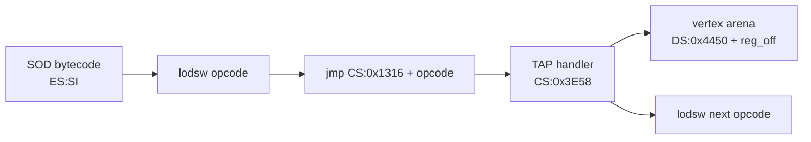
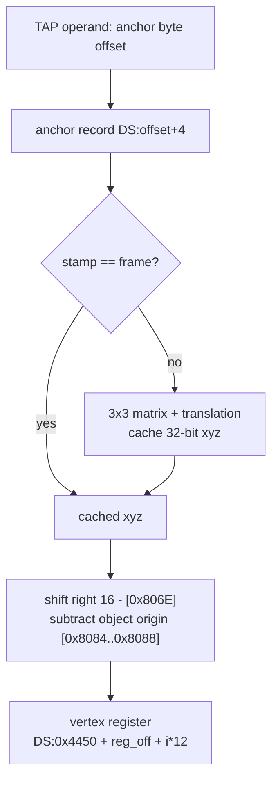

# `PLAYONE.EXE`: SOD Display-List VM & `OP_TAP` Semantics

* **Binary**: `PLAYONE.EXE` (LZEXE 0.91; unpacked EXE 201,548 bytes, i.e. the 200,524-byte load image plus its 1,024-byte MZ header)
* **Method**: DOSBox-X `MEMDUMPBIN` of the unpacked image after the LOAD FILM dialog settles; Capstone 16-bit disassembly
* **Scope**: `OP_TAP` (`0x022E`) operand encoding and register side effects; the VM execution model is in [`sod-vm-execution.md`](sod-vm-execution.md).
* **Anchor**: `# [FMT-SOD-TAP]`, `# [MEM-SOD-VM]`

Runtime segments in the captured session: `CS = 0x0F17`, `DS = 0x1575` for the main data segment, and a fixed display-list work segment at `0x1DF8` holding both the anchor table and the 1024-entry vertex register arena.
The memory image was dumped starting at segment `0x0D51`.

---

## 1. Dispatch

The VM does not compare opcodes one by one.
A dispatch table at `CS:0x1316` contains a 3-byte near jump at every opcode value multiple of 9.
The TAP entry sits at `CS:0x1316 + 0x022E = CS:0x1544` and jumps to `CS:0x3E58`.

In the unpatched image the table is a run of 108 nine-byte slots at load-image offset `0x8240` (Patch #3 has 107, `[Supported Inference]`: [`patch3.md` § 4.1](patch3.md#41-the-patched-build-has-one-dispatch-slot-fewer)), which is paragraph `0x824` (runtime `0x1048` in the `CTRY.FLM` session).
The 6 bytes before each jump aren't padding: they're `26 C7 44 FE imm16`, `mov word es:[si-2], imm16`, and for every slot `imm16 + 0x8240` equals the jump target.
The VM runs with `CS` = paragraph `0x824`, so an opcode word is the offset of its slot.
The first time a slot runs, it overwrites the opcode word in the stream with its handler's IP, so later passes jump straight to the handler.
No separate translation pass exists.
In these coordinates the `GVPOLY` handler `0x995C` (op `0x0168`) is `0x171C`, `0x9A24` (op `0x02BE`) is `0x17E4`, and the `SHADES` handler `0x9481` (op `0x0156`) is `0x1241`.
The `CS:0x1316` addresses above use the session's `CS = 0x0F17` alias for the same code.
`[Established]`, from a byte scan of the unpacked image ([`world-scene.md` § 4](world-scene.md#4-the-dispatch-slots-patch-the-stream-themselves)).

A 2026 community report, from an AI-assisted reading of a disassembly, says the game generates machine code at load time to draw shapes ([*Vibe-exploring Stunt Island*](https://marnetto.net/2026/04/26/vibe-exploring-si)).
`PLAYONE.EXE` generates none: what changes at run time is the bytecode stream, whose opcode words the slots overwrite with handler offsets as described above.
The report most likely describes this self-patching.
`[Bounded Observation]`; `STUNT.EXE` is unchecked.



The slot for opcode `0x022E` was observed as `E9 rel16` at `CS:0x1544`.
`[Established]` _Source: [108 dispatch slots is the unpatched count](../../work/2026-11/472_research-contradictions/journal.md#2026-11-13-108-dispatch-slots-is-the-unpatched-count)._

---

## 2. TAP Operand Encoding (`# [FMT-SOD-TAP]`)

```text
OP_TAP (0x022E)
  reg_off : u16      ; byte offset into the 12-byte vertex arena
  count   : u16      ; number of anchor records to copy
  anchors : u16[count]; byte offsets into the 28-byte anchor table
```

The operand width is **variable**: `2 + count` words.
The handler reads the first anchor inside the loop and the next bytecode opcode after the final iteration.

```asm
3E58  lodsw                  ; reg_off
3E5A  mov di, 0x4450
3E5D  add di, ax
3E5F  lodsw                  ; count -> [0x41B8]
3E64  lodsw                  ; first anchor offset -> SI
...
3F25  pop si
3F26  add di, 0x0C           ; next vertex register
3F29  dec word [0x41B8]
3F2D  je 3F32
3F2F  jmp 3E64               ; next anchor offset
3F32  lodsw                  ; next opcode
3F34  jmp ax
```

`[Established]`

Corpus evidence (`python` scan of every `.ALL`/`.RES`/`.SOD` chunk):

| Fact | Value |
|---|---|
| Stop sites | 2,413 |
| Unique TAP model payloads | 14 |
| `count` values | 2 and 3 |
| Anchor-offset alignment | every operand is `n * 28` |
| Maximum anchor index | 193 (CTRY hills) |

The ticket's original "operand width is 4 words" holds only for `count = 2`.
`CTRY.ALL` chunk `0x0204` in `BOB1.ALL` uses `count = 3`, so a fixed four-word skip desynchronizes the stream.

`[Established]`

---

## 3. Anchor Record Layout

TAP reads a 28-byte record from the display-list work segment (`DS = 0x1DF8` in the captured run):

| Record offset | Type | Meaning |
|---|---|---|
| `+0x00` | `i16` | Raw island X |
| `+0x02` | `i16` | Raw island Y (elevation, non-positive) |
| `+0x04` | `i16` | Raw island Z |
| `+0x06` | `i32` | Cached transformed X (written by TAP) |
| `+0x0A` | `i32` | Cached transformed Y |
| `+0x0E` | `i32` | Cached transformed Z |
| `+0x12` | `u16` | Copied to vertex `+6` (projection/ordering field) |
| `+0x16` | `u16` | Copied to vertex `+8` |
| `+0x1A` | `u8` | Vertex flag copied to `+0xA` |
| `+0x1B` | `u8` | Per-frame transform cache stamp |

TAP operand values point **four bytes before** the record (`record = table + operand + 4`); the table begins with a four-byte header, so record 0 lives at `table + 4` and the first operand is `0`.
All corpus operands are `n * 28`.

- The per-frame stamp at `+0x1B` is invalidated by `CS:0x492D`:
  - `mov ax,0x1DF8; mov ds,ax; mov cx,0xE7; mov si,0x1F; loop { [si]=0; si += 0x1C }`
  - 231 records (`0xE7`) confirm the table length and 28-byte stride.
- The runtime table's `x/y/z` match `ANCHORPT.DAT` records at the same indices; 145 of the 150 reachable records matched exactly, and the five mismatches were `y = -32768` sentinels stored as `0`.
- `ANCHORPT.DAT` record layout is `x,y,z,f[11]`; the in-memory record keeps `x/y/z` at `+0/+2/+4` and reuses `f[0..]` as transform/cache scratch.

`[Established]` for layout and cache loop; `[Bounded Observation]` for the source that populates the 231-entry table (embedded in `PLAYONE.EXE` for the demo; retail loading path not disassembled).

---

## 4. Register Side Effects

For each anchor record (handler image `0xAD88`, transform `0xAE67`):

1. If the cached stamp `+0x1B` differs from `[0x19A8]` (frame counter), transform the raw point through the 3×3 matrix at `[0x80C0..0x80CA]`, add the translation `[0x41D4..0x41DF]`, cache the 32-bit results at record `+0x06/+0x0A/+0x0E`, and store the stamp.
2. Shift each cached 32-bit component right by `16 - [0x806E]` to a 16-bit value (`0xADAC..0xADF1`).
3. Subtract the object's origin words `[0x8084]`, `[0x8086]`, `[0x8088]`.
4. Write `x, y, z` into the 12-byte vertex register `0x4450 + reg_off + i*12`.
5. Write `+6` and `+8` from anchor fields `+0x16`/`+0x1A`, or projected screen coordinates when `[0x8082] == 0x1AB1`; write the record flag to vertex `+0xA`.

`[Established]` for the instructions.
What the words hold is read from their writers.
The scene walk normalises the object's 32-bit view position at `0x31CF`, which returns 16-bit words and the shift `CL`.
`0x21B2..0x21BC` stores those words, rotated by `0x0824:06B0`, at `[0x8084..0x8088]`.
The light setup `0x9100`, called from `0x21F9`, stores that `CL` at `[0x806E]` (`0x9113`).
So a register holds the anchor's view-space position less the object's origin, in the units that origin was shifted to.
Vertices loaded by `VECTORS` share those units.
The cache is one per frame and shared by every object: anchors 156, 157 and 160 are each tapped by two shapes (section 5).
So `0x80C0` and `0x41D4` must be the camera's rotation and translation, not an object's (`[Supported Inference]`).

The **geometry** effect is therefore: *load a terrain anchor point, relative to the shape's own origin, into the SOD vertex register bank*.
`[Supported Inference]` for the units: that `[0x806E]` and the header's `scale_index` (`[es:8]`, taken into `CH` at `0x21D8` and kept as `[0x806F]`) put tapped and `VECTORS` points in one unit is read from the two writers, not from a trace.
On that reading, in the shape's frame, an unrotated scenery shape placed at `p` and lifted by `ground_y_offset >> scale_index` gets `(anchor - p) << scale_index - ground_y_offset`.
Its tapped points then land on the anchors wherever it is placed.
A point the stream builds from the origin itself, such as `CLRV; PUTV` or `CLRV; SUBV 0`, depends on the placement.
Subsequent `POLYZ` reads those registers exactly like `VECTORS`-populated vertices.

_Source: [2026-11-11: how OP_TAP places its points](../../work/2026-11/254_tap-anchors/journal.md#2026-11-11-how-op_tap-places-its-points)._

**No rotation term for scenery.**
`PLAYONE` does not rotate a scenery prop.
Both scenery draw branches were read: the `SP_1NODE` far stand-in (`0x2152..0x220A`) and `SP_LEAF` (`0x220B..0x235F`, jump-table type 10), the leaf branch that places the `OP_TAP` shapes the walk reaches.
Each rotates the tree position `[0x49F2..0x49FC]` by `0x80C0` (`0x2195..0x2198`; `0x225F..0x2262`) and culls it in `0x1B0C`, which reads the header's `[es:8]`, `[es:4]` and `[es:9]` and no angle.
Each then copies the draw matrix `0x808A` from `0x80C0`, or from `0x809C` when header bit 0 is set (`0x21A8`, `0x21C2..0x21D0`; `SP_LEAF` after drawing the pending objects it sorts in front, `0x2276`, `0x2302..0x2317`), and stores the rotated position in the origin words `[0x8084..0x8088]` (`0x21B2..0x21BC`; `0x231A..0x2324`).
Neither branch reads a per-prop angle, and no `SCENERY.scn` node carries one ([`scenery.md`](../formats/auxiliary/scenery.md) section 3.1).
The anchor translation `0x41D4` is written by `0x0824:03F5` (image `0x8635..0x8724`, called at `0x1DF0` with the view eye `[0x2A68..0x2A72]`): the eye negated, times `0x80C0` through `0x88FB`.
So with `R` the matrix at `0x80C0`, `p` the placement with the header lift added ([`scenery.md`](../formats/auxiliary/scenery.md) section 3.3) and the walk's position relative to the eye, a tapped register holds `R (anchor − eye) − R (p − eye) = R (anchor − p)` and a `VECTORS` point `R v`; in the shape's frame the tapped point is `anchor − p`, the translation-only load `anchored_models` makes.
`[Established]` for the instructions; `[Supported Inference]` for the conclusion, since `0x41D4` is the 16.16 eye shifted right by 16 and turned by `R` (`0x867F..0x8702` correct the signed multiply of the low words), and that `ANCHORPT.DAT` units equal the eye's whole-metre unit is not checked; no frame was traced live.
A view-facing (bit 0) shape would draw through `0x809C` with its anchors still through `0x80C0`, so a tapped point would not land at `anchor − p` in its frame; no view-facing shape in `INTRO.ALL` or `CTRY.ALL` runs `OP_TAP` ([section 8.8](sod-vm-generators.md#88-model-frame-the-other-generators), `[Bounded Observation]`).

_Source: [2026-11-13: whether PLAYONE turns a scenery prop's tapped anchors](../../work/2026-11/476_op-tap-anchors/journal.md#2026-11-13-whether-playone-turns-a-scenery-props-tapped-anchors)._



---

## 5. Hill Fins

`CTRY.ALL` chunks `0x0202`–`0x0208` and `0x0402`–`0x0408` are the 14 TAP shapes (`SCENERY1.RES` and `SCENERY3.RES` #0–6, replicated across the corpus).
Example `0x0402`:

| Field | Value |
|---|---|
| Header | `bounding=0x3971`, `yoff=0`, `scale_index=6` |
| TAP | `reg_off=0`, `count=2`, anchors `141`, `157` (`0x0F6C`, `0x112C`) |
| Follow-up | `VECTORS` reg 511 = `(0, -4928, 0)`; `GETV 511; SHLV 1; PUTV 510` |
| Derived vertex | `reg2 = reg1 - reg510`: 9,856 units, 154 m at scale 6, below the second anchor |
| Emit | `POLYZ 3` over regs `0,1,2`, one colour per side (`REJ`, `IFVIS 0` / `IFVIS 1`) |

`0x0204` uses `count=3` (anchors `14`, `185`, `193`) and emits four triangles over registers `0`–`3`, the fourth register being the origin (`CLRV; PUTV`).

`[Established]` for the streams and anchors, `[Bounded Observation]` for the shapes they make.
Each was resolved as section 4 describes, at the image tree's one placement of it.
Thirteen of the 14 are one vertical triangle each, from an anchor at sea level up to a ridge anchor 58 to 293 m high, with the third corner within 1 m of sea level.
On the seven `0x04xx` fins the third corner is directly under the ridge anchor, at the same plan position.
On the six `0x02xx` triangles it lies in plan on the line between the two anchors.
`0x0204` is the exception: four triangles over anchors at 0, 115 and 148 m and its origin at sea level.
The ridge and foot anchors of each `0x04xx` fin are corners of the same `MAP.BIN` hill patches.
`0x0402` and `0x0406` take anchors 141–157–158 (peak 155 m), shared by patches 109, 110, 113 and 114.
`0x0403`/`0x0407` take 154–156–159 (196 m), `0x0404`/`0x0408` take 155–160–161 (293 m), and `0x0405` takes 149–151 (82 m).
Their colours, `0xC0`–`0xC6`, are the colours of the hill patches on those anchors (192–198).

Verdict: TAP is **not** a debug marker and **not** a no-op.
It loads terrain anchors.
The shapes that use it are vertical fins standing in the hills, not ground patches or airfield tiles.

_Source: [2026-11-11: what the 14 TAP shapes are](../../work/2026-11/254_tap-anchors/journal.md#2026-11-11-what-the-14-tap-shapes-are)._

---

## 6. HUGETAP

`OP_HUGETAP` (`0x0237`) dispatches to `CS:0x3F36`, which is a single `int3` byte.
The demo engine does not implement it.
Do not model HUGETAP until a build with a real handler is found.

`[Established]`

---

## 7. Rust Mapping

| Original | Reconstruction |
|---|---|
| 28-byte anchor table | `stunt_core::anchor::AnchorPoint` slice |
| TAP operand loop | `OP_TAP` arm in [`crates/stunt-core/src/sod/vm.rs`](../../crates/stunt-core/src/sod/vm.rs) |
| Work-segment transform/cache | Not modelled. TAP writes the anchor's `[-x, -y, z]` in shape units, less the header lift; `world/tap_props.rs` decodes each TAP shape again against the table shifted by its placement (`anchored_models`) |
| Vertex arena write | `regs[(reg_off/12 + i) & 1023]` |
| Anchor source | `ANCHORPT.DAT` located by [`crates/stunt-cli/src/scene/mod.rs`](../../crates/stunt-cli/src/scene/mod.rs); raw records supplied to the VM |

Open items:

- A TAP shape drawn rotated: `vm.rs` loads the anchor unrotated, which holds for non-view-facing scenery (section 4).
  An actor (draw matrix `0x80C0 · R`, [`memory-map-vm.md`](memory-map-vm.md) `0x808A`) or a view-facing shape running `OP_TAP` would need the inverse turn; none is known in `INTRO.ALL` or `CTRY.ALL`.
- Retail `PLAYONE.EXE` anchor-table population path `[Bounded Observation]`.
- HUGETAP semantics `[Unknown]`.

The execution model (section 8.1 to 8.7) is in [`sod-vm-execution.md`](sod-vm-execution.md#8-execution-model).
The model frames and two-vertex polygons (sections 8.8 and 8.9) are in [`sod-vm-generators.md`](sod-vm-generators.md#88-model-frame-the-other-generators).
Lines, polygon spans and the back-face span test (sections 8.10 to 8.12) are in [`sod-vm-lines-spans.md`](sod-vm-lines-spans.md#810-lines-moveto-zlineto-and-linecol).
The per-frame routine and scene composition (section 9) is in [`sod-vm-frame.md`](sod-vm-frame.md#9-per-frame-routine-and-scene-composition).

---

## 10. Open questions

* **Who sets `SodVertex::flags` bit 1 (two-sided).**
  The field is documented as bit 1 in [`SodVertex`](../../crates/stunt-core/src/contracts/shape/mod.rs), but nothing is known to write it: the decal path sets bit 0, and no handler or SOD stream field is known to carry bit 1.
  The renderer now culls back faces on a clockwise winding, so a facet the player draws two-sided would be dropped.
  The only frame identified as affected is `CTRY.FLM` tick 832, worth about 0.0003 of the film mean, so this is a correctness question about a contract field rather than a parity lever.
