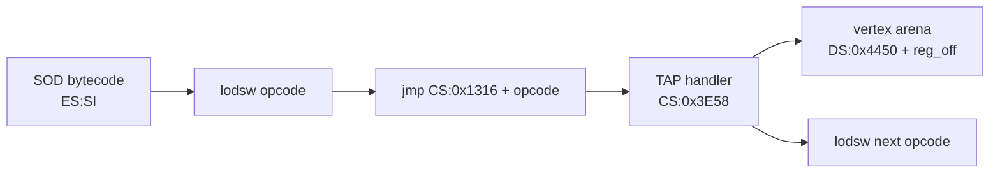
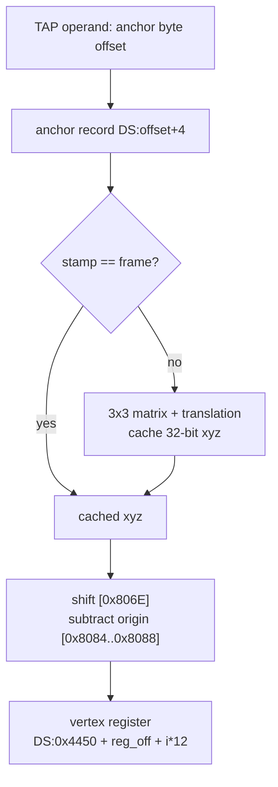

# `PLAYONE.EXE`: SOD Display-List VM & `OP_TAP` Semantics

* **Binary**: `PLAYONE.EXE` (LZEXE 0.91; unpacked EXE 201,548 bytes, i.e. the 200,524-byte load image plus its 1,024-byte MZ header)
* **Method**: DOSBox-X `MEMDUMPBIN` of the unpacked image after the LOAD FILM dialog settles; Capstone 16-bit disassembly
* **Scope**: `OP_TAP` (`0x022E`) operand encoding and register side effects; the general VM execution model (section 8)
* **Anchor**: `# [FMT-SOD-TAP]`, `# [MEM-SOD-VM]`

Runtime segments in the captured session: `CS = 0x0F17`, `DS = 0x1575` for the main data segment, and a fixed display-list work segment at `0x1DF8` holding both the anchor table and the 1024-entry vertex register arena. The memory image was dumped starting at segment `0x0D51`.

---

## 1. Dispatch

The VM does not compare opcodes one by one. A dispatch table at `CS:0x1316` contains a 3-byte near jump at every opcode value multiple of 9. The TAP entry sits at `CS:0x1316 + 0x022E = CS:0x1544` and jumps to `CS:0x3E58`.

The table is a run of 108 nine-byte slots at load-image offset `0x8240`, which is paragraph `0x824` (runtime `0x1048` in the `CTRY.FLM` session). The 6 bytes before each jump aren't padding: they're `26 C7 44 FE imm16`, `mov word es:[si-2], imm16`, and for every slot `imm16 + 0x8240` equals the jump target. The VM runs with `CS` = paragraph `0x824`, so an opcode word is the offset of its slot. The first time a slot runs, it overwrites the opcode word in the stream with its handler's IP, so later passes jump straight to the handler. No separate translation pass exists. In these coordinates the `GVPOLY` handler `0x995C` (op `0x0168`) is `0x171C`, `0x9A24` (op `0x02BE`) is `0x17E4`, and the `SHADES` handler `0x9481` (op `0x0156`) is `0x1241`. The `CS:0x1316` addresses above use the session's `CS = 0x0F17` alias for the same code. `[Established]`, from a byte scan of the unpacked image ([`world-scene.md` § 4](world-scene.md#4-the-dispatch-slots-patch-the-stream-themselves)).

A 2026 community report, from an AI-assisted reading of a disassembly, says the game generates machine code at load time to draw shapes ([*Vibe-exploring Stunt Island*](https://marnetto.net/2026/04/26/vibe-exploring-si)). `PLAYONE.EXE` generates none: what changes at run time is the bytecode stream, whose opcode words the slots overwrite with handler offsets as described above. The report most likely describes this self-patching. `[Bounded Observation]`; `STUNT.EXE` is unchecked.



`Execution supported by 107 table entries at 9-byte pitch: entry for opcode 0x022E observed as E9 rel16 at CS:0x1544.` `[Established]`

---

## 2. TAP Operand Encoding (`# [FMT-SOD-TAP]`)

```text
OP_TAP (0x022E)
  reg_off : u16      ; byte offset into the 12-byte vertex arena
  count   : u16      ; number of anchor records to copy
  anchors : u16[count]; byte offsets into the 28-byte anchor table
```

The operand width is **variable**: `2 + count` words. The handler reads the first anchor inside the loop and the next bytecode opcode after the final iteration.

```asm
3E58  lodsw                  ; reg_off
3E5A  mov di, 0x4450
3E5D  add di, ax
3E5F  lodsw                  ; count -> [0x41B8]
3E64  lodsw                  ; first anchor offset -> SI
...
3F25  pop si
3F26  add di, 0x0C           ; next vertex register
3F29  dec word [0x41B8]
3F2D  je 3F32
3F2F  jmp 3E64               ; next anchor offset
3F32  lodsw                  ; next opcode
3F34  jmp ax
```

`[Established]`

Corpus evidence (`python` scan of every `.ALL`/`.RES`/`.SOD` chunk):

| Fact | Value |
|---|---|
| Stop sites | 2,413 |
| Unique TAP model payloads | 14 |
| `count` values | 2 and 3 |
| Anchor-offset alignment | every operand is `n * 28` |
| Maximum anchor index | 193 (CTRY hills) |

The ticket's original "operand width is 4 words" holds only for `count = 2`. `CTRY.ALL` chunk `0x0204` in `BOB1.ALL` uses `count = 3`, so a fixed four-word skip desynchronizes the stream.

`[Established]`

---

## 3. Anchor Record Layout

TAP reads a 28-byte record from the display-list work segment (`DS = 0x1DF8` in the captured run):

| Record offset | Type | Meaning |
|---|---|---|
| `+0x00` | `i16` | Raw island X |
| `+0x02` | `i16` | Raw island Y (elevation, non-positive) |
| `+0x04` | `i16` | Raw island Z |
| `+0x06` | `i32` | Cached transformed X (written by TAP) |
| `+0x0A` | `i32` | Cached transformed Y |
| `+0x0E` | `i32` | Cached transformed Z |
| `+0x12` | `u16` | Copied to vertex `+6` (projection/ordering field) |
| `+0x16` | `u16` | Copied to vertex `+8` |
| `+0x1A` | `u8` | Vertex flag copied to `+0xA` |
| `+0x1B` | `u8` | Per-frame transform cache stamp |

TAP operand values point **four bytes before** the record (`record = table + operand + 4`); the table begins with a four-byte header, so record 0 lives at `table + 4` and the first operand is `0`. All corpus operands are `n * 28`.

- The per-frame stamp at `+0x1B` is invalidated by `CS:0x492D`:
  - `mov ax,0x1DF8; mov ds,ax; mov cx,0xE7; mov si,0x1F; loop { [si]=0; si += 0x1C }`
  - 231 records (`0xE7`) confirm the table length and 28-byte stride.
- The runtime table's `x/y/z` match `ANCHORPT.DAT` records at the same indices; 145 of the 150 reachable records matched exactly, and the five mismatches were `y = -32768` sentinels stored as `0`.
- `ANCHORPT.DAT` record layout is `x,y,z,f[11]`; the in-memory record keeps `x/y/z` at `+0/+2/+4` and reuses `f[0..]` as transform/cache scratch.

`[Established]` for layout and cache loop; `[Bounded Observation]` for the source that populates the 231-entry table (embedded in `PLAYONE.EXE` for the demo; retail loading path not disassembled).

---

## 4. Register Side Effects

For each anchor record:

1. If the cached stamp differs from `[0x19A8]` (frame counter), transform the raw point through the current 3×3 matrix at `[0x80C0..0x80CA]`, add translation `[0x41D4..0x41DA]`, cache the 32-bit results at record `+0x06/+0x0A/+0x0E`, and store the stamp.
2. Convert each cached 32-bit component to a 16-bit register value with arithmetic shift `[0x806E]`.
3. Subtract the view-origin words `[0x8084]`, `[0x8086]`, `[0x8088]`.
4. Write `x, y, z` into the 12-byte vertex register `0x4450 + reg_off + i*12`.
5. Write `+6` and `+8` from anchor fields `+0x16`/`+0x1A`, or projected screen coordinates when `[0x8082] == 0x1AB1`; write the record flag to vertex `+0xA`.

The **geometry** effect is therefore: *copy transformed terrain anchor points into the SOD vertex register bank*. Subsequent `POLYZ` reads those registers exactly like `VECTORS`-populated vertices.

`[Established]`



---

## 5. CTRY Hill Models

`CTRY.ALL` chunks `0x0402`–`0x0408` are 14 unique TAP payloads (the seven hills are replicated across the corpus). Example `0x0402`:

| Field | Value |
|---|---|
| Header | `bounding=0x3971`, `yoff=0`, `scale_index=6` |
| TAP | `reg_off=0`, `count=2`, anchors `141`, `157` (`0x0F6C`, `0x112C`) |
| Follow-up | `VECTORS` reg 511 = `(0, -4928, 0)`; `GETV 511; SHLV 1; PUTV 510` |
| Derived vertex | `reg2 = reg1 - reg510` (raises the second anchor by 9,856 units) |
| Emit | `POLYZ 3` over regs `0,1,2` with two `IFVIS` colors |

`0x0204` in `BOB1.ALL` uses `count=3` (anchors `14`, `185`, `193`) and emits four triangles over registers `0`–`3`.

Verdict: TAP is **not** a debug marker and **not** a no-op. It is the terrain-anchor loader used by ground patches.

`[Established]`

---

## 6. HUGETAP

`OP_HUGETAP` (`0x0237`) dispatches to `CS:0x3F36`, which is a single `int3` byte. The demo engine does not implement it. Do not model HUGETAP until a build with a real handler is found.

`[Established]`

---

## 7. Rust Mapping

| Original | Reconstruction |
|---|---|
| 28-byte anchor table | `stunt_core::anchor::AnchorPoint` slice |
| TAP operand loop | `OP_TAP` arm in [`crates/stunt-core/src/sod/vm.rs`](../../crates/stunt-core/src/sod/vm.rs) |
| Work-segment transform/cache | Not modelled; TAP writes `[-x, -y, z]` raw units directly (identity model transform) |
| Vertex arena write | `regs[(reg_off/12 + i) & 1023]` |
| Anchor source | `ANCHORPT.DAT` located by [`crates/stunt-cli/src/scene.rs`](../../crates/stunt-cli/src/scene.rs); raw records supplied to the VM |

Open items:

- Exact fixed-point matrix and shift for non-identity model transforms `[Unknown]`.
- Retail `PLAYONE.EXE` anchor-table population path `[Bounded Observation]`.
- HUGETAP semantics `[Unknown]`.

---

## 8. Execution Model

The VM is a stack-based, register-oriented geometry engine. Opcode semantics and operand widths are in [`formats/sod-opcodes.md`](../formats/sod-opcodes.md); this section holds the state the opcodes act on. Dispatch is section 1. Each claim carries its tier.

### 8.1 Vertex Register Bank

`[Established]` for the 12-byte stride, the 1024-entry arena at `DS:0x4450` and the `x/y/z` words (section 4 step 4). `[Supported Inference]` for the index mask.

- The VM keeps 1024 vertex registers (`regs[0..1023]`). In `PLAYONE.EXE` each is 12 bytes: three signed 16-bit coordinate words plus projection and flag words at `+6`, `+8` and `+0xA` (section 3).
- Bytecode operands address a register by **byte offset** (a multiple of 12). The reconstruction decodes `reg_index = (reg_off / 12) & 1023`; the mask keeps a bad operand inside the bank.
- The reconstruction stores each register as three floating-point metres `[x, y, z]`, scaled by the header scale table ([`sod.md`](../formats/sod.md) section 2); the original holds raw 16-bit units.
- Whether `PLAYONE.EXE` paged the bank or kept it in the work segment is Q-SOD-06 in [`sod.md`](../formats/sod.md). The captured session holds it in the work segment `0x1DF8`.

### 8.2 Vector Accumulator

`[Supported Inference]` — operand semantics from `SOD.H`, FreeFlight and the assembler macros; handlers other than `TAP` are not traced.

The VM keeps one 3D accumulator, `cur_vert = [x, y, z]`, which the vector opcodes read and write:

- `OP_CLRV` zeroes it; `OP_GETV reg` loads `regs[reg]`; `OP_PUTV reg` stores it into `regs[reg]`.
- `OP_ADDV reg` and `OP_SUBV reg` add or subtract `regs[reg]`; `OP_NEGV` negates; `OP_INTV reg` sets it to the midpoint `(cur_vert + regs[reg]) * 0.5`.
- `OP_SHLV n` and `OP_SHRV n` multiply or divide by `2^n`.
- `OP_BLOKADD` and `OP_BLOKNEG` apply the accumulator or a negation across a register range.

The CTRY hill example in section 5 uses this pattern: `GETV 511; SHLV 1; PUTV 510`.

### 8.3 Transform Stack and Subobject Articulation

`[Supported Inference]` — from the assembler macro sources (`SABRE.SOD`, `CURTISS.SOD`) and FreeFlight's `siobj.cpp`; the handlers are not disassembled.

Moving parts (propellers, landing gear, rudders) are subobjects drawn under a hierarchical stack, so they stay attached to the body:

1. `OP_PUSHCENTRE` (`0x007E`) pushes the current rotation origin onto the centre stack.
2. `OP_PUSHRELMAT` (`0x01E6`) pushes the current 3x3 local orientation matrix.
3. `OP_MOVECENTRE reg` (`0x0090`) translates the origin to `regs[reg]`, for example a landing-gear hinge.
4. `OP_ROTX` (`0x02E2`), `OP_ROTY` (`0x01DD`) and `OP_ROTZ` (`0x02EB`) rotate about one axis by a 16-bit BAM angle driven by an animation variable (`undercarriage1`, `rudder`). The si-tools reading of the operand differs ([`sod-opcodes.md`](../formats/sod-opcodes.md) section 3).
5. `OP_GOSUB target` (`0x01A7`) evaluates the articulated subobject geometry (for example `sabre_uc`).
6. `OP_POPRELMAT` (`0x01EF`) restores the parent matrix.
7. `OP_POPCENTRE` (`0x0087`) restores the parent rotation centre.

### 8.4 Control Flow

`[Supported Inference]`

`OP_GOTO` jumps and `OP_GOSUB` calls by a relative word offset; `OP_RETURN` (`OP_END`) ends the list or returns from a subroutine. `OP_SORTON` and the conditional branches `OP_IFVIS`/`OP_BVIS`, `OP_BVLT`, `OP_BVGT` and `OP_BZLT` choose which subtree runs; the visibility and BSP behaviour is in [`sod-opcodes.md`](../formats/sod-opcodes.md) section 2.5. The branch targets are relative, so a walk that mis-sizes one operand desynchronises (see [`sod-opcode-coverage.md`](../formats/sod-opcode-coverage.md) section 4).

### 8.5 Polygon Colour at `SHADE` Time

`[Hypothesis]` for the `SHADE*` level law, static and read once; `[Supported Inference]` for the light, measured below. Polygon colour is a running word at `[0x41E8]` that `OP_COLOR` and the four shade opcodes all write. `SHADE1` (`0x0144`), `SHADE2` (`0x014D`), `SHADE16` (`0x02B5`) and `SHADE216` (`0x02C7`) take `norm, base` (handlers at image `0xA526`, `0xA519`, `0xA550`, `0xA55D`, shared tail `0xA52F`): they load `s = word[0x7468 + norm]`, the per-normal shade that `SHADES` (`0x9481`) wrote as `-clamp(N.L >> 16)`, halve it (twice for the 16-level forms; the `2` forms negate it first), and store `base + max(0, (s >> 8) + adj)`, with `adj = -2` when `base == 0x10`. `base` is a ramp start: in the `INTRO.FLM` palette `0x10` is red 16..29, `0x30` grey 48..53, `0x40` brown 64..79, the ramps the capture's triplane uses. FreeFlight discards the operands and paints with the last `OP_COLOR`. The light vector `L` is passed in registers to the display-list entry `0x9100` by its caller: scenery gets the world light `DS:0x49EC..0x49F0` unchanged, a rotated object that light turned by its rotation and the view and doubled (caller `0x1CFB`; [`terrain-shade.md`](terrain-shade.md) section 4.2). `GVPOLY`/`GVPOLY16` give each vertex its own index, which the filler interpolates (below). Their word after the register list is `(ramp_base << 8) | count` (`0x3004` in `CTRY.FLM`'s `0x7F37`, `0x1004` on the triplane), not a normal register, and `count` shade offsets into the `SHADES` words follow, one per vertex (2026-11-01, `[Hypothesis]` from the stream shape; the handlers `0x995C` and `0x9A24` are disassembled for the index they compose, [`terrain-shade.md`](terrain-shade.md) section 5, but not traced for how they read these operands). The renderer first painted each such polygon flat at `base` plus the mean of its vertices' levels: grey-ramp pixels moved toward the capture's (`CTRY` 3.7k -> 33.8k against 52.4k, `INTRO` 120k -> 44.5k against 49.8k) but SSIM did not rise ([parity log](../parity/log.md)).

**The light** (2026-11-05, [#221](https://github.com/neilsh/stunt-reel/issues/221)). `SHADES` dots `L` with the shape's raw normal words, and an unrotated object is handed the world light as stored, so `L` is in the raw model frame and needs no game-to-`[I1]` axis mapping: the decoder keeps the normals in that frame too. The mapping is derived, not chosen by score. The decoded model frame is +Y up ([`coordinates-and-units.md` § 1.2](../formats/concepts/coordinates-and-units.md#12-right-handed-metric-basis-i1)), so `(99, 32766, -17)` points up, and `s = -(N . L)` leaves an upward face at its ramp base and lifts a downward one. The old stand-in `SHADE_LIGHT = (0, -32767, 0)` had the opposite sign. Both films set film variable 13 to `0x2D` at tick 0 (`mise run flm-events`), the value `0x196C` was seen with on both, so both get `(99, 32766, -17)` ([`ShadeLight`](../../crates/stunt-core/src/sod/light.rs)); how `0x196C` maps other values is open ([`terrain-shade.md`](terrain-shade.md), open question 1). Measured with `DBG_SHADE_LIGHT`, all shapes decoded under one light: the stand-in 0.8646 / 0.7986 (CTRY / INTRO), the world light 0.8641 / 0.8128, its negation `(-99, -32766, 17)` and the 180-degree-about-Z form `(-99, -32766, -17)` both 0.8646 / 0.7986 (the 99 and 17 move no shade across a ramp step, so only the sign of y matters). The world light for scenery with the stand-in for actors scored 0.8646 / 0.7986 exactly: no scenery shade that reaches the screen moves, and the whole gain is on the aircraft. Actors are therefore decoded under the world light unrotated, the light `PLAYONE` would hand a level, unrotated object. Their own light turns with their rotation and the view every frame, and shapes are decoded once, so it is not modelled.

**Interpolation.** The `GVPOLY` handlers write `(index << 8) | fraction` per vertex and the filler `0x75DB` interpolates it linearly in screen space ([`terrain-shade.md`](terrain-shade.md) sections 5-6). The renderer now gives each vertex its own index (`base` plus that vertex's level, the fraction dropped) and interpolates it in screen space (`@interpolate(linear)`), rounding to a whole index per fragment (`[I3]`): CTRY 0.8641 -> 0.8642, INTRO 0.8128 -> 0.8166 (`DBG_GVPOLY_INTERP`). Rounding stands in for the dropped fraction: `PLAYONE` floors the interpolated 8.8 value, and an average fraction of one half makes that a rounding of the whole indices.

Before the ramp word was read, `INTRO.FLM` tick 1009 drew the triplane's fuselage grey and its wings bright pink where the capture has a red fuselage and dark red wings (capture above, ours below): [`intro-1009-gvpoly-running-colour.png`](../parity/aircraft/intro-1009-gvpoly-running-colour.png).

_Found 2026-11-01 by the aircraft render round 2; see the [parity log](../parity/log.md)._

---

### 8.6 Facing Flags: `OP_REJ` and `OP_IFVIS`

`[Established]` for the instruction sequences, static, read from `build/re/playone.img` with iced-x86 (2026-11-05, [#74](https://github.com/neilsh/stunt-reel/issues/74)); nothing observed live. `OP_IFVIS` is not a level-of-detail gate. Its first operand is the byte offset of a facing flag in `work:0x7C68`, one byte per face, which three earlier opcodes write from the vertex registers. The section runs while its face points at the eye.

| Opcode | Handler | Reads | Does |
|---|---|---|---|
| `0x017A` `OP_IFVIS` | `0x9BCC` | `flag, size` | `cmp byte [flag + 0x7C68], 0`: nonzero runs the section, zero skips `size` bytes from the size word. |
| `0x0183` `OP_BVIS` | `0x9BB3` | `flag, size` | The inverse: zero runs the section. |
| `0x01B9` `REJ` | `0x9567` | `first, count, count × (a, b, c)` | Normal `n = (a - b) × (c - b)` (`0xB621`, registers at `work:0x4450 + reg`), then `n · (b + o)`, `o` the words at `work:0x8084..0x8088` (read as the object's origin relative to the eye, `[Supported Inference]`: the sign measurement below fits it); flag `first + i` = `0xFF` when negative (`shl dx, 1; sbb al, al`), else 0. |
| `0x01B0` `REJVEC` | `0x94D8` | `first, count, count × (p, b, e)` | The same flag from `(e - b) · (p + o)`, the normal given as two registers; the z term is scaled by `work:0x810A` and the x, y terms shifted by `work:0x810C`. |
| `0x01C2` `REJ2D` | `0x95C0` | `first, count, count × (a, b, c)` | The flag from the sign of the 2D cross product of the projected points (`+6`, `+8` of each register): the screen winding. |

`SORTON` (`0x9183`) reads the same table (`js` on the flag byte) to order its two branches. The renderer keeps each `REJ` face as `VisibilityCondition::FacesEye { point: b, normal: n }` in model space and draws the section while `n · (b - eye) < 0`, with the eye taken into each actor's space, and into the world's for scenery props, every frame. Measured 2026-11-05 ([parity log](../parity/log.md)): CTRY 0.8645 -> 0.8646, INTRO 0.7973 -> 0.7986; the opposite sign gives 0.8061 / 0.7366, which fixes the sign. The old reading (condition 1 as `D^2 <= 1000 m^2`, everything else drawn) had no binary basis.

The in-shape depth gate is `BZLT` (`0x0318`, handler `0x9BE5`), not `IFVIS`: it reads `reg, val, rel` and skips `rel` bytes when the register's view depth `z + work:0x8088` is at most `val >> work:0x806F`, so the section after it is the far form. Its census skip width of 2 words in `vm.rs` is one short.

_Found 2026-11-05 for [#74](https://github.com/neilsh/stunt-reel/issues/74); see the [parity log](../parity/log.md)._

## 9. Per-Frame Routine and Scene Composition

`[Supported Inference]`, static. The per-frame routine at `0x0EE9` (entered from `0x4A35` with `BX = 0x4888`, the snapshot copy of the film state made at `0x39B0`) builds the sun vector (`0x196C`), sets the view matrix (`0x11FC`), makes one 3D scene draw through `0x824:0x0A05`, then draws the credits string at `+0xFE` with `0x58BD`. There is no second view or window pass, so a scene the evaluator does not place has no extra layer to supply it.

`DS:0x2275`, which selects `0x824:0x07DC` with `AX = 0xE8`, `CX = 0xD0`, is a video-mode flag set next to an `int 10h` mode change (`0x6E1B`, `0x737B`), not a window compositor. The window in the `COL3-2.FLM` reference is therefore part of the one scene, not a composited inset.

_Found 2026-10-22 at `ff274e7`; see the [parity log](../parity/log.md)._

**The credits text.** `[Established]`, static, and pixel-exact on the `INTRO.FLM` title cards of two captures ([`pfont.md` § 3.2](../formats/auxiliary/pfont.md#32-drawing-the-credits)). After the scene, `0x0F7B` skips the text when its first byte at `state + 0xFE` is negative, measures each line with `0x58D0` (the sum of `PFONT.BIN` widths at `DS:0x4F02`), centres it in the clip rectangle at `DS:0x2294..0x229A` as `left + ((right - left - width) >> 1)`, puts line 1 at `top + ((bottom - top - 28) >> 1)` and line 2 twenty rows lower (skipped when empty), and calls `0x58BD` with colour `0xFF`. `0x58BD` draws the string through the text driver slot `[0x225A]` twice: at `x + 1` in colour 0, then at `x` in the given colour, so the shadow lies under the ink. The font layout and the whole rule are in [`pfont.md`](../formats/auxiliary/pfont.md); the renderer draws it over offscreen pages ([`credits.rs`](../../crates/stunt-core/src/credits.rs)).

_Found 2026-11-01 for [#75](https://github.com/neilsh/stunt-reel/issues/75); see the [parity log](../parity/log.md)._

### 9.1 The Actor Shadow Draw

`[Established]` for the instruction sequences and the `work:0x806C` readers and writer listed here (disassembled, not run); `[Hypothesis]` for what they draw at run time (the shadow is the actor flattened onto the plane and filled in index 0: no live check, no render scored against the capture). Static, read from `build/re/playone.img` (2026-11-05, [#99](https://github.com/neilsh/stunt-reel/issues/99)); nothing observed live. The scene walk `0x1DD5` loops over the film's slots (list at `state + 0x2E`, count at `state + 0x1E`) at `0x1E07..0x1E3A`. For each slot it skips unless the flag byte `[si+1]` has bit 1 (draw) and bit 0 (exists) and the shape word `[si+2]` is nonzero, queues the actor with `0x1A90` (not for the slot equal to `[0x22DE]`, the view camera's, `0x1E26`; that skip leaves the shadow test below, but the view slots read live on `INTRO.FLM`, 1 and 4, have flags `0x19` and shape 0, so they reach neither, `[Bounded Observation]`, [`film-segments.md`](../parity/film-segments.md#21-held-sand-shots-at-ticks-2690-2850) § 2.1), and when `[si+1]` bit 2 is set also calls `0x19FC` at `0x1E35`. Those three bits are `SIF_DRAW`, `SIF_EXISTS` and `SIF_SHADOW` ([`flm.md`](../formats/flm.md#32-object-type-flags-type_flags-u8)); that the slot byte is the create `type_flags` is a `[Hypothesis]` from the bit order and the flag census, not traced to the create handler.

| Image offset | Role |
|---|---|
| `0x19FC` | Shadow queue. Takes the height from slot `+0x20/+0x22` when `+0x22` is nonzero. Otherwise reads the plane through the pointer at slot `+0x1E` (`a`, `b`, `c` at `+0`, `+2`, `+4`; 32-bit `D` at `+6`) and solves `y = (D - a*x - c*z) / b` at the actor's x (`+4/+6`) and z (`+0xC/+0xE`); a null pointer gives y = 0 (`0x1A12`). Then it transforms that point, looks up the slot's own shape (`[si+2]`, `0x4C41`), culls (`0x1B0C`) and queues it at `0x1AD8`. |
| `0x1A90` | Actor queue: the same, at the actor's own y (`+8/+0xA`), with `or al, 0x80` at `0x1AD6`. The shadow entry lacks that bit. |
| `0x1B88..0x1BFF` | Entry sort. Branches on bit `0x80` of byte `+0xF` (`0x1B9F`, `0x1BA5`), so shadows and actors are ordered by kind before depth; the direction is not worked out. |
| `0x1C00` | Draws one entry. Bit `0x80` set goes to `0x1CFB` (the actor, light rotated into its frame, see [`terrain-shade.md`](terrain-shade.md) section 4.2). Clear goes to `0x1C0D`: builds the rotation matrix (`0x04E5`, `work:0x80D2`), halves it, replaces the Y row (second triple, `work:0x80D8..0x80DC`) with `-(a*row0 + c*row2) / b` (`idiv` by the plane's `b`; a null plane pointer zeroes it, `0x1C4B`), combines with the view matrix (`0x060A`), sets `work:0x806C = 0xFF`, calls `0x1D5F` (which runs the display list through `0x9100`) and clears the byte. |

`work:0x806C` is read at least at `0x7FD2`, `0x7FFB`, `0x8015`, `0x8040`, `0x92B2`, `0x93C2` (inside the `OP_ANIMATE` handler), `0x97B1`, `0x9896`, `0x995C`, `0x9A24`, `0x9EC5`, `0x9F29`, `0xA040`, `0xA05C` and `0xA9DC`. Nonzero changes the VM as follows: the flat-polygon gateways `0x8010` and `0x8040` load `CX = 0` instead of `work:0x41E8` before the driver slot `[0x2246]`; `0x7FD2` loads `DI = 0` and `0x7FFB` returns without drawing; `GVPOLY` and `GVPOLY16` (`0x995C`, `0x9A24`) and the polygon handlers at `0x97B1` and `0x9896` take the flat branch (`call [0x8080]`, `lcall 0:8010`) and step over their shade words instead of running the Gouraud filler; and the `OP_ANIMATE` handler (`0x92B2`) takes its skip path. The handlers at `0x9EC5`, `0x9F29`, `0xA040`, `0xA05C` and `0xA9DC` (which read the vertex register bank and the `0x1952` slot) also test it and skip their work; what they do was not decoded. So in shadow mode every polygon is flat palette index 0, drawn from the actor's own shape flattened onto the ground plane. [`memory-map.md`](memory-map.md) listed `0x806C` as an `OP_ANIMATE` gate only; that is one of its readers. Its only writer found is `0x1CE7`/`0x1CF4`.

_Found 2026-11-05 for [#99](https://github.com/neilsh/stunt-reel/issues/99); see the [parity log](../parity/log.md)._

## 10. Open questions

* **Facing flags** (section 8.6, [#74](https://github.com/neilsh/stunt-reel/issues/74)). Ruled out: `OP_IFVIS` as a distance gate. Open: `vm.rs` implements only `REJ`, so a shape that uses `REJVEC`, `REJ2D` or `OP_BVIS` still stops there in a lenient decode; nested `IFVIS` sections keep only the inner gate; an `IFVIS` on a flag its shape never set is drawn, where PLAYONE reads a stale byte. `BZLT`, the real in-shape depth gate, is unimplemented. The `INTRO.FLM` tick 3295 "conifers drawn as round bushes" is not an `IFVIS` effect: the facing gate leaves those trees as they were.

* **The actor shadow draw** (section 9.1, [#99](https://github.com/neilsh/stunt-reel/issues/99)). Ruled out: `OP_AIRBRUSH` in the hero shape (`CTRY.ALL` `0x7F37` has no `0x0171` word). Open: who writes slot `+0x1E` (the plane pointer) and `+0x20/+0x22`; whether our renderer should draw a shadow for the view camera's slot (`[0x22DE]` holds its record, [`memory-map.md`](memory-map.md) § 1). Statically, `0x1E26` skips only its actor draw, so the slot would reach the shadow call at `0x1E35` only with draw, exists and shadow flags set and a nonzero shape `[si+2]`. `[Bounded Observation]`: the two view slots read live on `INTRO.FLM` (slot 1 at ticks 2678-2766, slot 4 at 2801) had flag byte `0x19` (bits 1 and 2 clear) and shape 0, so they reach neither draw; no live view slot has been seen to reach the shadow queue; whether any altitude test hides the shadow of a high object (`0x19FC` has none; the handbook says there is a cutoff); the sort direction at `0x1B9F`; a live check that `0x1C0D`'s matrix replacement projects straight down; what the other `0x806C` readers do; the create handler that fills slot byte `+1` from `type_flags`. See [`framing-and-actors.md`](../parity/framing-and-actors.md) section 1 for the measured shadow and the renderer change this licenses.
* **Who sets `SodVertex::flags` bit 1 (two-sided).** The field is documented as bit 1 in [`SodVertex`](../../crates/stunt-core/src/contracts/shape.rs), but nothing is known to write it: the decal path sets bit 0, and no handler or SOD stream field is known to carry bit 1. The renderer now culls back faces on a clockwise winding, so a facet the player draws two-sided would be dropped. The only frame identified as affected is `CTRY.FLM` tick 832, worth about 0.0003 of the film mean, so this is a correctness question about a contract field rather than a parity lever.
* **The `SHADE` light vector and the `GVPOLY16` colour path** (section 8.5). Closed: the callers that hand `0x9100` its light are the three call sites of [`terrain-shade.md`](terrain-shade.md) section 4.2, and the renderer shades with the world light ([#221](https://github.com/neilsh/stunt-reel/issues/221)). Open: an actor's own light (the world light turned by its rotation and the view, `0x1CFB`), which changes every frame while shapes are decoded once; the vertex fraction the interpolation drops; the light for a film-variable-13 value other than `0x2D`; and whether `GVPOLY16` takes its ramp from the word after its registers. They decide the colour of the aircraft parts a full `SORTON` walk would reach ([`framing-and-actors.md`](../parity/framing-and-actors.md) section 1).
