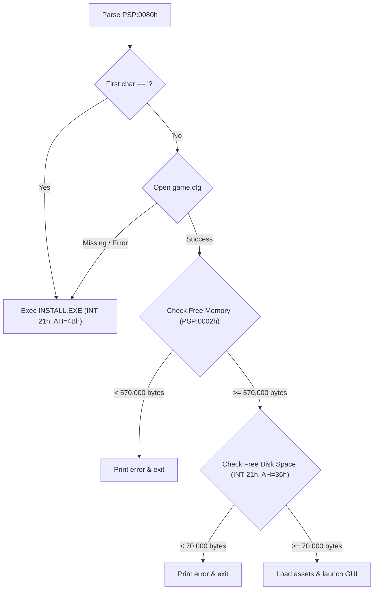

# `PLAYONE.EXE`: Startup, Initialization & Argument Parsing

This document details the executable structure, command-line argument evaluation, memory requirements, and initialization sequence of `PLAYONE.EXE` (the standalone film reel playback utility from the *Stunt Island* demo / `stisldem`), discovered through binary disassembly and static/runtime analysis.

---

## 1. Executable Specifications

| Attribute | Value | Details |
|---|---|---|
| **Binary Name** | `PLAYONE.EXE` | Standalone playback engine |
| **Origin** | Walt Disney Computer Software / The Assembly Line (1992) | Stunt Island Demo |
| **Executable Format** | 16-bit x86 MS-DOS MZ Executable | Standard real-mode DOS application |
| **Compression** | Packed with **LZEXE 0.91** | `LZ91` signature at file offset `0x1C`; [`python/scripts/unlzexe.py`](../../python/scripts/unlzexe.py) unpacks it |
| **Packed File Size** | 102,703 bytes | Disk footprint |
| **Unpacked File Size** | 201,548 bytes | In-memory uncompressed image size |
| **Unpacked Entry Point** | `CS:IP = 0000:0C5Eh` | Execution start after LZEXE decompression stub |
| **Header Paragraphs** | 64 paragraphs (1,024 bytes) | MZ header size in unpacked image |
| **Relocation Entries** | 213 relocations | Segment fixup table entries |
| **DGROUP (Data Segment)** | Segment `0x0D51` | File offset `0xD910` in unpacked image |

---

## 2. Command-Line Argument Parsing

`PLAYONE.EXE` does **not** accept film paths, file arguments, or standard DOS switches. Its command-line parser only inspects the first non-whitespace character in the Program Segment Prefix (PSP) command tail.

### Command Tail Processing Routine (`0x0C7C` – `0x0CBD`)

```assembly
0x0c7c: mov    si, 80h              ; PSP:0080h (command tail length byte)
0x0c7f: lodsb  al, es:[si]          ; Read length byte
0x0c81: mov    bl, al               ; BL = length
0x0c83: xor    al, al
0x0c85: mov    bh, al
0x0c87: mov    es:[bx + si], al     ; Null-terminate command tail in PSP
0x0c8a: lodsb  al, es:[si]          ; Read next character
0x0c8c: cmp    al, 20h              ; Skip leading whitespace (' ')
0x0c8e: je     0x0c8a
0x0c90: cmp    al, 3Fh              ; Check if character is literal '?' (ASCII 0x3F)
0x0c92: jne    0x0ccc               ; If not '?', jump to normal startup!

; If character is '?':
0x0cb0: mov    dx, 05BEh            ; DS:05BEh -> "install.exe"
0x0cb3: mov    ax, ds
0x0cb5: mov    es, ax
0x0cb7: mov    bx, 0701h            ; Parameter block for EXEC
0x0cba: mov    ax, 4B00h            ; INT 21h AH=4Bh (EXEC child program)
0x0cbd: int    21h                  ; Run INSTALL.EXE
```

### Argument Evaluation Behavior

* **`playone.exe ?`**:
  Matches literal ASCII `?` (`0x3F`). Executes `INSTALL.EXE` (the sound/hardware setup program) as a child process via `INT 21h, AH=4Bh`.
* **`playone.exe /?`**:
  The first non-space character is `'/'` (`0x2F`), which fails the `cmp al, 3Fh` check. It branches to `0x0CCC` and continues normal graphical startup.
* **File paths and switches (e.g. `playone.exe CTRY.FLM`)**:
  All additional parameters are completely ignored. The engine cannot be directly instructed via CLI arguments to open or play a specific film file.

---

## 3. Initialization & Environmental Checks

After command-line parsing completes at `0x0CCC`, the program executes three critical environment validations before initializing the graphical engine:



### 1. Hardware Configuration Verification (`game.cfg`)
* The program attempts to open `game.cfg` (`DS:05ACh`).
* If `game.cfg` is missing or unreadable (`0x0CD5: jb 0x0C94`), it immediately falls back to launching `install.exe` to configure sound and display drivers.

### 2. Conventional Memory Check (`0x0CF6` – `0x0D0A`)
* Reads the top of available memory from `PSP:0002h`.
* Requires at least **570,000 bytes** (`0x8B29` paragraphs) of free conventional RAM.
* If memory is insufficient, the program prints the following error via `INT 21h, AH=09h` and terminates:
  ```text
  "Not enough memory.  Stunt Island requires 570,000 bytes free."
  ```
* **Operational note:** the gate reads the free-memory size from `PSP:0002h`, so a DOS-box launch wrapper such as `loadfix -64` that lowers free conventional RAM below 570,000 bytes trips it. (Carried over from the former `SPEC.md` § 3.4.)

### 3. Disk Space Check (`0x0D0D` – `0x0D34`)
* Queries available storage using DOS function `INT 21h, AH=36h` (Get Disk Free Space).
* Requires at least **70,000 bytes** of free storage on the active drive.
* If disk space is insufficient, it prints the following error via `INT 21h, AH=09h` and terminates:
  ```text
  "Not enough free disk space to run.  Stunt Island requires 70,000 bytes of free disk space."
  ```

---

## 4. Primary Asset Dependencies

During initialization, `PLAYONE.EXE` references several key data assets located in the working directory:

| Path / Pattern | DGROUP Offset | Description |
|---|---|---|
| `game.cfg` | `DS:05AC` | Hardware configuration (sound card, IRQ, DMA, display settings) |
| `game.var` | `DS:05B5` | Runtime engine variables and default states |
| `install.exe`| `DS:05BE` | Setup utility invoked when config is missing or requested |
| `pfont.bin` | `DS:05CA` | Proportional UI font data for menus and dialogs |
| `pilots\` | `DS:05D4` | Pilot profile directory |
| `res\*.res` | `DS:05DB` | Core resource package files |
| `VAULT\*.*` | `DS:0A58` | Directory pattern scanned for film playback |
