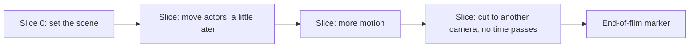

A film is a recorded timeline of where every actor and the camera are, step by step.
It normally comes as two files that travel together: a .FLM holding the timeline, beside a .ALL holding the models, sounds and palettes it uses.
Stunt Reel plays a film by reading both.

## The timeline

A [film](../../GLOSSARY.md#film-playback) does not contain a picture of anything.
It contains instructions about the scene: which actors exist, where each one is, which way it faces, which camera is active, what text to show, which sound to start.
The player turns those instructions into a picture, frame by frame, using the models from the companion file.

The film is cut into [slices](../../GLOSSARY.md#film-playback).
A slice is one recorded moment: a short list of changes to the scene, plus how much time has passed since the previous slice.
Time is counted in [ticks](../../GLOSSARY.md#film-playback), the steps of the original player's fixed playback clock.
A slice's place on the clock is the sum of the durations up to and including its own, which is why the glossary calls a film's slices placed on that clock its [timeline](../../GLOSSARY.md#film-playback).

A slice can have no time at all.
Such slices often bundle several changes that happen at the same instant, such as a title appearing together with a sound.

## What a slice can say

A change to an actor or a camera names it by a numbered slot.
The film notes list the main kinds of change:

- **Create**: bring an actor into the scene and say which model draws it.
  An actor that never moves gets its fixed position here, and one that never turns its fixed direction; otherwise they come from updates.
  A slot whose model is left out is not drawn at all.
  The film notes describe such slots as invisible camera rigs or markers, which is how cameras are placed in the world.
- **Update**: give the new position, direction or animation value for an actor or camera.
  Between two slices the player works out the in-between poses itself, so a film does not need an entry for every tick.
- **Choose the camera**: switch which camera rig the picture is taken from.
  This is a hard cut, so the player jumps to the new view and does not glide towards it.
- **Set a variable**: a small set of numbers the player blends over time.
  Some of them drive the palette, which is how fades and dusk are authored.
- **Credits**: show or clear a two-line text banner.
- **Sound**: start a recorded sound, named by an identifier that points into the companion file.

Notice what is missing.
The game's film editor offered camera behaviours such as following an actor, but the film has no way to say so.
The camera's aim is simply recorded as a direction, like any actor's, and a player can read the aim from there.
The film notes mark this as an inference, not something proven from the original program.

## The companion file

A .ALL is an [archive](../../GLOSSARY.md#assets-and-models).
The original linking tool, MAKEONE.EXE, gathers every asset a film refers to and writes them into one file beside the .FLM.
The archive is a numbered directory followed by the items themselves, so any item can be found directly from its number.

The number also says what kind of item it is.
The format note divides the range of identifiers into regions: models, small colour ramps, full master palettes, a region that community code expects to hold scenery and map data (though no archive in the corpus uses it), and digital sounds.
That is how a film's sound cue finds its sound: the cue carries a number, and the archive holds the sample under that number.

Colour matters here because the original drew with a limited palette, and a film's fades and tints change it.
The [drawing guide](drawing.md) explains how models are shaded from it.

The .ALL is different from the .RES archives, which hold the game's shared libraries of models, sprites, dialogue and scenery in a similar numbered layout.
The .RES note is worth reading to see the same idea applied to the permanent assets.

## Why it is built this way

Because a film is a script and not a video, it can be played at any size and any frame rate, and the same film gives the same motion each time.
That is what lets Stunt Reel replay a film at modern resolutions, and what lets us compare our frames with the original player's frame by frame at matching moments.

The cost is that a film needs an archive to say what its numbers mean, normally its own .ALL.
A film names models and sounds by number, and some models can also be found in the game's .RES libraries.

## Read next

- [The film format](../../research/formats/flm.md) — the timeline stream slice by slice, and each kind of change a slice can make
- [The scene archive format](../../research/formats/all.md) — how the companion file is laid out and which identifiers mean which kind of asset
- [Timeline and ticks](../../research/formats/concepts/timeline-and-ticks.md) — how the playback clock turns slices into smooth motion, and how camera cuts are handled
- [The resource archive format](../../research/formats/res.md) — the permanent libraries of models, sprites and dialogue that sit beside the per-film archives
