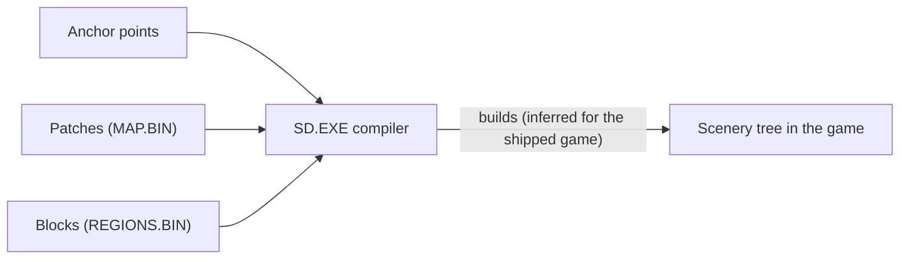

The ground is drawn largely from flat coloured patches over anchor points, compiled into a scenery tree, and distance decides how much detail is drawn. This guide follows the island from the files that describe it to what the original film player does with them each frame.

## Anchor points

The island's ground starts from a table of anchor points, each one a position on the island, with its height stored upside down so that the real height is the stored value negated. The [glossary](../../GLOSSARY.md#assets-and-models) defines an anchor point as a record shared by the terrain patches and by models, and that is how it is used: ground corners and model parts that must meet the terrain both name the same points. The table file is ANCHORPT.DAT, described in the [anchor point note](../../research/formats/auxiliary/anchorpt.md). Some entries are marked as "no point" with a special height, and the note records that the game's own copy of the table holds some of these too.

## Patches

A second file, MAP.BIN, lists the ground itself as patches. A patch is a flat polygon of three to eight corners, each corner an anchor point, with a single palette colour for the whole polygon. There is no texture and no shading: the [world and scene note](../../research/playone-exe/world-scene.md) records that the player draws a ground polygon as one flat palette colour. See [how the game draws a frame](drawing.md) for what a palette index is.

Some patches are coarse and come with a set of finer patches. The files record a distance at which the finer set replaces the coarse patch. Patches without finer versions have no such distance.

## From files to a scenery tree

The game carries compiled copies of the anchor table and most of the ground, but MAP.BIN is not among them. The files were working files of SD.EXE, a scenery compiler that the [map note](../../research/formats/auxiliary/map.md) identifies as the developers' own tool. That the shipped game was built with it is an inference. The compiler also takes a second file, REGIONS.BIN, which divides the island into blocks by a tree of cutting planes. It slots each top-level patch into the block it belongs to and writes out one combined structure, the scenery tree.

The [glossary](../../GLOSSARY.md#assets-and-models) calls the island's static content the world: the ocean, the ground patches, and the props placed by the scenery tree. The [scenery note](../../research/formats/auxiliary/scenery.md) describes the tree as a space-dividing tree. Some of its nodes cut the island in two along a plane, so the player can tell which side of a cut the viewer is on. Some nodes shift the position where their children sit. Some are ground patches and some are leaves that stand a model, a prop, in place.

That note also records that the game does not ship the tree as a file. It sits inside the player program itself, and the file that other tools read is that copy, widened. The map note adds a detail about what survives the journey. The patch file has a few patches that nothing links to, so the compiler never writes them into the tree. The notes find them in no other file the player could draw from, and infer that it never draws them.

## Distance and detail

Level of detail means drawing less when things are far away. The tree carries two kinds of node for it.

- A coarse ground patch records a distance at which its finer patches replace it. The notes give that distance as data in the files, not how the original film player chooses between the two.
- A detail node on the props side holds a simple stand-in model. Beyond a threshold distance the original film player draws the stand-in and stops walking that branch. Closer than the threshold it skips the stand-in and carries on into the detailed subtree.

So the stand-in is drawn instead of the subtree, not on top of it. The [scenery note](../../research/formats/auxiliary/scenery.md) states this, and the [level-of-detail note](../../research/playone-exe/lod.md) traces it in the player's code.

The threshold is not a fixed distance. The level-of-detail note finds that it is scaled by a detail setting that the game reads from a settings file. It infers that the shot's zoom scales it too, so a zoomed shot would keep its fine detail further out than a wide one. The same note records that our reference captures were made without that settings file, so they probably run at full detail. Even then the original film player still switches to coarser nodes as things recede.

## Props sit on the ground by their own height

One surprise from the scenery note is how a prop gets its height. The player does not look the terrain up under a prop. A prop's height is the sum of the height offsets on the path down the tree plus a lift stored in the model's own header. For props placed by the tree, the height is therefore in the data, and the note finds no terrain lookup at draw time.

## What the notes leave open

The glossary says what supplies the rest of the ground, such as the sand flats, is not established. The [world and scene note](../../research/playone-exe/world-scene.md) reports that in its live runs of one film, the airfield's other ground colours came from scenery shapes placed on top.

## Read next

- [The map format](../../research/formats/auxiliary/map.md) — the patch and block files, how their links work, and how SD.EXE compiles them into the tree
- [The anchor point table](../../research/formats/auxiliary/anchorpt.md) — the table of points that patches and models share, and where its copies differ
- [The scenery tree](../../research/formats/auxiliary/scenery.md) — each kind of node in the tree, the detail rule and how props get their height
- [How the ground is drawn](../../research/playone-exe/world-scene.md) — how the player walks the tree and where each ground colour comes from
- [The level-of-detail gate](../../research/playone-exe/lod.md) — the distance test, the detail setting that scales it and what that means for captures
