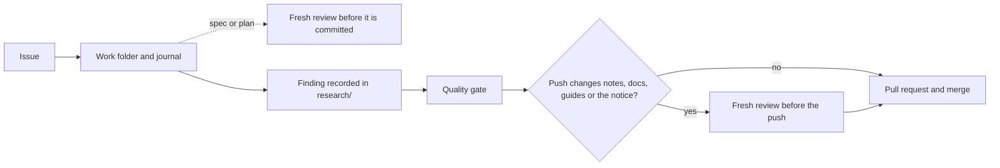

Stunt Reel is partly a testbed for agentic workflows.
The reverse engineering of Stunt Island is real work with real results, and so is the experiment running beside it: how can AI agents do that work reliably?
Some of the rules below came from something going wrong; ADR 0041 below is one.
The [harness page](../../docs/harness.md) records the project's policy for agents and the harnesses it has been worked with.

## One piece of work, issue to merge

1. **Issue.**
   A piece of work is a GitHub issue, and the issue's status is the work's status: open is active, closed as completed is landed.
2. **Work folder and journal.**
   When the work has a spec or plan, or will ship as more than one pull request, it gets a folder under work/ and a journal of dated entries.
   Each entry asks a question, says how it was tried, records the result, gives a verdict and names the note that now holds the fact.
   The [work folders page](../../work/README.md) has the layout.
3. **Finding recorded.**
   A current fact belongs in research/ or docs/ and is rewritten in place, while the dated record stays in the work folder.
   The project's rule is that a finding, including a ruled-out hypothesis, is committed with the code that relies on it.
   The [recording-findings skill](../../.agents/skills/recording-findings/SKILL.md) says how.
4. **Quality gate.**
   The gate is the project's automated set of checks.
   Before work is presented, it must pass for what the branch touches.
5. **Fresh review.**
   Under the project's [rule](../../AGENTS.md#committing), a reviewer with no memory of the work (a subagent, meaning another agent started fresh, or another person) reads the diff and the notes it cites before a change to research notes, the top-level docs pages and how-to guides, the notice file, the reading page or these guides is pushed, and before a work spec or plan is committed.
6. **Pull request.**
   The title is a conventional commit subject (a short type, scope and summary, such as "docs(site): …"), because it is the subject that lands on the main branch.

## The workflows in use

**Skills and the fresh-review rule.**
Skills are short instruction files an agent reads before a kind of work.
The project keeps them in .agents/skills, for example for [changing seam contracts](../../.agents/skills/changing-seam-contracts/SKILL.md), [managing worktrees](../../.agents/skills/managing-worktrees/SKILL.md) and [improving render parity](../../.agents/skills/improving-render-parity/SKILL.md).
The fresh-review rule is in the [contributor rules](../../AGENTS.md#committing).
Commits that change a work spec or plan, including a second spec or plan named for its topic, carry a Fresh-review trailer that the commit hook checks; [the development guide](../../docs/development.md#commit-messages) notes it.

**Work folders and journals.**
The project's rule is that a current fact is rewritten in place, and a dated record is frozen once its work lands.
[ADR 0041](../../docs/adr/0041-dated-records-live-in-work-folders.md), an ADR being a short decision record, records the decision and why: investigations had been appending dated rounds to the notes for their subject, and nothing made a writer replace what a round superseded.

**The quality gate.**
One command runs the checks, and since [ADR 0038](../../docs/adr/0038-the-local-gate-runs-what-a-change-touches.md) the local run covers what a change touches, with a full option and continuous integration (the automated checks on GitHub) running everything, except that a pull request whose changed files the gate's own classifier counts as documentation runs the documentation checks ([ADR 0047](../../docs/adr/0047-ci-scopes-a-docs-only-pull-request.md)); pushes to the main branch and manual runs stay full.
[The quality gate page](../../docs/quality-gate.md) lists the steps.

**Unattended queue runs.**
An agent can work through the open pull requests and the issues marked ready for an agent without a person present.
The [running-unattended skill](../../.agents/skills/running-unattended/SKILL.md) describes the loop: an item that needs a human decision is handed off, and the run moves on.

**Orchestrated workers in separate worktrees.**
A worktree is a separate working copy of the repository.
The project's rule is one writer per checkout, with a branch per worktree ([worktrees](../../AGENTS.md#worktrees)).
The harness page describes a worktree per writer as an opt-in mode, and the policy for unattended runs is about two implementers at once, each in its own worktree and each opening its own pull request.
Worktree handling is in the [managing-worktrees skill](../../.agents/skills/managing-worktrees/SKILL.md).

**Cloud sessions.**
An agent can also work in a cloud session, which starts without the game archives and fetches pinned copies as it begins.
[The cloud sessions page](../../docs/cloud-sessions.md) explains the setup.

## Read next

- [Development guide](../../docs/development.md) — setup, tasks and commit conventions
- [Agents and harnesses](../../docs/harness.md) — the policy for agents and the notes on each harness
- [System specification](../../docs/SPEC.md) — the goals and invariants the work is checked against
- [ADR 0041: dated records live in work folders](../../docs/adr/0041-dated-records-live-in-work-folders.md) — why dated records are kept apart from current facts
