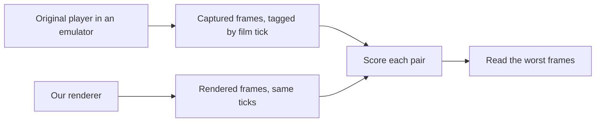

We play the same film in the original player and in ours, then score the frames. This guide explains how the scoring works, where the remaining differences are, and what a score cannot tell you. It quotes no scores itself. Each figure lives in the note that measured it, with the date and the code it was measured on.

## The same film, twice

The check is called [parity](../../GLOSSARY.md#evidence): how closely our picture matches the original's for the same film. The loop in the [method note](../../research/parity/method.md) has more steps than we show here; in outline:

1. **Capture.** The original film player runs inside an emulator, and we save frames from it. Each captured frame is tagged with the film clock, the tick of the film it shows, because capture order alone does not say which tick a frame is. The notes infer this from the way the player grabs distinct rendered pages.
2. **Render.** Our renderer draws every tick that was captured.
3. **Score.** Each pair of frames is compared (see below).
4. **Look at the worst frames.** An average can hide a regression or an improvement, so a change is judged by its biggest movers as well as its mean.

Two measures do the scoring. SSIM compares small windows of the two pictures, after turning both to brightness, so it rewards matching edges and texture. IoU asks a simpler question: does our picture cover the same area as the original's, with the sky left out? It judges framing and ignores shading. Neither is a judgement of how the picture looks to a person.

Some pixels are left out on purpose: the on-screen controls, and frames fading to near black, where two dark pictures agree whatever they show. The fade is part of the film, so our renderer applies it too.

## Where the differences are

The [attribution note](../../research/parity/attribution.md) splits each frame's loss by what our render drew there: ocean, terrain, props (scenery such as trees and buildings), actors, sky. It is a bounded observation, from one capture set for each of two films, and it says where the loss is, not what is wrong.

- **Ground.** Much of the early loss came from the ground. Flat ground tiles that the original paints over its terrain were hidden by our depth test. Drawing them as decals on the terrain cut the terrain loss sharply, and the notes record the before and after.
- **Props.** After that change props are the largest class on both films. Part of that is bookkeeping: tiles that were hidden are now drawn, and their remaining error is credited to props. On the paths the notes walked, the facing check inside shapes was ruled out as the cause, and the notes infer the shading light is not it either. Other causes stay open.
- **The aircraft.** In graded sheets of the aircraft frames, the graders often noted missing parts and a broken shape, and in the second film a misplaced aircraft. The notes warn that small changes in those counts are within grader noise.

## What the scores cannot show

The [evidence limits note](../../research/parity/evidence-limits.md) is a list of what is not yet proved.

- **Which films.** The reference scores come from a small set of films and do not speak for other films.
- **Repeat captures.** In early captures of one film on one machine, repeats at the same tick disagreed with each other, for a cause the notes have not identified, so a near-perfect score could not be told from that noise. Later references replayed page for page.
- **Sparse samples.** Captures are many ticks apart, so motion between them goes unobserved.
- **Metric blind spots.** The notes infer that SSIM punishes a slightly misplaced thin object and cares about flat brightness, and that IoU ignores everything inside the outline. When they disagree, look at the pictures.
- **Machines differ.** On one machine, the same code scored differently on a software graphics driver and on a graphics card, until a fix reduced the gap. Until a graphics-card run confirms the fix, a decision to adopt a change needs one.
- **Odd frames.** One captured palette blanks part of itself. Whether the original does that or the capture caught it half-updated is unknown, so the frame stays in and the anomaly is recorded.

## Beyond the reference films

The [batch note](../../research/parity/batch.md) describes a survey that ran the whole pipeline on films from the wider corpus of community and demo films: archive, capture, render, score. It was stopped on purpose after a fraction of the films, once the failure modes were clear. Among the films it scored, a bounded observation, the ones we never tuned for land in roughly the same band as the two we did, and none came near the project's sign-off score. Most of those scores were never checked against the survey's later validity rule, and some early ones were not evidence at all: a few came from captures whose film clock never moved.

## Read next

- [Parity method](../../research/parity/method.md) — the scoring loop and its dead ends
- [Parity attribution](../../research/parity/attribution.md) — where the loss sits
- [What is not yet evidence](../../research/parity/evidence-limits.md) — the limits on reading a score
- [Batch parity survey](../../research/parity/batch.md) — the survey of corpus films
