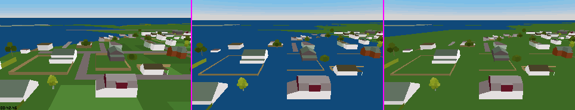

# Journal: LOCATION's ground under the houses

## 2026-11-12: Which prop paints the ocean under LOCATION's houses

- **Question**: At `LOCATION.FLM` tick 2124 the capture shows green ground under the foreground houses and ours shows ocean blue. Is a `MAP.BIN` patch missing, did the scenery walk stop early, or does something draw over the ground?
- **Method**: `mise run frame -- --film location --ticks 2124` at `main` `59d62f12`; `render.json` gave the eye at `(-6892, 10.9, 5582)`. Index and layer planes of the render store counted per pixel (`RenderStore`). Temporary `eprintln!` probes in `build_world_ir`, `push_prop_mesh` and `ground_decal_vertices`, and `stuntreel sod-trace` on the shapes found; a temporary `DBG_HIDE_OCEAN` switch (not committed). Static preorder walk of the image's scene tree (`build/re/playone.img`) with `python/stunt_reel/scene_tree.py`'s node decoding. `mise run sweep -- --var DBG_HIDE_OCEAN=0,1`, then `mise run parity -- --films location` once per value and `stuntreel parity --compare`.
- **Result**:
  - **Not a missing patch or a stopped walk.** `MAP.BIN` records 17, 18 and 22 (colour 195, flat at height 0, 2 to 5 km across) cover the eye's position and are built as base terrain; the walk reports no stop. Removing the ocean-coloured props (a temporary `DBG_NO208`) turns the foreground 195 over the whole bottom of the frame. The 195 terrain was there and was painted over.
  - **The painter is a prop.** In ours, 32,241 of the frame's 185 x 320 pixels are index 208 on the prop layer (layer 3) and 2,258 on the ocean layer (1); the capture has 9,407 of 208 and 17,177 of 195, against 1,870 of 195 in ours. The props are the `LOCATION.ALL` tile shapes `0x03E4` to `0x03E9` (160 m and 320 m squares, `OP_IPG` type 2 corners), placed under two `SP_1NODE` gates at raw `(7168, 0, 4096)` and `(7024, 0, 5696)` with splitdist 400. Each opens `COLOR 0x00D0` (208) with one polygon over the whole square, then `COLOR 0x00C3` (195) with smaller polygons (in `0x03E4` thin strips along the square's edges), all behind one `IFVIS`. `0x03E4`, `0x03E5` and `0x03E6` are the near variants at the eye (distance 175 m, under 400), `0x03E9` is the far stand-in.
  - **Why our depth test lets them win.** `ground_decal_vertices` finds the tiles flat (extent 0.001 m) and over terrain, snaps them to height 0, and `build_world_ir` puts every mesh in the decal batch, which wins a tie against the terrain. So the 208 polygon, snapped onto the 195 plane, lies over it (ADR 0035).
  - **Candidate.** Dropping, from a ground-snapped prop, every triangle whose three vertices are palette 208 and lie over terrain draws the capture's dark green there; tick 2124 then has green ground under the houses (picture below). The grey road (index 14) and the lighter lawn (about 197) of the capture are still absent in ours.
  - **Scores**, `main` then candidate, `mean_ssim_scored`: `CTRY` 0.9048 / 0.9048, `INTRO` 0.8468 / 0.8468, `LAND` 0.8666 / 0.8666, `BALLOON` 0.8137 / 0.8137, `TRAINTNL` 0.8573 / 0.8573, `BOMB` 0.8202 / 0.8216, `LOCATION` 0.8144 / 0.8151 (RTX 4070 Laptop). Only `BOMB` and `LOCATION` change. On `LOCATION` 33 of 745 frames change, 27 closer and 6 further (worst -0.004, tick 2190); 20 improve by more than 0.005, best +0.054 (tick 2047), and none falls by more than 0.005.
  - **The tree's order does not explain it.** In a preorder of the image's tree, the colour-195 leaves of records 18, 17, 22, 10, 25 and 7 come first (events 0 to 8 of 164) and the tile placements `0x03E9`, `0x03E7`, `0x03E5`, `0x03E4`, `0x03E6` last (events 158 to 162), under the `SP_2NODE` at `0xDF2A`. Read as `#431`'s painter order, the tiles are painted after the ground, which would leave the blue showing. The order of an `SP_2NODE` may depend on the eye's side, which this walk does not model, so this neither shows nor excludes a runtime order that paints the ground last.
- **Verdict**: Rejected under the adoption rule, change reverted. No film falls by 0.002, but no `LOCATION` or `BOMB` gain reaches 0.004 and the others gain nothing, so the heuristic track fails; the evidence-backed track has no `PLAYONE` rule to cite (the static order points the other way). The cause is recorded and the candidate is a few lines: this is the first thing to retry once a rule is read.
- **Lives in**: [`world-scene.md`](../../../research/playone-exe/world-scene.md) section 6.6.

Panels, left to right: the capture; ours at `main` `59d62f12`; ours with the candidate (`DBG_HIDE_OCEAN=1`, not committed).
