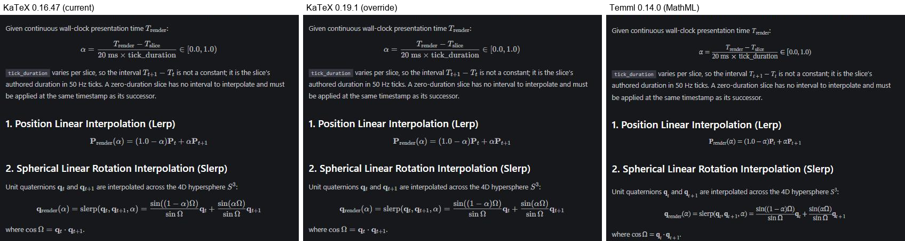

# Spike: the research site's math renderer

Issue [#576](https://github.com/neilsh/stunt-reel/issues/576). Should `site/` keep `remark-math` + `rehype-katex`, and if not, what should replace it? Checked 2026-11-15 against `6f3f4ecf` (PR [#578](https://github.com/neilsh/stunt-reel/pull/578)'s branch).

## Recommendation

**Keep `rehype-katex` 7.0.1 and `remark-math` 6.0.0. Force a single KaTeX 0.18.11 through a Bun override.**

```diff
   "dependencies": {
-    "katex": "0.16.47",
+    "katex": "0.18.11",
     ...
-  }
+  },
+  "overrides": { "katex": "0.18.11" }
```

In `.github/renovate.jsonc`, the `katex` rule changes from `allowedVersions: "<0.17.0"` to `"<0.19.0"`, and its comment changes with it. The override and the stylesheet pin then move together. PR #578 applied all of this as `ff59c406`.

Why this version:

- **0.18.11 clears the advisory.** It is past [GHSA-238p-pmpm-9mq7](https://github.com/advisories/GHSA-238p-pmpm-9mq7), which affects KaTeX below 0.18.2 (low severity, published 2026-10-05).
- **It is the one version every consumer accepts.** It falls inside the `katex: ^0.18.0` range of `mermaid` 12.3.0. 0.19.1 renders our pages identically, but it would put mermaid outside its declared range.
- **The tree drops from two KaTeX copies to one.** Today it holds 0.16.47 (`rehype-katex`, `micromark-extension-math`, our stylesheet pin) and 0.18.10 (`mermaid/katex`). Both are below 0.18.2.

Remove the override once [remarkjs/remark-math#122](https://github.com/remarkjs/remark-math/pull/122) ships. That PR widens `rehype-katex` to `katex ^0.19.0`. When it does, move to 0.19.x if mermaid has followed by then.

If a future KaTeX ever breaks `rehype-katex` and nobody releases a fix, fall back to MathJax 4 through a local plugin, in CHTML output. A follow-up spike, recorded in closed PR [#580](https://github.com/neilsh/stunt-reel/pull/580), found that it draws these notes about as well as KaTeX does, bold subscripts included. Temml ([Prototype B](#prototype-b-temml-through-a-local-plugin)) sets those subscripts low. MathJax 4 is not the choice today: it adds 17 packages and 98 MB of install, and makes pages 1.2–1.3× larger.

## What "unmaintained" means here

Primary sources: the npm registry, [remarkjs/remark-math](https://github.com/remarkjs/remark-math) and the [KaTeX releases](https://github.com/KaTeX/KaTeX/releases).

- **Dormant, not abandoned.** The repository is not archived. Its last push was 2025-02-20 (`rehype-mathjax` 7.1.0). `rehype-katex` 7.0.1 dates from 2024-08-19, and `remark-math` 6.0.0 from 2023-09-19. Nine issues are open. Three PRs from 2026 (#117–#119) wait to move `rehype-mathjax` to MathJax 4. #122, the KaTeX bump, has had no maintainer response since 2026-10-14.
- **The KaTeX range is what lags.** `rehype-katex` and `micromark-extension-math` 3.1.0 both declare `katex: ^0.16.0`. KaTeX itself is active: 0.17.0 on 2026-05-22, 0.18.0 on 2026-07-17, 0.19.1 on 2026-10-23. A consumer gets the advisory fix only through an override. Issue #121 says so, and commenters on #122 report the npm and pnpm overrides working.
- **The lag is what caused CodeRabbit's skew.** `mermaid` pulls a newer KaTeX, so two copies coexisted, and `rehype-katex` rendered with the older one. KaTeX 0.18 then prefixed its internal classes ([#4229](https://github.com/KaTeX/KaTeX/issues/4229): `base` became `katex-base`, and so on), so the markup and stylesheet versions must match.
- **No API breaks for us between 0.16 and 0.19.** 0.17 changed only the internal `__defineFunction`. 0.18 prefixed the classes. 0.19 routes missing-glyph warnings through `strict`. `rehype-katex` calls only `renderToString`, and our build logs no KaTeX warning under any of the three versions.

## Options compared

| Option | Maintenance | Output and quality | CSS and fonts | Bad formula fails build? | New packages |
|---|---|---|---|---|---|
| **`rehype-katex` + KaTeX override** (recommended) | KaTeX active. Plugin dormant, but small (143 lines) and stable | Identical to today: build-time HTML plus hidden MathML | KaTeX CSS (25 KB) + KaTeX fonts, fetched per glyph set used | Yes, with the existing `failOnKatexError` | 0 |
| Temml through a local plugin (prototyped) | `temml` 0.14.0, 2026-10-08, zero dependencies, 360★ | Build-time MathML Core. Our HTML is ~half the size. Rendering is visibly weaker in Chromium (below) | `Temml-Local.css` 9 KB + a math font (STIX Two Math, 403 KB woff2) + a Starlight margin fix | Yes, with `throwOnError` in our plugin | 2 (`temml`, `@fontsource/stix-two-math`) |
| `@daiji256/rehype-mathml` 1.3.0 (Temml) | One maintainer, 10★, updated 2026-10 | As Temml | As Temml | **No.** It catches every Temml error and emits a red span with no vfile message, so we would need our own check | 2+ |
| `rehype-mathjax` 7.1.0 | Same dormant repo. Depends on `mathjax-full` 3.2.2, which npm marks deprecated in favour of `@mathjax/src` 4; the v4 PRs are unmerged | SVG or CHTML; heavier pages | MathJax CHTML fonts or inline SVG paths | With a check like ours: since 7.1.0 it records MathJax exceptions as vfile messages | 1 + `mathjax-full` tree |
| KaTeX from our own rehype plugin | KaTeX only | Same as `rehype-katex` | Same | Yes | 0, but we maintain ~30 lines that duplicate `rehype-katex` |
| `starlight-katex` 0.0.4 | Last release 2024-10-25 | Wraps `rehype-katex` with `katex ^0.16.11`, so it has the same lag | Same | With our check | 1 + its dependencies |

No Astro- or Starlight-maintained math integration turned up. `starlight-katex` is a third-party wrapper.

## Prototypes

Each variant was built with `mise run site` (`bun run build` for the variants) and served locally. The comparison covered three pages in the browser pane, in its dark theme at 1024 px.

### Prototype A: KaTeX override

Both 0.19.1 and 0.18.11 were built with the override above.

- **Markup is unchanged.** On all 21 pages that contain math, the HTML is byte-identical to today's, apart from the `katex-` class prefix and asset hashes. The check script normalises both and compares whole files.
- **Screenshots show no visible difference.**
- **A bad formula still fails the build.** Both `$\frac{1}{$` and an unknown `$\foo{1}$` exit with code 1.
- **`bun.lock` holds one `katex`.**
- **`micromark-extension-math` is not affected.** Its KaTeX import is only in `lib/html.js`, its micromark HTML extension, which `remark-math` never imports. `remark-math` uses only the `math` syntax extension.
- **Mermaid's client bundle** loads KaTeX only for `$$` inside diagram labels, which no mermaid block under `research/` contains.

### Prototype B: Temml through a local plugin

A ~25-line rehype plugin replaced `rehypeKatex` and `failOnKatexError`. It finds `remark-math`'s `math-inline` and `math-display` code nodes and calls `temml.renderToString(tex, {displayMode, throwOnError: true})`. It emits the result as a raw node and rethrows with the file path. `customCss` became `temml/dist/Temml-Local.css` plus a small `math.css`.

What it took to look right:

- **A math font, declared by hand.** `@fontsource/stix-two-math`'s own CSS gives the font a Latin-only `unicode-range`. Operators such as ∑, ≤ and ≈ would then fall back to another font. The woff2 file holds the full font (4605 code points and a `MATH` table), so `math.css` declares its own `@font-face` with no range.
- **A margin reset.** Starlight's `.sl-markdown-content :not(…) + :not(…) { margin-top: 1rem }` lands on MathML sibling elements (`<mo>` measured 16 px). Without a reset, every sub- and superscript separates from its base. The prototype's `.sl-markdown-content.sl-markdown-content math * { margin-top: 0 }` fixes it.

What remained after that:

- **Formulas render smaller than KaTeX's**, which sets `.katex` at 1.21 em.
- **Subscripts on bold letters sit low** ($\mathbf{q}_t$, $\mathbf{v}_\text{raw}$). The likely cause is Chromium's MathML layout dropping a subscript below the descender of its base glyph, where TeX would not.

It does pass the build-failure check, and `coordinates-and-units` shrinks from 307 KB to 146 KB of HTML.

<details><summary>The prototype plugin (in <code>site/astro.config.mjs</code>, used as <code>rehypePlugins: [rehypeTemml]</code>)</summary>

```js
import temml from "temml";

// remark-math leaves math as <code class="math-inline"> and <pre><code class="math-display">;
// render each to MathML with Temml at build time, throwing on a bad formula so the build fails.
function text(node) {
  return node.type === "text" ? node.value : (node.children ?? []).map(text).join("");
}
function rehypeTemml() {
  return (tree, file) => {
    const walk = (parent) => {
      parent.children?.forEach((node, i) => {
        if (node.type !== "element") return;
        const code = node.tagName === "pre" ? node.children.find((c) => c.tagName === "code") : node;
        const cls = code?.properties?.className ?? [];
        const display = cls.includes("math-display");
        if (!display && !cls.includes("math-inline")) return walk(node);
        const tex = text(code);
        try {
          const value = temml.renderToString(tex, { displayMode: display, throwOnError: true });
          parent.children[i] = { type: "raw", value };
        } catch (err) {
          throw new Error(`${file.path}: ${err.message}`);
        }
      });
    };
    walk(tree);
  };
}
```

</details>

### Screenshots

Each image shows, left to right, KaTeX 0.16.47 (today), KaTeX 0.19.1 (override) and Temml 0.14.0.

`research/formats/concepts/coordinates-and-units/`:


`research/formats/all/`:


`research/formats/concepts/timeline-and-ticks/` (note the low subscripts on bold **q** under Temml):



## Not checked

- Firefox and Safari. Temml's look depends on each engine's MathML layout. Only Chromium (the browser pane) was viewed.
- Light theme and phone width.
- Whether Renovate opens one PR or two for a package named in both `dependencies` and `overrides`. The "research site" group should put them in the same PR.
